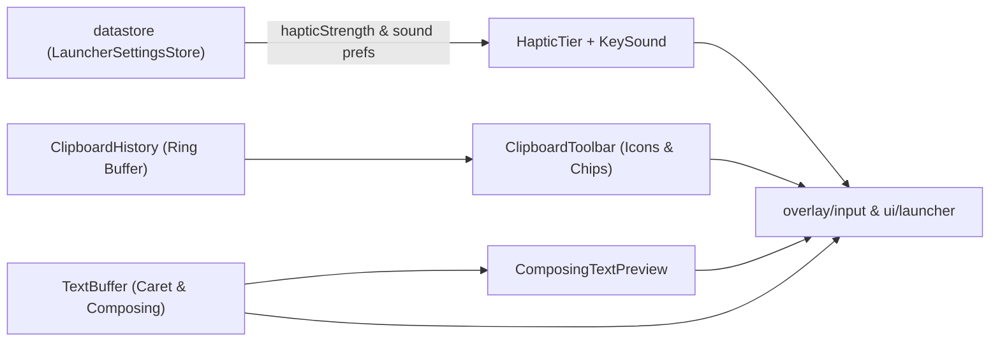

# `ui.keyboard.primitives` Package

## What This Folder Does

`ui/keyboard/primitives/` provides the reusable **non-Floris state, feedback, clipboard, and buffer helpers** shared across Cover-Screen-OS's keyboard overlays and search bars (while key buttons, popup previews, smartbars, and drag-to-resize controls live inside `:keyboard-floris`):

1. **Vibration & key-click audio** (`HapticTier.kt`, `KeySound.kt`) that honor both the user's Cover-Screen-OS preferences and Android's system sound/touch-vibration toggles.
2. **Live composing text preview** (`ComposingTextPreview.kt`) with collapsible lines and auto-scrolling to keep the active cursor tail in view.
3. **Clipboard ring buffer & toolbar** (`ClipboardHistory.kt`, `ClipboardToolbar.kt`) for Copy, Cut, Paste, and quick snippet chips.
4. **Pure text-buffer math** (`TextBuffer.kt`) tracking text, cursor selection, and active composing spans safely in memory.

---

## File-by-File Guide

### `HapticTier.kt`
- **In plain terms**: Translates keyboard vibration strengths (`None`, `Light`, `Standard`, `Strong`) into real hardware clicks while respecting both in-app preferences and Android's system touch-vibration toggle.
- **Key variables & state**:
  - `HapticTier`: Maps to both `HapticFeedbackConstants` and `VibrationEffect` predefined IDs (`EFFECT_TICK`, `EFFECT_CLICK`, `EFFECT_HEAVY_CLICK`).
  - `hapticStrength`: Collected from `LauncherSettingsStore` (`Off`, `Light`, `Standard`, `Strong`) to scale the requested tier into `effectiveTier`.
- **How it connects**: Used by `CoverKeyboardOverlayRoot`, `ClipboardToolbar`, and configured in `ui/customize/input`.

### `KeySound.kt`
- **In plain terms**: Plays Android's crisp system key-click sound (`AudioManager.FX_KEYPRESS_STANDARD`) only when the user's "Key-press sound" preference is switched on.
- **Key variables & state**:
  - `soundEnabled`: Reactive boolean observed from `LauncherSettingsStore`.
  - `audioManager`: Cached from `context.applicationContext`.
- **How it connects**: Provides system sound effects alongside haptic feedback.

### `ComposingTextPreview.kt`
- **In plain terms**: A collapsible text read-out banner that stays auto-scrolled to the *end* (where you're actively typing) instead of chopping off the newest characters.
- **Key variables & state**:
  - `expanded`: Toggles between `maxCollapsedLines` and `expandedMaxLines` when text overflows.
  - `totalLineCount`, `lineHeightPx`, `scrollState`: Keeps the latest typed characters visible.
- **How it connects**: Displays live typed buffers inside `CoverLiveBufferDisplay` (`overlay/input`) and cover search.

### `ClipboardHistory.kt`
- **In plain terms**: A pure-Kotlin "last 5 clips" memory ring buffer that automatically moves repeated clips back to the front and ignores blank text.
- **Key variables & state**:
  - `entries` (`DEFAULT_MAX_SIZE = 5`), `snippets`: Newest-first clip storage and read-only snapshot.
- **How it connects**: Fed by `CoverInputSessionManager` copy/cut actions and rendered by `ClipboardHistoryRow`.

### `ClipboardToolbar.kt`
- **In plain terms**: Clean borderless Copy, Cut, and Paste icon buttons (`ClipboardActionIcons`) plus the scrollable recent-clips chip strip (`ClipboardHistoryRow`).
- **Key variables & state**:
  - `HISTORY_CHIP_MAX_CHARS` (`18`), `performHaptic`, test tags `"clipboard_copy"`, `"clipboard_cut"`, `"clipboard_paste"`, `"clipboard_history_row"`.
- **How it connects**: Wired into QWERTY `headerExtraContent` and `clipboardHistoryContent` in `CoverKeyboardOverlayUI.kt`.

### `TextBuffer.kt`
- **In plain terms**: An immutable "virtual notepad" mirroring Android `InputConnection` editing rules—storing text, selection/caret bounds, and an active composing word region as safe Compose state.
- **Key variables & state**:
  - `text`, `selection`, `composing`, `Empty`.
- **How it connects**: Drives local overlay/search text state in `CoverInputSessionManager`.

---

## Quick-Reference Summary Table

| File | Role | Key Types / Entry Points |
| --- | --- | --- |
| `HapticTier.kt` | Scaled `Vibrator` (`VibrationEffect`) & `View` haptic performer | `HapticTier`, `scaledBy`, `rememberHapticPerformer` |
| `KeySound.kt` | Preference-gated `AudioManager.playSoundEffect` performer | `rememberKeySoundPerformer` |
| `ComposingTextPreview.kt` | Collapsible tail-scrolled composing buffer viewer | `ComposingTextPreview` |
| `ClipboardHistory.kt` | Deduplicated 5-item recent-clip ring buffer | `ClipboardHistory` |
| `ClipboardToolbar.kt` | Copy/Cut/Paste buttons and scrollable clipboard chip bar | `ClipboardActionIcons`, `ClipboardHistoryRow` |
| `TextBuffer.kt` | Immutable text, selection, and composing-region state model | `TextBuffer` |

---

## Architecture Flow

---

## Works Hand-in-Hand With

| Module | Relationship | Link |
| --- | --- | --- |
| `overlay/input` | Consumes `TextBuffer`, `ClipboardHistory`, `ClipboardToolbar`, `ComposingTextPreview`, and `HapticTier` | [overlay/input](../../../overlay/input/README.md) |
| `ui/keyboard` | Coordinates contacts revision alongside these primitives | [ui/keyboard](../README.md) |
| `ui/launcher` | Uses `ComposingTextPreview` in cover search | [ui/launcher](../../launcher/README.md) |
| `:keyboard-floris` | Provides key caps, popup bubbles, smartbar, and vertical drag resize | [floris](../../../../../../../../../../keyboard-floris/src/main/java/com/tyejaedon/coverscreenos/keyboard/floris/README.md) |
