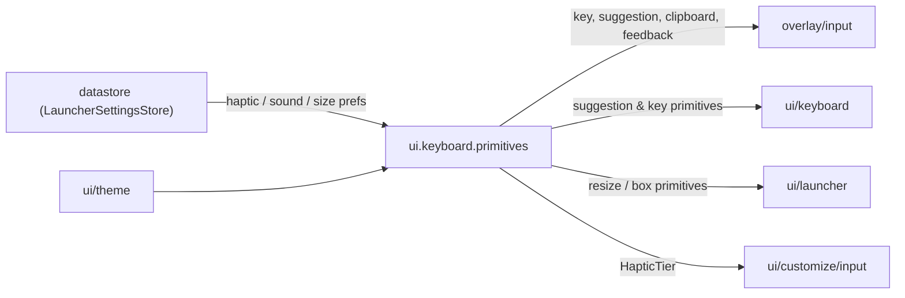

# `ui.keyboard.primitives` Package

Low-level Jetpack Compose keyboard primitives, clipboard history/toolbar, haptic/sound feedback performers, and text buffer utilities.

## What This Module Holds

| File | Key Types | Responsibility |
| --- | --- | --- |
| `KeyboardKey.kt` | `KeyboardKeyColors`, `KeyboardKey` | Styled key cap composable with press states and accents |
| `KeyPreview.kt` | `KeyPreview`, `KeyPreviewController`, `rememberKeyPreviewController` | Floating key-press preview popup |
| `SuggestionStrip.kt` | `SuggestionStrip`, `SuggestionChip` | Horizontal candidate suggestion chip bar |
| `ComposingTextPreview.kt` | `ComposingTextPreview` | Inline composing-text preview banner |
| `ClipboardHistory.kt` & `ClipboardToolbar.kt` | `ClipboardHistory`, `ClipboardHistoryRow`, `ClipboardHistoryChip`, `ClipboardIconButton` | Clipboard history store and toolbar UI |
| `ResizableKeyboardSurface.kt` | `ResizableKeyboardSurfaceControls`, `OneHandedKeyboardBox`, `roundToNearestPreset` | Keyboard height resizing and one-handed alignment container |
| `HapticTier.kt` & `KeySound.kt` | `HapticTier`, `rememberHapticPerformer`, `rememberKeySoundPerformer` | Keypress haptic feedback tiers and audio feedback |
| `TextBuffer.kt` | `TextBuffer` | Local editable text buffer for overlay input |

## Data Flow Diagram

## Works Hand-in-Hand With

| Module | Relationship | Link |
| --- | --- | --- |
| `overlay/input` | Consumes `TextBuffer`, `ClipboardHistory`, `HapticTier`, `KeySound`, and `ResizableKeyboardSurfaceControls` | [overlay/input](../../../overlay/input/README.md) |
| `ui/keyboard` | Composes `SuggestionStrip` and key primitives | [ui/keyboard](../README.md) |
| `ui/launcher` | Uses resizable/keyboard primitives in cover search | [ui/launcher](../../launcher/README.md) |
| `ui/customize/input` | Configures `HapticTier` and sizing presets | [ui/customize/input](../../customize/input/README.md) |
| `datastore` & `ui/theme` | Supplies preferences and theme tokens | [datastore](../../../datastore/README.md) |
