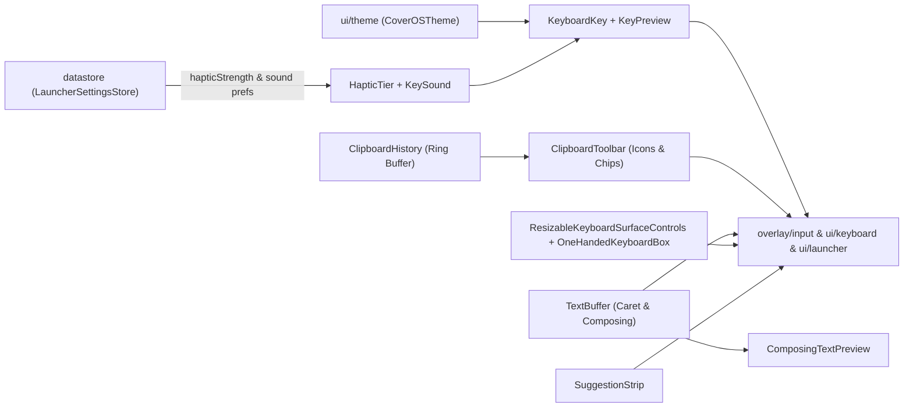

# `ui.keyboard.primitives` Package

## What This Folder Does

Think of `ui/keyboard/primitives/` as a **"box of Lego bricks"** for building any keyboard or keypad on Cover-Screen-OS (QWERTY, T9, numeric PIN, or cover search). Instead of rewriting key animations, vibration levels, sound clicks, pop-up letter bubbles, clipboard history, or text cursor math over and over, every keypad shares these small, thoroughly tested pieces.

Together, the files in this package handle five everyday keyboard jobs:
1. **Tactile keys & pop-up previews** (`KeyboardKey.kt`, `KeyPreview.kt`) so keys shrink subtly when touched, repeat when held (like Backspace), support spacebar sliding, and pop a zoomed letter above your fingertip.
2. **Vibration & key-click audio** (`HapticTier.kt`, `KeySound.kt`) that honor both the user's Cover-Screen-OS preferences and Android's system sound/touch-vibration toggles.
3. **Word suggestions & live text preview** (`SuggestionStrip.kt`, `ComposingTextPreview.kt`) with learn/suppress menus and an auto-scrolling composing box that keeps the latest characters in view.
4. **Clipboard tools & quick resize / one-handed controls** (`ClipboardHistory.kt`, `ClipboardToolbar.kt`, `ResizableKeyboardSurface.kt`).
5. **Pure text-buffer math** (`TextBuffer.kt`) tracking text, cursor selection, and active composing spans safely in memory.

---

## How It Works Step-by-Step

1. **You touch a `KeyboardKey`**: Immediately on finger-down (`awaitFirstDown`), `isPressed` becomes `true`, shrinking the key (`0.92f`), changing its color, popping a `KeyPreview` above your thumb, and firing `performHaptic()` + `playKeySound()`.
2. **You hold or drag the key**:
   - Holding Backspace (`repeatOnHold = true`) waits `450ms` (`repeatInitialDelayMillis`), then fires `onClick` every `55ms` (`repeatIntervalMillis`) with crisp haptic ticks until you lift your finger.
   - Holding a letter key with `onLongPress` waits `400ms` (`longPressThresholdMillis`) and triggers its secondary action, canceling the normal tap.
   - Sliding horizontally more than `24px` switches into drag mode (`onHorizontalDrag`), canceling hold timers so you can scrub the cursor smoothly.
3. **Feedback checks your settings**: `rememberHapticPerformer` scales the requested `HapticTier` by your saved `HapticStrength`, checks `Settings.System.HAPTIC_FEEDBACK_ENABLED`, and plays a predefined `VibrationEffect` on `Vibrator` (or falls back to `View.performHapticFeedback`). `rememberKeySoundPerformer` checks `keyPressSoundEnabled` and calls Android's `AudioManager.playSoundEffect(FX_KEYPRESS_STANDARD)`.
4. **Text & clipboard update**: Edits can flow through `TextBuffer` (keeping `text`, `selection`, and `composing` in sync just like Android's `InputConnection`), display at the tail inside `ComposingTextPreview`, or record copied clips into `ClipboardHistory` for `ClipboardHistoryRow`.
5. **Resizing & one-handed mode**: Dragging the `"keyboard_resize_grip"` bar up or down calls `detectVerticalDragGestures`, updates `extraHeightDp`, and snaps haptic detents whenever you cross a height preset.

---

## File-by-File Guide

### `KeyboardKey.kt`
- **In plain terms**: The universal keyboard button used across cover keypads—supports text or icons, press shrink animations, repeat-on-hold (Backspace), long-press, horizontal drag, accessibility `Role.Button` semantics, and optional pop-up letter previews.
- **Key variables & state**:
  - `isPressed`: Tracks live touch inside the key; drives `scale` (`0.92f`), background color animation (`bg`), and `KeyPreview` visibility.
  - `holdJob`: Coroutine started on finger-down to power either hold-to-repeat (`450ms` -> `55ms`) or `onLongPress` (`400ms`).
  - `held`, `dragged`, `emitted`, `wasTap`: Guard flags ensuring a long-press, horizontal drag, or out-of-bounds slide never double-fires a tap on release.
  - `onClickState` / `onLongPressState` / `onDragState`: `rememberUpdatedState` wrappers so changing lambdas never cancel an active `pointerInput` gesture.
- **How it connects**: Consumes `HapticTier`, `KeySound`, and `KeyPreview`; used by `CoverT9PredictionToggle` and keypads across `:app`.

### `KeyPreview.kt`
- **In plain terms**: The floating enlarged letter bubble (`~24sp`) hovering `40dp` above a pressed key so your fingertip never hides what you tapped.
- **Key variables & state**:
  - `verticalOffsetPx` & `positionProvider`: Custom `PopupPositionProvider` centering the bubble horizontally over the key and pushing it upward by `verticalOffsetDp`.
  - `PopupProperties`: Sets `focusable = false` (so it never steals editor focus or breaks touch tracking) and `clippingEnabled = false` (so it can rise above the keyboard top edge).
  - `KeyPreviewController.label`: Optional shared state holder (`rememberKeyPreviewController`) when one `KeyPreview` serves multiple keys.
- **How it connects**: Anchored inside `KeyboardKey` while pressed.

### `HapticTier.kt`
- **In plain terms**: Translates keyboard vibration strengths (`None`, `Light`, `Standard`, `Strong`) into real hardware clicks while respecting both in-app preferences and Android's system touch-vibration toggle.
- **Key variables & state**:
  - `HapticTier`: Maps to both `HapticFeedbackConstants` (`CLOCK_TICK`, `KEYBOARD_TAP`, `LONG_PRESS`) and `VibrationEffect` predefined IDs (`EFFECT_TICK`, `EFFECT_CLICK`, `EFFECT_HEAVY_CLICK`).
  - `hapticStrength`: Collected from `LauncherSettingsStore` (`Off`, `Light`, `Standard`, `Strong`) to scale the requested tier into `effectiveTier`.
  - `vibrator`: System `Vibrator` service (queried via `Vibrator::class.java` for minSdk 28 compatibility without API 31's `VibratorManager`), falling back to `View.performHapticFeedback`.
- **How it connects**: Used by `KeyboardKey`, `SuggestionStrip`, `ClipboardToolbar`, `CoverT9SuggestionStrip`, and configured in `ui/customize/input`.

### `KeySound.kt`
- **In plain terms**: Plays Android's crisp system key-click sound (`AudioManager.FX_KEYPRESS_STANDARD`) only when the user's "Key-press sound" preference is switched on.
- **Key variables & state**:
  - `soundEnabled`: Reactive boolean observed from `LauncherSettingsStore` using `.distinctUntilChanged()`.
  - `audioManager`: Cached from `context.applicationContext` so no `Activity` or overlay reference is leaked.
- **How it connects**: Paired with `rememberHapticPerformer` inside `KeyboardKey`.

### `SuggestionStrip.kt`
- **In plain terms**: A fixed-height (`32dp`) horizontal scrolling bar of word chips that won't jump the layout when empty, with optional long-press "Learn" and "Suppress" menus.
- **Key variables & state**:
  - `listState`: Scroll state for the horizontal `LazyRow`.
  - `performHaptic`: `HapticTier.Light` vibration triggered when a candidate is selected.
  - `menuExpanded`: Per-chip boolean controlling the Material 3 `DropdownMenu` opened by `combinedClickable(onLongClick = ...)`.
- **How it connects**: Reusable suggestion primitive for `:app` keyboard/search hosts.

### `ComposingTextPreview.kt`
- **In plain terms**: A collapsible text read-out banner that stays auto-scrolled to the *end* (where you're actively typing) instead of chopping off the newest characters like a normal single-line label.
- **Key variables & state**:
  - `expanded`: Toggles between `maxCollapsedLines` (default `2`) and `expandedMaxLines` (default `5`) when text overflows.
  - `totalLineCount` & `lineHeightPx`: Updated by `onTextLayout` (`TextLayoutResult`) so `heightIn(max = ...)` matches real rendered font metrics.
  - `scrollState`: Automatically jumped to `scrollState.maxValue` via `LaunchedEffect(text, visibleLines)`.
- **How it connects**: Displays live typed buffers inside `overlay/input` and cover search.

### `ClipboardHistory.kt`
- **In plain terms**: A pure-Kotlin "last 5 clips" memory ring buffer that automatically moves repeated clips back to the front and ignores blank text.
- **Key variables & state**:
  - `entries`: Internal `MutableList<String>` kept newest-first (index `0`) up to `maxSize` (`DEFAULT_MAX_SIZE = 5`).
  - `snippets`: Read-only snapshot exposed to the UI.
- **How it connects**: Fed by the host's `ClipboardManager` / copy-cut handlers and rendered by `ClipboardHistoryRow`.

### `ClipboardToolbar.kt`
- **In plain terms**: Clean borderless Copy, Cut, and Paste icon buttons (`ClipboardActionIcons`) plus the scrollable recent-clips chip strip (`ClipboardHistoryRow`).
- **Key variables & state**:
  - `HISTORY_CHIP_MAX_CHARS` (`18`): Caps chip labels with `"…"` so long clips fit cleanly on narrow cover screens.
  - `performHaptic`: Light feedback fired on Copy/Cut/enabled Paste; Paste omits `.clickable(...)` when `canPaste` is `false` so TalkBack ignores it.
  - Test tags: `"clipboard_copy"`, `"clipboard_cut"`, `"clipboard_paste"`, `"clipboard_history_row"`.
- **How it connects**: Hosts connect `ClipboardManager` and `ClipboardHistory.snippets` to these stateless Composables.

### `ResizableKeyboardSurface.kt`
- **In plain terms**: The slim top strip with a vertical drag-to-resize handle, a `"1-hand"` toggle, and a left/right swap button, paired with `OneHandedKeyboardBox` which shrinks key rows to `80%` width and docks them to one thumb side.
- **Key variables & state**:
  - `HEIGHT_PRESETS` & `lastSnappedPreset`: Preset dp steps used to trigger a haptic detent whenever dragging crosses a height tier.
  - `ONE_HANDED_WIDTH_FRACTION` (`0.8f`): Shrinks the keyboard width to 80% in one-handed mode.
  - `onExtraHeightChangedState` / `onHapticState`: `rememberUpdatedState` wrappers inside `pointerInput(Unit)` so live height changes never cancel an ongoing vertical drag (`detectVerticalDragGestures`).
  - Test tags: `"keyboard_resize_grip"`, `"keyboard_one_handed_toggle"`, `"keyboard_one_handed_anchor_swap"`.
- **How it connects**: Used by `overlay/input` and `ui/launcher` search keypads.

### `TextBuffer.kt`
- **In plain terms**: An immutable "virtual notepad" that mirrors Android `InputConnection` editing rules—storing text, selection/caret bounds, and an active composing word region as safe Compose state.
- **Key variables & state**:
  - `text`: Full buffer string.
  - `selection`: Half-open range `0..text.length` (`first == last` is a caret; `first < last` is highlighted text; `hasSelection` checks `first < last`).
  - `composing`: Optional half-open composing span shifted or cleared cleanly by `adjustRange` when edits happen elsewhere in the buffer.
  - `Empty`: Shared empty buffer constant (`text = ""`, caret at `0`).
- **How it connects**: Drives local overlay/search text state in `overlay/input` when no direct `InputConnection` is available.

---

## Quick-Reference Summary Table

| File | Role | Key Types / Entry Points |
| --- | --- | --- |
| `KeyboardKey.kt` | Reusable key button with press, repeat, long-press, drag, semantics | `KeyboardKey`, `KeyboardKeyColors` |
| `KeyPreview.kt` | Non-focusable floating key-press preview `Popup` | `KeyPreview`, `KeyPreviewController`, `rememberKeyPreviewController` |
| `HapticTier.kt` | Scaled `Vibrator` (`VibrationEffect`) & `View` haptic performer | `HapticTier`, `scaledBy`, `rememberHapticPerformer` |
| `KeySound.kt` | Preference-gated `AudioManager.playSoundEffect` performer | `rememberKeySoundPerformer` |
| `SuggestionStrip.kt` | Fixed-height `LazyRow` of suggestion chips + learn/suppress menu | `SuggestionStrip`, `SuggestionChip` |
| `ComposingTextPreview.kt` | Collapsible tail-scrolled composing buffer viewer | `ComposingTextPreview` |
| `ClipboardHistory.kt` | Deduplicated 5-item recent-clip ring buffer | `ClipboardHistory` |
| `ClipboardToolbar.kt` | Copy/Cut/Paste buttons and scrollable clipboard chip bar | `ClipboardActionIcons`, `ClipboardHistoryRow` |
| `ResizableKeyboardSurface.kt` | Vertical drag-resize grip, 1-hand toggle, and 80% dock container | `ResizableKeyboardSurfaceControls`, `OneHandedKeyboardBox` |
| `TextBuffer.kt` | Immutable text, selection, and composing-region state model | `TextBuffer` |

---

## Architecture Flow

---

## Works Hand-in-Hand With

| Module | Relationship | Link |
| --- | --- | --- |
| `overlay/input` | Consumes `TextBuffer`, `ClipboardHistory`, `HapticTier`, `KeySound`, and `ResizableKeyboardSurfaceControls` | [overlay/input](../../../overlay/input/README.md) |
| `ui/keyboard` | Composes `KeyboardKey`, `HapticTier`, and `rememberHapticPerformer` | [ui/keyboard](../README.md) |
| `ui/launcher` | Uses key and resize primitives in cover search | [ui/launcher](../../launcher/README.md) |
| `ui/customize/input` | Configures `HapticTier`, sound, and sizing presets | [ui/customize/input](../../customize/input/README.md) |
| `datastore` & `ui/theme` | Supplies user settings flows and Material 3 theme tokens | [datastore](../../../datastore/README.md) |
