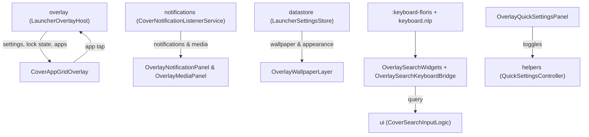

# `ui.launcher` Package

The cover-display launcher UI rendered inside the accessibility-hosted `CoverComposeSurface`: horizontal pager, app drawer, dock, notifications, media controls, search + Floris keyboard host, wallpaper layer, and Quick Settings.

## What This Module Holds

| File | Key Types | Responsibility |
| --- | --- | --- |
| `CoverAppGridOverlay.kt` | `CoverAppGridOverlay`, `InteractiveSection`, `resolveDockSlots` | Root cover launcher composable hosting the pager, gestures, and panels |
| `OverlayDisplayPolishSpec.kt` | `CoverDisplayPolishSpec`, `rememberCoverDisplayPolishSpec` | Display-cutout and container-height layout polish specifications |
| `OverlayPackageIconCache.kt` | `OverlayBitmapIconCache`, `rememberPackageIconBitmap`, `rememberPackageLabel` | In-memory LRU + disk-backed app icon and label resolution |
| `OverlayBatteryStatus.kt` | `BatteryStatusSnapshot`, `rememberBatteryStatus`, `BatteryStatusPill` | Live battery level/charging monitor and status pill |
| `OverlayLockscreenTile.kt` | `LockAndDockTile`, `currentCoverTime`, `currentCoverDate` | Lockscreen clock, status pills, media card, and dock tile |
| `OverlayAppGridComponents.kt` | `AppGridPageTile`, `GridPageLetterTooltip`, `PageIndicator`, `OneUiDockRow` | Paginated app icon grid, letter scrubber tooltip, and pinned One UI dock row |
| `OverlayIconThumbnailDiskCache.kt` | `OverlayIconThumbnailDiskCache` | Disk cache for app icon bitmaps to avoid repeated `Drawable` rasterization |
| `OverlayLayoutSpec.kt` | `OverlayLayoutSpec` | Responsive grid, spacing, and panel sizing calculations for cover display dimensions |
| `OverlayMediaPanel.kt` | `CompactNowPlayingCard`, `ExpandedNowPlayingPanel`, `MediaPlayerContent`, `openMediaApplicationFromOverlay` | Now-playing card and expanded media playback controls |
| `OverlayNotificationPanel.kt` | `NotificationsPanelTile`, `groupNotificationsByProvider`, `NotificationClearAllButton` | Grouped notification list with expand/collapse and clear actions |
| `OverlayQuickSettingsPanel.kt` | `QuickSettingsPanelTile`, `QuickSettingsToggleTile`, `QuickSettingsBrightnessControl` | Cover Quick Settings toggles and brightness slider |
| `OverlaySearchWidgets.kt` | `WidgetGridPageTile`, `SearchWidgetTile`, `CoverSearchInputRow`, `rememberVoiceInputHandle` | Search bar, voice input, and widget/search page |
| `OverlaySearchKeyboardBridge.kt` | `SearchFlorisKeyboardHost` | Embeds `:keyboard-floris` (`CoverFlorisKeyboardSurface`) for in-launcher app search |
| `OverlayWallpaperLayer.kt` | `CoverWallpaperLayer`, `WallpaperMediaContent`, `decodeWallpaperFrame` | Renders static, GIF, or video wallpapers behind the launcher |
| `WallpaperBitmapCache.kt` & `WallpaperStaticFrame.kt` | `WallpaperBitmapCache`, `WallpaperStaticFrame`, `WallpaperTransformFrame` | Caches decoded wallpaper bitmaps and applies crop/zoom/rotation transforms |

## Data Flow Diagram

## Works Hand-in-Hand With

| Module | Relationship | Link |
| --- | --- | --- |
| `overlay` | `CoverAccessibilityService` mounts `CoverAppGridOverlay` inside `CoverComposeSurface` with `LauncherOverlayHost` | [overlay](../../overlay/README.md) |
| `notifications` & `models` | Supplies `CoverNotificationModel`, `CoverMediaModel`, and `AppModel` | [notifications](../../notifications/README.md) |
| `datastore` & `repository` | Supplies `LauncherSettings` and scanned `AppModel` lists | [datastore](../../datastore/README.md) |
| `helpers` | `QuickSettingsController` executes system toggle and brightness changes | [helpers](../../helpers/README.md) |
| `:keyboard-floris` & `keyboard.nlp` | Powers `SearchFlorisKeyboardHost` | [keyboard-floris](../../../../../../../../../keyboard-floris/README.md) |
| `ui/theme` & `ui/theme/oneui` | Provides One UI accent tokens, blur modifiers, and typography | [ui/theme](../theme/README.md) |
