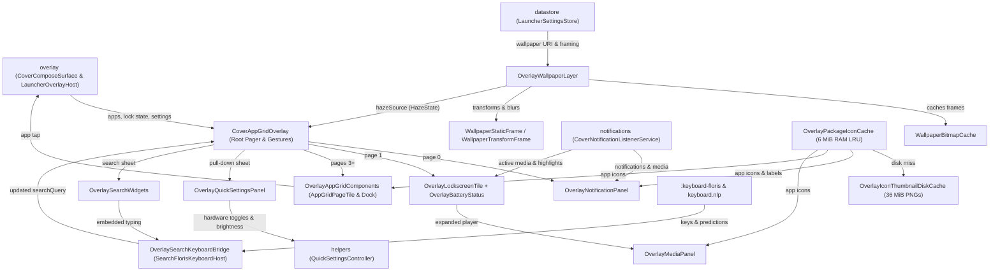

# `ui.launcher` Package

---

## 1. What This Folder Does

When you close a flip phone like a Galaxy Z Flip, Android's normal home screen stays trapped on the inside display. Because phone makers block third-party apps from replacing the cover screen's built-in home app, Cover-Screen-OS paints its own launcher inside a special full-screen accessibility overlay window (`CoverComposeSurface`) on the outer display.

Everything you actually touch and look at on the cover screen lives right here in `ui/launcher/`:

- **The swipeable home pages** — swipe left for your grouped **Notifications**, sit in the center for your **Lock Screen & Dock**, swipe right for your **Widgets**, and keep swiping right for your **4x3 App Pages**.
- **Pop-over control sheets** — pull down from the top for **Quick Settings** (Wi-Fi, Bluetooth, Flashlight, Brightness), tap the music pill to expand **Now Playing**, or tap the glowing search pill to open **App Search** with an embedded cover keyboard and voice dictation.
- **The live wallpaper & glass blur backdrop** — renders photos, animated GIFs, or looping videos behind the launcher and feeds them into **Haze** frosted-glass cards so text stays crisp over any background.
- **Fast app icon & wallpaper caches** — keeps recently used app icons and decoded wallpaper bitmaps ready in memory (and on disk) so waking the cover screen feels instant instead of choppy.

---

## 2. How It Works Step-by-Step

1. **Mount the stage & paint the wallpaper first**: `CoverAppGridOverlay` draws `CoverWallpaperLayer` at the very back, wrapped with a shared `HazeState` (`hazeSource`) so every glass panel above it can blur whatever is behind it in real time.
2. **Show the lock screen immediately, scan apps a split-second later**: To make the first frame appear without stutter, `CoverAppGridOverlay` waits for the first frame to draw (`withFrameNanos`) plus 120 ms (`APP_SCAN_DEFER_AFTER_FIRST_FRAME_MS`) before asking `PackageManagerAppScannerRepository` for installed apps, then quietly prewarms the first two pages of app icons in small IO batches.
3. **Wire up live phone signals**: Sticky battery monitoring (`rememberBatteryStatus`), a minute-by-minute clock ticker, and `CoverNotificationListenerService.activeNotificationsFlow()` stream live status into the lock page (`OverlayLockscreenTile`), notification shade (`OverlayNotificationPanel`), and music card (`OverlayMediaPanel`).
4. **Navigate safely around the lock state**: A horizontal pager starts on the center lock screen (`LOCK_PAGER_PAGE_INDEX = 1`). While the phone is locked, `resolveAccessiblePageCount` hides the widget and app-drawer pages so only notifications (page 0) and the lock screen (page 1) are reachable.
5. **Handle cover-sized pull-downs, search, and media**:
   - Swiping down opens `QuickSettingsPanelTile` (or the system shade).
   - Tapping search opens `WidgetGridPageTile` with `SearchFlorisKeyboardHost`—an in-process keyboard bridge—and optional `SpeechRecognizer` voice input (`rememberVoiceInputHandle`).
   - Tapping any app icon hands the launch back to the host overlay so the app opens on the outer cover display rather than the inside screen.

---

## 3. File-by-File Guide

### `CoverAppGridOverlay.kt`
- **In plain terms**: The main conductor of the cover launcher—like the stage manager making sure the wallpaper, swipeable pages, pull-down sheets, search box, and icon prewarmer all appear on cue without dropping frames.
- **Key variables & state**:
  - `GRID_COLUMNS` (`4`), `GRID_ROWS` (`3`), `APPS_PER_GRID_PAGE` (`12`), `DOCK_SLOT_COUNT` (`4`): Fixed 4x3 app drawer page size and 4-slot dock layout.
  - `NOTIFICATION_PANEL_PAGE_INDEX` (`0`), `LOCK_PAGER_PAGE_INDEX` (`1`), `WIDGET_HOST_PAGE_INDEX` (`2`), `FIRST_APP_GRID_PAGE_INDEX` (`3`): Fixed slot order in the horizontal pager.
  - `APP_SCAN_DEFER_AFTER_FIRST_FRAME_MS` (`120L`), `ICON_PREWARM_COUNT` (`24`), `ICON_PREWARM_BATCH_SIZE` (`6`), `ICON_PREWARM_BATCH_DELAY_MS` (`32L`): Startup pacing knobs that let the lock screen render first before scanning apps and warming icons in gentle batches.
  - `shouldLoadApps`, `isGridHydrated`, `appsState`: Staged hydration flags that hold off heavy `PackageManager` work until the initial frame commits.
  - `searchQuery`, `isCoverKeyboardVisible`, `isWidgetTileVisible`, `isQuickSettingsVisible`: Live UI toggles for the slide-over search sheet and Quick Settings drawer.
  - `hazeState`: Shared `HazeState` attached to `CoverWallpaperLayer` so panels in front get frosted-glass blur.
  - `pagerState`, `accessiblePageCount`: Pager controller restricted to pages `0..1` while locked via `resolveAccessiblePageCount`.
- **How it connects**: Mounted inside `CoverComposeSurface` by the `overlay` package; delegates to `CoverWallpaperLayer`, `NotificationsPanelTile`, `LockAndDockTile`, `AppGridPageTile`, `WidgetGridPageTile`, `QuickSettingsPanelTile`, `PageIndicator`, and `GridPageLetterTooltip`.

### `OverlayAppGridComponents.kt`
- **In plain terms**: The building blocks for browsing and launching apps: the 4x3 app icon grid, empty loading placeholders, the floating A–Z letter bubble, the scrubbing page dots at the bottom, and the 4-app pill dock.
- **Key variables & state**:
  - `GRID_COLUMNS` (`4`), `GRID_ROWS` (`3`), `APPS_PER_GRID_PAGE` (`12`), `DOCK_SLOT_COUNT` (`4`): Match the root pager's 4x3 grid and 4-slot dock dimensions.
  - `INDICATOR_SCRUB_SENSITIVITY` (`1.45f`), `INDICATOR_SCRUB_INTERVAL_MS` (`42L`): Tuning knobs that let a short thumb drag across `PageIndicator` scrub smoothly across many app pages with throttled haptics.
  - `displaySlots`: Pads any partial final app page with `null` placeholder slots so icons never stretch out of alignment.
  - `isDragging`, `indicatorWidthPx`, `lastScrubbedPage`, `lastScrubTimestampMs`: Track finger scrubbing across the bottom indicator dots.
  - `pillShape`: Fully rounded (`percent = 50`) One UI pill geometry used by `OneUiDockRow`.
- **How it connects**: Rendered inside `CoverAppGridOverlay` (for app drawer pages, `PageIndicator`, and `GridPageLetterTooltip`) and `LockAndDockTile` (for `OneUiDockRow`). Pulls app icons from `rememberPackageIconBitmap`.

### `OverlayBatteryStatus.kt`
- **In plain terms**: A live battery meter pill that listens for Android battery broadcasts and draws a tiny fuel gauge showing charge percentage and whether the phone is plugged in or running low.
- **Key variables & state**:
  - `BatteryStatusSnapshot` (`levelPercent`, `isCharging`): Simple snapshot of current battery level (`0..100`) and plugged/full state.
  - `status`: Reactively updated inside `rememberBatteryStatus()` using Android's sticky `Intent.ACTION_BATTERY_CHANGED` broadcast and a `BroadcastReceiver` registered with `Context.RECEIVER_NOT_EXPORTED`.
  - `levelFraction`, `fillColor`: Drives the gauge bar width and turns it red at `<= 15%` or green/accent when charging.
- **How it connects**: Called by `CoverAppGridOverlay` and displayed inside `LockAndDockTile`'s top status bar.

### `OverlayDisplayPolishSpec.kt`
- **In plain terms**: A pocket tape-measure for different flip-phone cover screens—it checks how tall the screen is and where the camera punch-hole or hinge cutout sits so status pills and the dock never clip under hardware cutouts.
- **Key variables & state**:
  - `CoverDisplayPolishSpec` (`statusChipMinHeight`, `dockBottomPadding`, `cutoutTopPadding`, `cutoutBottomPadding`, `cutoutStartPadding`, `cutoutEndPadding`): Computed spacing bucket for the active display.
  - `containerHeightDp`: Measured from `LocalWindowInfo.current.containerSize.height` and grouped into `<= 680.dp`, `<= 760.dp`, or larger buckets.
  - `cutoutInsets`: Read from `WindowInsets.displayCutout` in a layout-direction-aware way.
- **How it connects**: Remembered once in `CoverAppGridOverlay` and passed down to `LockAndDockTile` and layout containers.

### `OverlayIconThumbnailDiskCache.kt`
- **In plain terms**: A filing cabinet on disk (`cacheDir/cover_icon_thumbs`) that saves rendered `128x128` PNG copies of app icons so the launcher doesn't have to ask Android to re-draw complex adaptive icons every time the overlay restarts.
- **Key variables & state**:
  - `ICON_THUMBNAIL_CACHE_DIR_NAME` (`"cover_icon_thumbs"`): Subdirectory inside Android's `cacheDir`.
  - `ICON_THUMBNAIL_EDGE_PX` (`128`), `ICON_THUMBNAIL_CACHE_MAX_BYTES` (`36L * 1024L * 1024L`): Target `128x128` PNG size and 36 MiB total folder budget before oldest files (`lastModified`) are trimmed.
  - Filename hash: Deterministic SHA-256 of `packageName|versionToken` so app updates automatically miss stale icons.
- **How it connects**: Works directly beneath `OverlayPackageIconCache.kt` (`resolvePackageIconBitmap`) as the second-tier persistent cache.

### `OverlayLayoutSpec.kt`
- **In plain terms**: Simple shared ruler constants (`horizontalMargin`, `verticalPadding`, `maxOverlayWidth`, `contentTopOffset`) that keep overlay sheets centered and nicely padded even on wider screens.
- **Key variables & state**:
  - `horizontalMargin` (`16.dp`), `verticalPadding` (`12.dp`), `maxOverlayWidth` (`560.dp`), `contentTopOffset` (`72.dp`): Canonical sheet spacing constants.
  - `overlayWidth(screenWidth)`: Subtracts side margins and caps width at `560.dp`.
- **How it connects**: Shared layout specification referenced across overlay sheets inside `ui.launcher`.

### `OverlayLockscreenTile.kt`
- **In plain terms**: The main "home" view you see first when you wake the cover screen—showing the lock icon, battery pill, urgent notification icon badges, big clock & date, glowing search button, compact music bar, and 4-icon app dock.
- **Key variables & state**:
  - `mediaNotification`: Picks the newest active media session from `notifications` to feed `CompactNowPlayingCard` and `ExpandedNowPlayingPanel`.
  - `showExpandedMedia`: Controls whether the full-screen pop-up music controller (`ExpandedNowPlayingPanel`) is open, automatically resetting if the track/session changes.
  - `MAX_LOCK_ONGOING_HIGHLIGHTS` (`1`), `MAX_LOCK_NORMAL_HIGHLIGHTS` (`2`), `LOCK_HIGHLIGHT_BANNED_PACKAGES`: Caps top notification badges to 1 active ongoing item (like a call) plus 2 recent app alerts while hiding SystemUI noise.
  - `LOCK_PILL_DIM_RGB_COLORS`: Palette used by `dimRgbGlow()` to paint a subtle glowing rim around the search button.
- **How it connects**: Hosted at `LOCK_PAGER_PAGE_INDEX` (`1`) in `CoverAppGridOverlay`; connects to `OverlayBatteryStatus`, `OverlayMediaPanel`, `OverlayAppGridComponents` (`OneUiDockRow`), `OverlayPackageIconCache`, and `CoverNotificationListenerService`.

### `OverlayMediaPanel.kt`
- **In plain terms**: The cover screen's music player—both the slim "Now Playing" pill sitting above the dock and the big pop-up artwork card with Play/Pause, Previous, Next, and "Open app" buttons.
- **Key variables & state**:
  - `PREFERRED_MEDIA_PACKAGES`: Fallback list (Spotify, Apple Music, YouTube Music, Pandora, SoundCloud, Amazon Music, Samsung Music) checked when tapping the idle music bar if nothing is currently playing.
  - `ExpandedPlayerLayoutSpec`: Responsive button and panel sizing computed by `expandedPlayerLayoutSpec(height)` so controls remain `>= 48.dp` touch targets even on tiny flip displays.
  - `artworkBitmap`, `sourceIcon`, `canPlayPause`, `canSkipPrevious`, `canSkipNext`: Mirror live `MediaSession` metadata and allowed transport actions.
- **How it connects**: Embedded by `OverlayLockscreenTile`; triggers playback controls and app launches through `CoverNotificationListenerService`.

### `OverlayNotificationPanel.kt`
- **In plain terms**: Your cover-screen notification shade—like a mini inbox that groups alerts from the same app together, splits them into "Now" and "Earlier", lets you tuck away persistent background alerts, and lets you swipe notifications away.
- **Key variables & state**:
  - `NOTIFICATION_RECENT_WINDOW_MS` (`1 hour`): Cutoff dividing `"Now"` from `"Earlier"` sticky headers.
  - `notificationGroupExpandEnter` / `notificationGroupExpandExit`: Fade + spring animations used when expanding an app card with more than 2 alerts.
  - `collapseOngoing`: Toggle hiding or showing ongoing/non-clearable items (`isOngoing || !isClearable`).
  - `ongoingNotifications`, `importantNotifications`, `ongoingGroupedNotifications`, `importantGroupedNotifications`, `nowGroups`, `earlierGroups`: Pipeline that separates ongoing vs. clearable items, groups each by `packageName`, and sorts newest-first.
  - `isExpanded`, `visibleNotifications`: Caps collapsed app cards to 2 rows with a `"Show N more"` chip.
  - `dismissState`, `color`: Material 3 `SwipeToDismissBox` state requiring a 60% horizontal swipe (for clearable items) while tinting the reveal background red.
- **How it connects**: Mounted at pager index `0` in `CoverAppGridOverlay`; pulls app icons/names via `OverlayPackageIconCache`, blurs backgrounds via `HazeState` (`oneUiPanel`), opens notifications via `onNotificationOpen` (so the host fires the notification's `PendingIntent`), and calls `CoverNotificationListenerService` to dismiss single items or clear all.

### `OverlayPackageIconCache.kt`
- **In plain terms**: A fast two-step icon courier—think of `OverlayBitmapIconCache` as the small desk tray in RAM holding ready-to-paint app icons, while `OverlayIconThumbnailDiskCache` is the filing cabinet on disk so icons only get converted from Android `Drawable`s once per app update.
- **Key variables & state**:
  - `ICON_CACHE_MAX_BYTES` (`6 MiB`), `ICON_CACHE_SIZE_UNIT_BYTES` (`1024`), `ICON_BITMAP_EDGE_PX` (`128`): Keep memory usage bounded at 6 MiB (measured in KiB) with crisp `128x128` icons.
  - `OverlayBitmapIconCache.cache`: Synchronized `LruCache<String, ImageBitmap>` keyed by `packageName`.
  - `versionToken`: Built from `PackageInfo.longVersionCode` and `lastUpdateTime` so updating an app invalidates its old cached icon.
  - `iconState`, `labelState`: `produceState` holders seeded immediately with the RAM icon (or trailing package segment text) and filled off the main thread on `Dispatchers.IO`.
- **How it connects**: Used everywhere an app icon or app title appears (`OverlayAppGridComponents`, `OverlayNotificationPanel`, `OverlayLockscreenTile`, `OverlayMediaPanel`) and prewarmed in batches by `CoverAppGridOverlay`.

### `OverlayQuickSettingsPanel.kt`
- **In plain terms**: The slide-down control sheet for quick toggles—Wi-Fi, Bluetooth, Flashlight, a Customize shortcut, and a screen Brightness slider—styled with frosted glass and dismissible with an upward swipe or tap outside.
- **Key variables & state**:
  - `wifiEnabled`, `bluetoothEnabled`, `flashlightEnabled`, `canWriteSettings`, `brightnessPercent`, `torchCameraId`: Live Compose states seeded from `QuickSettingsController`.
  - `LifecycleEventObserver` (`ON_RESUME`): Re-reads Wi-Fi, Bluetooth, brightness, and `WRITE_SETTINGS` permission whenever the user returns from an Android Settings dialog.
  - `CameraManager.TorchCallback`: Keeps `flashlightEnabled` accurate even if the camera or system shade turns the flashlight on or off behind the scenes.
  - `fillAlpha`, `borderAlpha`, `contentTint`: Adjust toggle chip brightness across unavailable, off, and active states.
- **How it connects**: Opened from `CoverAppGridOverlay` when pulling down on the lock screen; delegates hardware/system actions to `QuickSettingsController` (`helpers`) and blurs the background via `HazeState`.

### `OverlaySearchKeyboardBridge.kt`
- **In plain terms**: A custom in-process translator between Cover-Screen-OS's built-in Floris keyboard and the search bar—needed because Android's normal system keyboard cannot reliably attach above an accessibility overlay window.
- **Key variables & state**:
  - `settingsStore`, `settings`: Collect keyboard height, one-handed dock side, suggestion strip visibility, autocorrect, and key-preview settings from `LauncherSettingsStore`.
  - `cursorPosition`: Synthetic cursor index inside the Compose `query` string (replacing a standard Android `EditText` / `InputConnection`), paired with `rememberUpdatedState` refs so the remembered `CoverEditorBridge` never reads stale text.
  - `activeLayoutMode`, `candidates`, `nlpRevision`: Drive off-thread (`Dispatchers.Default`) autocomplete and next-word predictions via `CoverKeyboardNlpManager`, refreshing whenever the user learns or suppresses a word.
  - `dockAnchor`: Maps left/right one-handed preference to `ClamshellDockAnchor`.
- **How it connects**: Embedded inside `SearchWidgetTile` (`OverlaySearchWidgets.kt`); wraps `:keyboard-floris` (`CoverFlorisKeyboardSurface`) and `CoverKeyboardNlpManager` (`keyboard.nlp`), sending edits back to `CoverAppGridOverlay`'s `searchQuery`.

### `OverlaySearchWidgets.kt`
- **In plain terms**: The slide-over app search sheet—holding the frosted-glass search box, voice-dictation mic button, swipe-up-to-close gesture, and the embedded keyboard container.
- **Key variables & state**:
  - `OverlayVoiceInputHandle`: Simple control handle (`isAvailable`, `startListening`, `stopListening`) exposed by `rememberVoiceInputHandle`.
  - `insetsModifier`: Adds bottom `WindowInsets.safeDrawing` padding while ignoring system IME insets so the embedded keyboard sits cleanly at the bottom.
  - `cumulativeDrag`: Tracks upward finger swipes across `WidgetGridPageTile` to return to the lock screen.
  - `speechRecognizer`, `languageTag`: Native `android.speech.SpeechRecognizer` managed inside `DisposableEffect` (`stopListening`/`destroy` on exit), sending live partial and final spoken transcripts back to the search bar.
- **How it connects**: Displayed as a slide-over sheet by `CoverAppGridOverlay`; embeds `SearchFlorisKeyboardHost` (`OverlaySearchKeyboardBridge.kt`) and `ComposingTextPreview`, and blurs the wallpaper via `HazeState`.

### `OverlayWallpaperLayer.kt`
- **In plain terms**: The wallpaper player behind the entire launcher—handling photos, animated GIFs, and muted looping videos while automatically pausing animation when the screen turns off or Battery Saver kicks in.
- **Key variables & state**:
  - `MAX_WALLPAPER_DECODE_PIXELS` (`1,800,000`): 1.8-megapixel ceiling so huge camera photos downsample safely without blowing app memory.
  - `media` / `frame`: Off-thread decoded `WallpaperFrame` holding either a scaled still bitmap or frame 0 of a video as a poster image (falling back to a dark gradient if missing or broken).
  - `playbackActive`, `lowEffects`, `shouldPlay`: Combine lifecycle `STARTED`, `PowerManager.isInteractive` (`ACTION_SCREEN_ON`/`OFF`), and `PowerManager.isPowerSaveMode` (`ACTION_POWER_SAVE_MODE_CHANGED`) to pause motion when sleeping or saving battery.
  - `animatedDrawable`, `videoPlaybackFailed`: Manage `AnimatedImageDrawable` GIF playback and graceful fallback to a static poster frame if `MediaPlayer` errors out.
  - `WallpaperVideoTextureView` (`sourceUri`, `shouldPlay`, `player`, `isPrepared`, `surface`, `failureCallback`): Custom `TextureView` wiring a muted looping `MediaPlayer` to a `SurfaceTexture` so Compose can transform and blur live video.
- **How it connects**: Rendered at the bottom z-layer of `CoverAppGridOverlay` with `.hazeSource(hazeState)`; stores/reads decoded frames in `WallpaperBitmapCache` and delegates visual crop/zoom/rotation/blur/dimming to `WallpaperStaticFrame` and `WallpaperTransformFrame`.

### `WallpaperBitmapCache.kt`
- **In plain terms**: A dedicated 10 MiB RAM shelf keeping recently decoded wallpaper images and video poster frames so waking the phone doesn't force Android to re-decode large files.
- **Key variables & state**:
  - `cache`: Synchronized `LruCache<String, WallpaperFrame>` sized in KiB (`10 * 1024`, i.e., 10 MiB), measuring each entry by `value.bitmap.byteCount / 1024`.
  - `buildKey(...)`: Combines URI, file timestamp/size + transform token, and viewport pixel dimensions so resizing or editing a wallpaper invalidates stale entries cleanly.
- **How it connects**: Used directly by `decodeWallpaperFrame` in `OverlayWallpaperLayer.kt`.

### `WallpaperStaticFrame.kt`
- **In plain terms**: The picture-framing engine shared by photos, GIFs, and videos—scaling, rotating, zooming, panning, blurring, and dimming any wallpaper so it fits the cover screen cleanly without black gaps.
- **Key variables & state**:
  - `widthPx` / `heightPx`, `rotatedWidth` / `rotatedHeight`: Measured container bounds and orientation-swapped media dimensions (for 90°/270° rotations).
  - `baseScale`, `scaledWidth` / `scaledHeight`: Aspect-crop (`max`) vs. aspect-fit (`min`) multiplier plus user zoom.
  - `offsetX` / `offsetY`: Clamped pan offset derived from normalized `cropX`/`cropY` (`-1f..1f`) so panning never exposes empty edges when zoomed/cropped.
  - `transform`: Compose `Modifier` chain combining `requiredSize`, GPU-accelerated `graphicsLayer` (`rotationZ`, `scaleX`, `scaleY`, `translationX`, `translationY`), and bounded `.blur(..., BlurredEdgeTreatment.Unbounded)`, topped by a black dimming scrim (`dimAmount`).
- **How it connects**: Called directly by `WallpaperMediaContent` in `OverlayWallpaperLayer.kt` for videos, GIFs, and static/poster fallback frames.

---

## 4. Quick-Reference Summary Table

| File | Role in Plain English | Key Types / Entry Points |
| --- | --- | --- |
| `CoverAppGridOverlay.kt` | Root launcher stage, pager & gesture coordinator | `CoverAppGridOverlay`, `InteractiveSection`, `resolveAccessiblePageCount` |
| `OverlayAppGridComponents.kt` | 4x3 app pages, letter badge, scrubbing dots & dock | `AppGridPageTile`, `GridPageLetterTooltip`, `PageIndicator`, `OneUiDockRow` |
| `OverlayBatteryStatus.kt` | Live battery monitor and status chip | `BatteryStatusSnapshot`, `rememberBatteryStatus`, `BatteryStatusPill` |
| `OverlayDisplayPolishSpec.kt` | Cutout & display-height spacing rules | `CoverDisplayPolishSpec`, `rememberCoverDisplayPolishSpec` |
| `OverlayIconThumbnailDiskCache.kt` | 36 MiB PNG icon cache on disk | `OverlayIconThumbnailDiskCache` |
| `OverlayLayoutSpec.kt` | Shared sheet margins and max-width clamping | `OverlayLayoutSpec` |
| `OverlayLockscreenTile.kt` | Center lock screen clock, badges, media & dock | `LockAndDockTile`, `selectLockHighlightNotifications`, `currentCoverTime` |
| `OverlayMediaPanel.kt` | Compact music pill & expanded media player | `CompactNowPlayingCard`, `ExpandedNowPlayingPanel`, `openMediaApplicationFromOverlay` |
| `OverlayNotificationPanel.kt` | Grouped, swipe-to-dismiss notification shade | `NotificationsPanelTile`, `groupNotificationsByProvider`, `NotificationClearAllButton` |
| `OverlayPackageIconCache.kt` | 6 MiB RAM LRU + async icon/label loader | `OverlayBitmapIconCache`, `rememberPackageIconBitmap`, `rememberPackageLabel` |
| `OverlayQuickSettingsPanel.kt` | Pull-down Wi-Fi, Bluetooth, Torch & Brightness sheet | `QuickSettingsPanelTile`, `QuickSettingsToggleTile`, `QuickSettingsBrightnessControl` |
| `OverlaySearchKeyboardBridge.kt` | In-overlay Floris keyboard & NLP bridge | `SearchFlorisKeyboardHost` |
| `OverlaySearchWidgets.kt` | Slide-over search box & voice dictation | `WidgetGridPageTile`, `SearchWidgetTile`, `CoverSearchInputRow`, `rememberVoiceInputHandle` |
| `OverlayWallpaperLayer.kt` | Photo, GIF & looping video wallpaper player | `CoverWallpaperLayer`, `WallpaperMediaContent`, `decodeWallpaperFrame` |
| `WallpaperBitmapCache.kt` | 10 MiB RAM cache for decoded wallpaper frames | `WallpaperBitmapCache` |
| `WallpaperStaticFrame.kt` | Shared zoom, crop, rotation, blur & dim frame | `WallpaperStaticFrame`, `WallpaperTransformFrame` |

---

## 5. Architecture & Data Flow

---

## 6. Works Hand-in-Hand With

| Module | Relationship | Link |
| --- | --- | --- |
| `overlay` | `CoverAccessibilityService` mounts `CoverAppGridOverlay` inside `CoverComposeSurface` with `LauncherOverlayHost` | [overlay](../../overlay/README.md) |
| `notifications` & `models` | Supplies `CoverNotificationModel`, `CoverMediaModel`, and `AppModel`, and handles notification open/dismiss & media actions | [notifications](../../notifications/README.md) |
| `datastore` & `repository` | Supplies `LauncherSettings` (wallpaper & keyboard prefs) and scanned `AppModel` lists | [datastore](../../datastore/README.md) |
| `helpers` | `QuickSettingsController` executes Wi-Fi, Bluetooth, Torch, and Brightness changes | [helpers](../../helpers/README.md) |
| `:keyboard-floris` & `keyboard.nlp` | Powers `SearchFlorisKeyboardHost` layouts and word suggestions | [keyboard-floris](../../../../../../../../../keyboard-floris/README.md) |
| `ui/theme` & `ui/theme/oneui` | Provides One UI accent tokens, `oneUiPanel` Haze blur modifiers, and typography | [ui/theme](../theme/README.md) |
