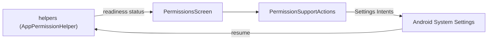

# `ui.permissions` Package

Inner-display onboarding and readiness screen guiding the user through required Android permissions (notifications, accessibility service, notification listener, and battery optimization exemption).

## What This Module Holds

| File | Key Types | Responsibility |
| --- | --- | --- |
| `PermissionsScreen.kt` | `PermissionsScreen`, `PermissionsContent`, `RestrictedAccessibilityHelp`, `PermissionHealthRing`, `PermissionRow` | Displays readiness ring, permission checklist rows, and restricted-settings guidance |
| `PermissionSupportActions.kt` | `PermissionSupportActions` | Launches Android settings intents for each required permission |
| `FeatureDegradedNotice.kt` | `FeatureDegradedNotice` | Reusable notice banner explaining degraded behavior when optional/required permissions are missing |

## Data Flow Diagram

## Works Hand-in-Hand With

| Module | Relationship | Link |
| --- | --- | --- |
| `ui/appshell` | Routes to `PermissionsScreen` (including as initial destination when required permissions are missing) | [ui/appshell](../appshell/README.md) |
| `ui/dashboard` | Links to `PermissionsScreen` and embeds `FeatureDegradedNotice` | [ui/dashboard](../dashboard/README.md) |
| `helpers` | Queries `AppPermissionHelper` for live permission state | [helpers](../../helpers/README.md) |
| `ui/theme/oneui/components` | Uses One UI scaffold and card group components | [oneui/components](../theme/oneui/components/README.md) |
