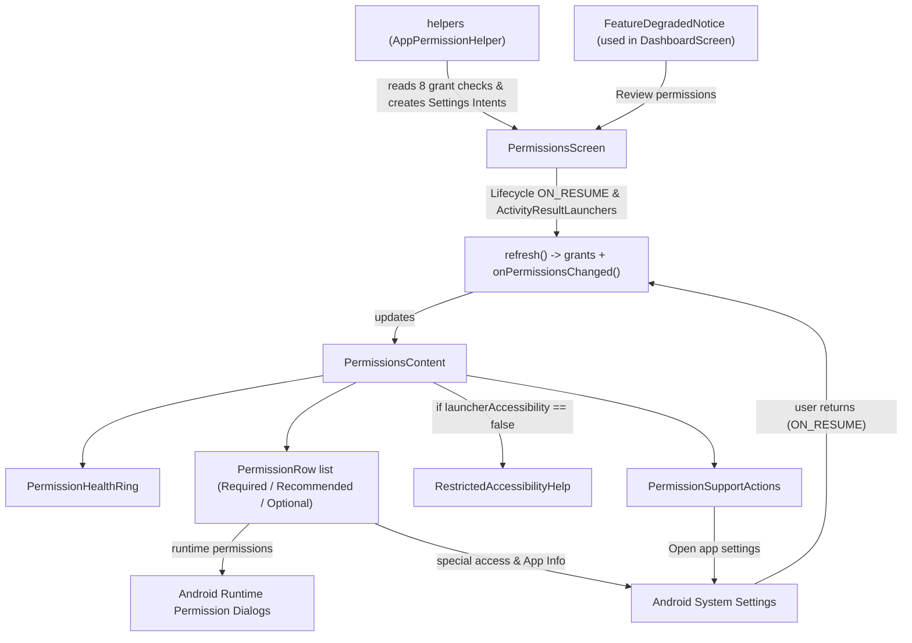

# `ui.permissions` Package

## What This Folder Does

Think of `ui/permissions` as the **pre-flight checklist and troubleshooting desk** for Cover Screen OS. Because Android protects special abilities—like drawing an overlay via an Accessibility Service, reading notifications, or staying awake without aggressive battery throttling—this folder helps users turn on everything cleanly in plain English.

It divides permissions into three priority tiers (**Required**, **Recommended**, and **Optional**), shows an easy-to-read **Permission health % ring**, launches the exact Android permission dialog or System Settings page needed for each item, explains how to unlock Android 13+ **Restricted Settings** if the accessibility toggle is grayed out, and provides reusable warning banners (`FeatureDegradedNotice`) when setup isn't finished yet.

## How It Works Step-by-Step

1. **Read current grants (`PermissionGrants.read`)**: On launch, `PermissionsScreen` calls `AppPermissionHelper` to evaluate all 8 grants (4 required, 1 recommended, 3 optional) and computes `healthPercent` across the 5 required + recommended items.
2. **Watch for System Settings returns**: Many Android capabilities (Accessibility Service, Notification Listener, Battery Optimization exemption) cannot be granted via an in-app popup—the user must toggle them inside Android System Settings and navigate back. `PermissionsScreen` attaches a `LifecycleEventObserver` for `ON_RESUME` and registers `ActivityResultContracts` launchers so status refreshes automatically the instant the user returns.
3. **Dispatch the right action per row**:
   - **Runtime permissions** (*Post notifications*, *Selected photos*, *Microphone*, *Bluetooth*): Launches Android's standard permission dialog when missing, or opens App Info settings if already granted (so users can inspect or revoke them).
   - **Special system access** (*Cover screen launcher service*, *Notification access*, *Battery optimization exemption*, *Cover keyboard input*): Safely launches the matching System Settings `Intent` via `openSettings` (wrapping `settingsLauncher.launch(...)` in a `try/catch` for OEM safety).
4. **Guide around Android 13+ restrictions**: Whenever `launcherAccessibility` is still disabled, `PermissionsContent` automatically displays `RestrictedAccessibilityHelp` right beneath *Required Access* explaining how to allow restricted settings in App Info.
5. **Notify the rest of the app**: Every refresh calls `onPermissionsChanged()`, bumping `permissionRefreshKey` in `AppShell` so the Dashboard updates and `ForegroundService` can auto-start as soon as required permissions are satisfied.

## File-by-File Guide

### PermissionsScreen.kt

- **In plain terms**: The full Permissions onboarding and diagnostics screen—tracking all 8 permissions, handling Android runtime permission popups and Settings screen launches, refreshing on `ON_RESUME`, and rendering the health ring, grouped checklist cards, restricted-settings guide, support card, and *"Continue with limited features"* escape hatch.
- **Key variables & state**:
  - `PermissionGroup` & `PermissionId`: Categorize the 8 tracked permissions into `REQUIRED`, `RECOMMENDED`, and `OPTIONAL`.
  - `PermissionGrants`: Snapshot of all 8 grant booleans plus computed `requiredMissing` and `healthPercent`.
  - `grants`: Mutable Compose state holding the latest `PermissionGrants` snapshot.
  - `observer`: `LifecycleEventObserver` that runs `refresh()` every time the screen hits `ON_RESUME`.
  - `settingsLauncher`, `notificationLauncher`, `mediaLauncher`, `microphoneLauncher`, `bluetoothLauncher`: `ActivityResultLauncher` handles for external Settings activities and runtime permission prompts (`POST_NOTIFICATIONS`, gallery media, `RECORD_AUDIO`, `BLUETOOTH_CONNECT`), each calling `refresh()` on return.
  - `rows`: List of `PermissionRowModel` entries binding title, rationale, icon, grant status, and click handler for all 8 permissions.
  - `isCompactHeight`, `groupRows`, `ringSize`, `interactionSource`: Layout adaptation and One UI press feedback inside `PermissionsContent`, `PermissionHealthRing`, and `PermissionRow`.
- **How it connects**: Hosted at `HomeRoutes.Permissions` inside `AppShell`; reads checks and intents from `AppPermissionHelper`, calls `onPermissionsChanged()` to sync `AppShell`/`DashboardScreen`, and embeds `PermissionSupportActions`.

### PermissionSupportActions.kt

- **In plain terms**: A compact *"More actions"* support card at the bottom of the Permissions list with two fallback buttons: **Open app settings** (handy for restricted-settings unlocks or manual changes) and **Refresh status** (manual re-poll).
- **Key variables & state**:
  - Stateless component driven by `onOpenAppSettings` and `onRefresh` callbacks from `PermissionsScreen`.
- **How it connects**: Embedded inside `PermissionsContent`'s *"Support & Diagnostics"* `OneUICardGroup`.

### FeatureDegradedNotice.kt

- **In plain terms**: A clean *"Limited features"* warning banner card telling the user which required permissions are still missing, offering a **Review permissions** button and an optional dismiss (`X`) icon.
- **Key variables & state**:
  - Stateless component driven by `message`, `onPermissions`, and nullable `onDismiss` (omitting `onDismiss` hides the close button).
- **How it connects**: Embedded in `DashboardScreen` (and available to any other screen needing to warn about missing permissions) to route users back to `PermissionsScreen`.

## Quick-Reference Summary

| File | Key Types / Composables | Purpose |
| --- | --- | --- |
| `PermissionsScreen.kt` | `PermissionGroup`, `PermissionId`, `PermissionGrants`, `PermissionRowModel`, `PermissionsScreen`, `PermissionsContent`, `RestrictedAccessibilityHelp`, `PermissionHealthRing`, `PermissionRow`, `PermissionsScreenPreview` | Core permissions onboarding screen, `ON_RESUME` + `ActivityResultContracts` polling, health ring, and restricted-settings guidance |
| `PermissionSupportActions.kt` | `PermissionSupportActions` | Bottom fallback card with *"Open app settings"* and *"Refresh status"* buttons |
| `FeatureDegradedNotice.kt` | `FeatureDegradedNotice` | Reusable *"Limited features"* warning card with *"Review permissions"* CTA and optional dismiss button |

## Architecture Flowchart

## Works Hand-in-Hand With

| Module | Relationship | Link |
| --- | --- | --- |
| `ui/appshell` | Chooses `Permissions` as start route when required grants are missing and listens to `onPermissionsChanged` | [ui/appshell](../appshell/README.md) |
| `ui/dashboard` | Embeds `FeatureDegradedNotice` and routes to `PermissionsScreen` from quick controls | [ui/dashboard](../dashboard/README.md) |
| `helpers` | Centralizes all Android version checks and System Settings `Intent` builders in `AppPermissionHelper` | [helpers](../../helpers/README.md) |
| `ui/theme/oneui/components` | Supplies `OneUIScaffold`, `OneUICardGroup`, and `OneUIInternalDivider` | [oneui/components](../theme/oneui/components/README.md) |
