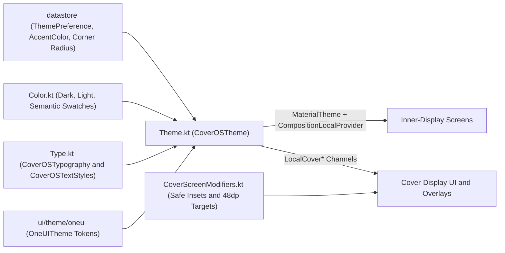

# `ui.theme` Package

Application-wide visual styling, color palettes, typography, and cover-screen spacing helpers for Cover-Screen-OS.

## What This Folder Does

Think of `ui.theme` as the **master paint palette and measuring tape** for the entire app. Before any screen draws a button, clock, notification card, or settings menu, it asks this package two simple questions: *"What colors and fonts should I use?"* and *"How much breathing room do I need around the edges of a tiny flip-phone cover screen?"*

Instead of hardcoding hex color codes or pixel margins inside every screen, all inner-phone screens and outer-cover overlays wrap themselves in `CoverOSTheme`. From that single wrapper, every nested widget receives coordinated light/dark colors, custom user accent overrides, readable text sizes, and safe padding around display notches and status bars.

## How It Works Step-by-Step

1. **Read user preferences**: The app passes the user's saved settings (`ThemePreference`, `AccentColor`, and `panelCornerRadiusDp`) into `CoverOSTheme` in `Theme.kt`.
2. **Pick Light or OLED Dark mode**: `CoverOSTheme` checks whether the user forced Light, forced Dark, or selected `SYSTEM` (resolved via `isSystemInDarkTheme()`).
3. **Swap in the chosen accent**: `coverAccentScheme` starts with `CoverOSDarkColorScheme` or `CoverOSLightColorScheme` (built from `Color.kt`) and replaces the primary accent family if the user picked `MINT`, `AMBER`, or `ROSE`.
4. **Sync the One UI design layer**: `CoverOSTheme` creates matching One UI color, dimension, shape, and typography tokens (from the `oneui/` sub-package) and overrides One UI's accent color if the user picked a custom accent.
5. **Broadcast tokens down the UI tree**: Using Jetpack Compose's `CompositionLocalProvider`, `CoverOSTheme` makes both standard Material 3 values (`MaterialTheme`) and cover-overlay channels (`LocalCoverPanelCornerRadius`, `LocalCoverOverlayAccent`, `LocalCoverOverlayOnAccent`, `LocalCoverOverlayPanelBorder`, `LocalCoverAccentIsCustomized`) available to every child composable without passing extra arguments everywhere.
6. **Keep layouts clear of screen edges**: Individual screens apply modifiers from `CoverScreenModifiers.kt` and text styles from `Type.kt` so content stays inside rounded corners, status bars, and thumb-friendly 48dp hit targets.

## File-by-File Guide

### `Color.kt`

- **In plain terms**: The master paint swatch book holding every named color used by Cover-Screen-OS. Keeping all colors here prevents magic hex numbers (`Color(0xFF...)`) from scattering across UI files.
- **Key variables & state**:
  - `CoverOSPrimary` (`0xFF7C9CFF`), `CoverOSPrimaryContainer`, `CoverOSOnPrimary`, `CoverOSOnPrimaryContainer`: The signature "Galaxy" indigo accent and its matching container/text contrast pairs.
  - `CoverOSSecondary` (`0xFF6EE7C0`) & `CoverOSTertiary` (`0xFFFFB870`): Reserved mint and amber highlights for special indicators (like dock-visibility toggles or fast-scroll letter badges).
  - `CoverOSDestructiveColor`, `CoverOSBatteryChargingColor`, `CoverOSCallActiveColor`, `CoverOSMediaPlaceholderGradientStart` / `End`: Semantic status colors for alerts, charging, active calls, and fallback album art gradients.
  - `CoverOSDarkBackground` (`0xFF000000`), `CoverOSDarkSurface`, `CoverOSDarkSurfaceVariant`, `CoverOSDarkOutline`, `CoverOSDarkOn*`: True OLED pure-black canvas paired with dark charcoal cards and softened off-white ink (`0xFFF2F3F5`) to minimize screen glow.
  - `CoverOSLightBackground` (`0xFFF4F5F9`), `CoverOSLightSurface` (`0xFFFFFFFF`), `CoverOSLight*`: Full light-mode parity palette with crisp white cards over a cool gray backdrop.
- **How it connects**: Imported by `Theme.kt` to build `CoverOSDarkColorScheme`, `CoverOSLightColorScheme`, and `coverAccentScheme`.

### `CoverScreenModifiers.kt`

- **In plain terms**: A small toolkit of reusable layout rules ("don't touch the camera notch", "make buttons big enough for a thumb", "use One UI corner curves") tailored to compact outer displays.
- **Key variables & state**:
  - `CoverScreenHorizontalPadding` (`8.dp`) & `CoverScreenVerticalPadding` (`8.dp`): Default tight outer margins that add breathing room without wasting space on small cover screens.
  - `CoverScreenMinTouchTarget` (`48.dp`): Android's minimum accessible tap size enforced by `coverMinimumTouchTarget()`.
  - `CoverOSCornerRadiusLarge` (`34.dp`), `CoverOSCornerRadiusMedium` (`24.dp`), `CoverOSCornerRadiusSmall` (`16.dp`): Oversized continuous corner radii matching Samsung One UI's rounded silhouette.
- **How it connects**: Consumed by cover-screen overlays and launcher containers via `Modifier.coverScreenPadding()`, `Modifier.coverMinimumTouchTarget()`, `Modifier.coverTopLevelSafeInsets()`, `Modifier.navbarPadding()`, and `coverScreenContentPadding()`.

### `Theme.kt`

- **In plain terms**: The central switchboard that picks dark/light mode, applies the user's accent color and corner radius preference, and broadcasts those choices down to every screen.
- **Key variables & state**:
  - `CoverOSDarkColorScheme` & `CoverOSLightColorScheme`: Pre-built Material 3 `ColorScheme` objects mapping `Color.kt` tokens to M3 roles (`primary`, `surface`, `background`, `outline`, etc.).
  - `LocalCoverPanelCornerRadius`: `staticCompositionLocalOf` channel holding the normalized panel corner radius (`DEFAULT_PANEL_CORNER_RADIUS_DP.dp` default).
  - `LocalCoverOverlayAccent` & `LocalCoverOverlayOnAccent`: `staticCompositionLocalOf` channels holding the active overlay accent color and readable foreground ink color.
  - `LocalCoverOverlayPanelBorder`: `staticCompositionLocalOf<Color?>` holding an optional 45%-alpha accent border tint (`null` on the default accent so panels keep neutral borders).
  - `LocalCoverAccentIsCustomized`: `staticCompositionLocalOf` flag (`true` when `accentColor != AccentColor.DEFAULT`) telling One UI overlay pages not to override the user's explicit accent choice.
  - `useDarkTheme`, `scheme`, `oneUiBaseColors`, `effectiveOneUiColors`: Local state inside `CoverOSTheme` reconciling `ThemePreference`, Material 3 `ColorScheme`, and `OneUIColors`.
- **How it connects**: Wraps root UI trees (`CoverOSTheme` and legacy alias `CoverScreenOSTheme`), reads `AccentColor`/`ThemePreference`/`normalizePanelCornerRadius` from `datastore`, and provides tokens from `ui/theme/oneui`.

### `Type.kt`

- **In plain terms**: The lettering guide defining font sizes, weights, and character spacing for the cover-screen clock, date, app labels, and section headers.
- **Key variables & state**:
  - `CoverOSTypography`: Default Material 3 `Typography` instance supplied directly to `MaterialTheme`.
  - `CoverOSTextStyles.ClockText` (`42.sp`, `FontWeight.Light`, `-0.5.sp` tracking): Large, airy numerals for the cover clock.
  - `CoverOSTextStyles.DateText` (`14.sp`, `FontWeight.Medium`, `0.2.sp` tracking): Clean date readout placed directly under the clock.
  - `CoverOSTextStyles.AppLabelText` (`11.sp`, `FontWeight.Medium`, `0.1.sp` tracking): Small, readable app names underneath grid icons.
  - `CoverOSTextStyles.SectionLabelText` (`12.sp`, `FontWeight.SemiBold`, `0.6.sp` tracking): Spaced-out section headers for grouped lists.
- **How it connects**: `CoverOSTypography` is passed into `MaterialTheme` inside `Theme.kt`; `CoverOSTextStyles` is referenced directly by clock, launcher, and cover-screen widgets.

## Quick-Reference Summary Table

| File | Key Symbols | Main Responsibility |
| --- | --- | --- |
| `Color.kt` | `CoverOSPrimary`, `CoverOSDark*`, `CoverOSLight*`, semantic colors | Centralized dark, light, accent, and status color swatches |
| `CoverScreenModifiers.kt` | `CoverOSCornerRadius*`, `coverTopLevelSafeInsets`, `navbarPadding`, `coverMinimumTouchTarget` | Cover-screen safe margins, status bar insets, and 48dp hit targets |
| `Theme.kt` | `CoverOSTheme`, `CoverScreenOSTheme`, `coverAccentScheme`, `LocalCover*` | Root theme wrapper combining Material 3, One UI tokens, and user preferences |
| `Type.kt` | `CoverOSTypography`, `CoverOSTextStyles` | Base M3 typography and cover-display text scale |
| `oneui/` | `OneUITheme`, `CoverOneUITokens`, `Modifiers.kt`, `Motion.kt` | Samsung One UI 8 design tokens, frosted glass modifiers, and spring animations |

## Data Flow Diagram

## Works Hand-in-Hand With

| Module | Relationship | Link |
| --- | --- | --- |
| `ui/theme/oneui` | Supplies One UI 8 color, shape, motion, and glass tokens wired into `CoverOSTheme` | [oneui](oneui/README.md) |
| `ui/theme/oneui/components` | Reusable One UI cards, floating nav bar, sliders, and collapsing scaffolds | [oneui/components](oneui/components/README.md) |
| `datastore` | Provides persisted `ThemePreference`, `AccentColor`, and panel corner radius values | [datastore](../../datastore/README.md) |
| `ui/launcher` | Consumes cover-screen theme tokens, `CoverOSTextStyles`, and safe-inset modifiers | [ui/launcher](../launcher/README.md) |
