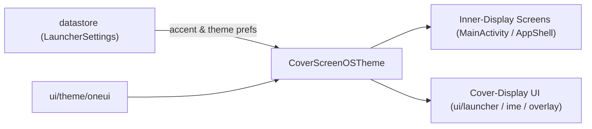

# `ui.theme` Package

Application-wide Material 3 theme, color palette, typography, and cover-screen layout modifiers.

## What This Module Holds

| File / Sub-Package | Key Types | Responsibility |
| --- | --- | --- |
| `Theme.kt` | `CoverOSTheme`, `CoverScreenOSTheme`, `coverAccentScheme` | Root Material 3 theme composable configuring color scheme and typography |
| `Color.kt` | Color constants | Base CoverOS palette definitions |
| `Type.kt` | `CoverOSTextStyles` | Typography scale for inner and cover displays |
| `CoverScreenModifiers.kt` | `coverScreenContentPadding`, `Modifier` extensions | Safe padding and surface modifiers tailored for cover-screen dimensions |
| `oneui/` | `OneUITheme`, `CoverOneUITokens`, One UI components | Samsung One UI 8-inspired design tokens, motion, and components |

## Data Flow Diagram

## Works Hand-in-Hand With

| Module | Relationship | Link |
| --- | --- | --- |
| `ui/theme/oneui` | Provides One UI tokens and motion specs integrated into `CoverScreenOSTheme` | [oneui](oneui/README.md) |
| `datastore` | Supplies accent/theme preferences from `LauncherSettingsStore` | [datastore](../../datastore/README.md) |
| Root, `ime`, `overlay`, `ui/*` | Wraps all inner-display and cover-display Compose hierarchies | [ui/launcher](../launcher/README.md) |
