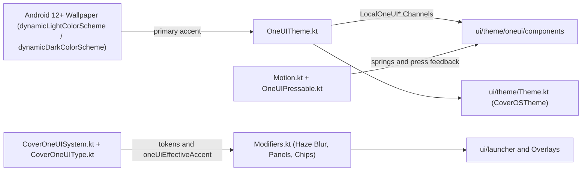

# `ui.theme.oneui` Package

Samsung One UI 8-inspired design language: colors, spacing grid, typography, frosted glass modifiers, spring animations, tactile press feedback, and contrast previews.

## What This Folder Does

If `ui.theme` is the main paint box, `ui.theme.oneui` is the **Samsung One UI 8 interior-design playbook**. Standard Android apps often look flat or overly pastel on a flip phone; this package gives Cover-Screen-OS the unmistakable feel of Galaxy One UI:

- **Two distinct surfaces**: Pure OLED black (`#000000`) or cool gray (`#F2F2F7`) backgrounds paired with crisp rounded cards (`24.dp`–`32.dp` corners) so every card feels contained and intentional.
- **One signal color per overlay page**: Notification, dock, app-grid, and media pages each get a single signature highlight color—unless the user customized their own accent in settings, which always takes priority.
- **Frosted glass depth**: Overlay panels blur whatever wallpaper sits behind them using the Haze library (`HazeState`), with subtle borders separating Tier-1 cards from Tier-2 popups.
- **Soft spring motion**: Everything presses inward slightly (`97%` scale) under your finger and glides back with gentle spring physics instead of stiff linear timers.

## How It Works Step-by-Step

1. **Choose the palette (`OneUITheme.kt`)**: `OneUITheme` checks dark vs. light mode and, on Android 12+ (`Build.VERSION_CODES.S`), optionally extracts the wallpaper's Material You primary color (`dynamicDarkColorScheme` / `dynamicLightColorScheme`) to tint One UI's `accent` while keeping One UI's stark black/gray card surfaces untouched.
2. **Expose tokens cleanly (`OneUITheme.kt` & `CoverOneUISystem.kt`)**: `OneUITheme` broadcasts `OneUIColors`, `OneUIDimensions`, `OneUIShapes`, and `OneUITypography` via `CompositionLocalProvider`, while overlay pages can swap `LocalOverlayAccent` (`OverlayPageAccent`) and read the winning color via `oneUiEffectiveAccent()`.
3. **Style surfaces (`Modifiers.kt` & `CoverOneUIType.kt`)**: Screens attach `Modifier.oneUiPanel(...)` (with optional live `HazeState` blur), `Modifier.oneUiElevatedPanel(...)`, `Modifier.oneUiChip(...)`, and `Modifier.oneUiIconSquircle(...)`, alongside `CoverOneUIType` text styles.
4. **Animate interactions (`Motion.kt` & `OneUIPressable.kt`)**: Interactive cards attach `Modifier.oneUIPressable(...)` for subtle shrink-and-tint feedback, and animated visibility containers use `oneUiSpring()`, `oneUiFadeIn()`, `oneUiFadeOut()`, `oneUiSlideUp()`, and `oneUiSlideDown()`.
5. **Check legibility without a physical phone (`Previews.kt`)**: Developers inspect `OneUiPreviewDarkWallpaper`, `OneUiPreviewBrightWallpaper`, and `OneUiPreviewMidWallpaper` right inside Android Studio to verify frosted panels remain readable over black, white, and photographic wallpapers.

## File-by-File Guide

### `OneUITheme.kt`

- **In plain terms**: The core One UI token warehouse (`colors`, `dimensions`, `shapes`, `typography`) plus the `OneUITheme` composable that turns Android 12+ Material You wallpaper colors into a One UI + Material 3 hybrid theme.
- **Key variables & state**:
  - `OneUILightColors` & `OneUIDarkColors`: Preconfigured `OneUIColors` palettes (`#F2F2F7` / `#FFFFFF` for light; `#000000` / `#17171A` for OLED dark; default Samsung Blue `#0381FE`).
  - `OneUIDimensions`: Immutable `8.dp` / `4.dp` grid measurements including `cardCornerRadius` (`24.dp`), `maxCardWidth` (`680.dp`), `floatingNavHeight` (`60.dp`), `nowPillHeight` (`44.dp`), `sliderHeight` (`24.dp`), and `encircledIconSize` (`40.dp`).
  - `OneUIShapes` & `OneUITypography`: Continuous rounded shapes (`card`, `cardLarge`, `bottomSheet`, `pill`, `encircledIcon`) and sans-serif font scale (`displayLarge` `34.sp` Light down to `bodyMedium` `13.sp`).
  - `LocalOneUIColors`, `LocalOneUIDimensions`, `LocalOneUIShapes`, `LocalOneUITypography`: `staticCompositionLocalOf` channels read cleanly via `OneUITheme.colors` / `.dimensions` / `.shapes` / `.typography` (`@ReadOnlyComposable`).
  - `dynamicAccent`, `baseColors`, `effectiveColors`, `materialColorScheme`: Local state inside `OneUITheme(...)` bridging wallpaper-derived accent colors and One UI surfaces into `MaterialTheme`.
- **How it connects**: Bound by `CoverOSTheme` in `ui/theme/Theme.kt` and directly by `OneUICardGroup`, `OneUIFloatingNavBar`, `OneUINowPill`, `OneUIPillSlider`, and `OneUIScaffold` inside `components/`.

### `CoverOneUISystem.kt`

- **In plain terms**: The overlay-specific rulebook defining exact corner curves, spacing gaps, glass transparency levels, spring constants, and per-page accent colors.
- **Key variables & state**:
  - `CoverOneUITokens`: Holds `radiusHero` (`32.dp`), `radiusPanel` (`24.dp`), `radiusChip` (`14.dp`), spacing (`gutter` `20.dp`, `gapLarge` `16.dp`, `gapMedium` `12.dp`, `gapSmall` `8.dp`), depth alphas (`tier1FillAlpha` `0.22f`, `tier1BorderAlpha` `0.28f`, `tier2FillAlpha` `0.38f`, `tier2BorderAlpha` `0.55f`), and motion timings (`motionSpringDamping` `0.82f`, `motionSpringStiffness` `380f`, `motionEnterMillis` `260`, `motionExitMillis` `200`).
  - `OverlayPageAccent`: Enum assigning one signal color per overlay page (`NOTIFICATIONS`, `LOCK_DOCK`, `APP_GRID`, `MEDIA`).
  - `LocalOverlayAccent`: `compositionLocalOf` channel defaulting to `OverlayPageAccent.APP_GRID`.
- **How it connects**: `oneUiEffectiveAccent()` checks `LocalCoverAccentIsCustomized` and `LocalCoverOverlayAccent` from `ui/theme/Theme.kt`, falling back to `LocalOverlayAccent` when the user hasn't picked a custom accent.

### `CoverOneUIType.kt`

- **In plain terms**: Typography presets specifically sized for cover-screen overlay cards, headings, and status pills—using weight and size contrast instead of bright colors.
- **Key variables & state**:
  - `CoverOneUIType.displayHero`: `48.sp` Light with tight `-1.5.sp` letter spacing for hero clocks and expanded media headers.
  - `CoverOneUIType.sectionTitle`: `22.sp` SemiBold for section headers like "Notifications" or "Media".
  - `CoverOneUIType.tileTitle` (`15.sp` Medium) & `CoverOneUIType.tileSubtitle` (`13.sp` Normal): Primary and secondary notification/app row text.
  - `CoverOneUIType.chipLabel`: `12.sp` SemiBold with wide `0.8.sp` letter spacing for small pills and mode toggles.
- **How it connects**: Consumed by overlay screens and `Previews.kt` alongside `CoverOneUITokens`.

### `Modifiers.kt`

- **In plain terms**: Ready-to-attach Compose `Modifier` helpers that paint frosted glass panels, elevated dialog surfaces, selected accent chips, and rounded-square ("squircle") app icons.
- **Key variables & state**:
  - Inside `oneUiPanel`: `scheme` (active M3 palette), `borderColor` (priority: explicit `signal` -> `LocalCoverOverlayPanelBorder` -> `tier1BorderAlpha` outline), and `fillModifier` (live `hazeEffect` blur with `40%` black `HazeTint` and `0.04f` `noiseFactor` when `hazeState != null`, or `tier1FillAlpha` flat fill fallback).
  - Inside `oneUiElevatedPanel`: `scheme` and `borderColor` using stronger `tier2FillAlpha` (`0.38f`) and `tier2BorderAlpha` (`0.55f`).
  - Inside `oneUiChip`: `accent` (`oneUiEffectiveAccent()`), `fillColor`, and `borderColor` toggling between frosted neutral and highlighted accent state.
- **How it connects**: Reads `LocalCoverPanelCornerRadius` and `LocalCoverOverlayPanelBorder` from `ui/theme/Theme.kt`, `CoverOneUITokens` / `oneUiEffectiveAccent` from `CoverOneUISystem.kt`, and `dev.chrisbanes.haze` for live backdrop blur.

### `Motion.kt`

- **In plain terms**: Shared animation recipes so every popup, card, and drawer enters and exits with One UI's signature smooth feel rather than jerky linear timing.
- **Key variables & state**:
  - `oneUiSpring(visibilityThreshold)`: Returns a `SpringSpec` built from `CoverOneUITokens.motionSpringDamping` (`0.82f`) and `motionSpringStiffness` (`380f`).
  - `oneUiFadeIn()` / `oneUiFadeOut()`: Opacity transitions timed to `260ms` enter and `200ms` exit.
  - `oneUiSlideUp()` / `oneUiSlideDown()`: Vertical 25%-height (`fullHeight / 4`) slide combined with fade for bottom-anchored sheets and choosers.
- **How it connects**: Uses timing constants from `CoverOneUITokens` and is called by overlay transitions across the launcher and UI panels.

### `OneUIPressable.kt`

- **In plain terms**: Gives any clickable pill, icon, or card that satisfying "push-in" squish and gentle light sheen when tapped—just like native Samsung One UI buttons.
- **Key variables & state**:
  - `OneUISpringSpec`: Shared `spring(dampingRatio = 0.82f, stiffness = 400f)` animation curve.
  - `source`: `MutableInteractionSource` shared with `Modifier.clickable` to watch finger press/release events.
  - `isPressed`: Live `Boolean` state updated via `collectIsPressedAsState()`.
  - `scale`: Animated scale multiplier squeezing to `pressedScale` (`0.97f`) in `100ms` on press and springing back on release via GPU `graphicsLayer`, paired with a `drawWithContent` highlight overlay (`overlayColor`).
- **How it connects**: Used directly inside `OneUIFloatingNavBar`, `OneUINowPill`, and `OneUIEncircledActionIcon` in `components/`.

### `Previews.kt`

- **In plain terms**: An Android Studio visual test sheet rendering One UI panels, elevated cards, and all four page-accent chips over dark, bright, and mid-tone wallpapers.
- **Key variables & state**:
  - `PreviewWallpaperDark` (`0xFF000000`), `PreviewWallpaperBright` (`0xFFF5F5F5`), `PreviewWallpaperMid` (`0xFF5B6B8C`): Simulated wallpaper backgrounds checking worst-case contrast.
- **How it connects**: Wraps `OneUiPreviewGallery` inside `CoverOSTheme` and `CompositionLocalProvider(LocalOverlayAccent provides accent)` to exercise `Modifiers.kt`, `CoverOneUISystem.kt`, and `CoverOneUIType.kt`.

## Quick-Reference Summary Table

| File | Key Symbols | Main Responsibility |
| --- | --- | --- |
| `OneUITheme.kt` | `OneUITheme`, `OneUIColors`, `OneUIDimensions`, `OneUIShapes`, `OneUITypography` | Core One UI tokens + Android 12+ dynamic color M3 bridge |
| `CoverOneUISystem.kt` | `CoverOneUITokens`, `OverlayPageAccent`, `LocalOverlayAccent`, `oneUiEffectiveAccent` | Overlay radii, spacing, depth alphas, motion values, and page accents |
| `CoverOneUIType.kt` | `CoverOneUIType` | Overlay typography hierarchy (`displayHero` to `chipLabel`) |
| `Modifiers.kt` | `oneUiPanel`, `oneUiElevatedPanel`, `oneUiChip`, `oneUiIconSquircle` | Frosted Haze glass panels, elevated surfaces, chips, and squircles |
| `Motion.kt` | `oneUiSpring`, `oneUiFadeIn`, `oneUiFadeOut`, `oneUiSlideUp`, `oneUiSlideDown` | Standardized spring and enter/exit transition specs |
| `OneUIPressable.kt` | `OneUISpringSpec`, `oneUIPressable` | Tactile press shrink (`0.97f`) and luminance veil feedback |
| `Previews.kt` | `OneUiPreviewGallery`, `OneUiPreview*Wallpaper` | Contrast sanity previews over black, bright, and mid-tone backdrops |

## Data Flow Diagram

## Works Hand-in-Hand With

| Module | Relationship | Link |
| --- | --- | --- |
| `ui/theme/oneui/components` | Consumes `OneUITheme` tokens and `oneUIPressable` to build reusable One UI widgets | [components](components/README.md) |
| `ui/theme` | Integrates `OneUITheme` tokens and `LocalCover*` overrides inside `CoverOSTheme` | [ui/theme](../README.md) |
| `ui/launcher` | Applies `CoverOneUITokens`, `OverlayPageAccent`, `Modifiers.kt`, and `Motion.kt` on the cover screen | [ui/launcher](../../launcher/README.md) |
| `ui/appshell` | Hosts inner-display screens built on `OneUITheme` and its component library | [ui/appshell](../../appshell/README.md) |
