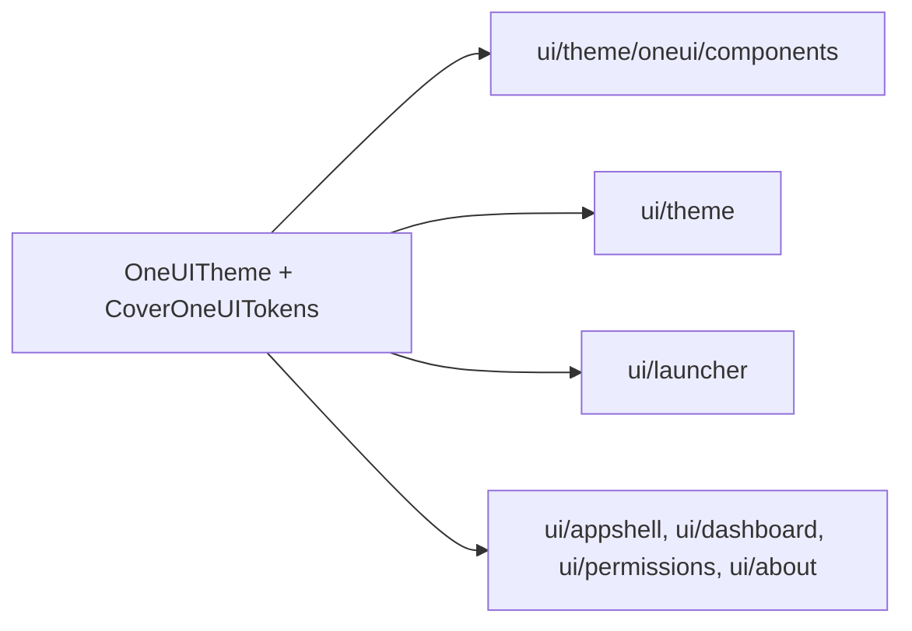

# `ui.theme.oneui` Package

One UI-inspired design system tokens, dimensions, shapes, typography, haze/glass modifiers, pressable feedback, and motion specs.

## What This Module Holds

| File / Sub-Package | Key Types | Responsibility |
| --- | --- | --- |
| `OneUITheme.kt` | `OneUIColors`, `OneUIDimensions`, `OneUIShapes`, `OneUITypography`, `OneUITheme` | `CompositionLocal`-backed One UI theme tokens |
| `CoverOneUISystem.kt` | `CoverOneUITokens`, `OverlayPageAccent`, `oneUiEffectiveAccent` | Cover-specific One UI accent resolution and token presets |
| `CoverOneUIType.kt` | `CoverOneUIType` | One UI typography definitions |
| `Modifiers.kt` | `Modifier` extensions | Glass/surface/border modifiers |
| `Motion.kt` | `oneUiFadeIn`, `oneUiFadeOut`, `oneUiSlideUp`, `oneUiSlideDown` | Standardized One UI enter/exit transitions |
| `OneUIPressable.kt` | `Modifier` pressable extension | Tactile scale/press animation modifier |
| `Previews.kt` | `OneUiPreviewGallery`, wallpaper previews | Compose previews across dark/bright/mid wallpapers |
| `components/` | `OneUIScaffold`, `OneUICardGroup`, `OneUIFloatingNavBar`, `OneUINowPill`, `OneUIPillSlider` | Reusable One UI UI components |

## Data Flow Diagram

## Works Hand-in-Hand With

| Module | Relationship | Link |
| --- | --- | --- |
| `ui/theme/oneui/components` | Consumes `OneUITheme` tokens to render One UI widgets | [components](components/README.md) |
| `ui/theme` | Integrates `OneUITheme` with `CoverScreenOSTheme` | [ui/theme](../README.md) |
| `ui/launcher` | Applies `CoverOneUITokens`, `OverlayPageAccent`, and `Motion` specs on the cover display | [ui/launcher](../../launcher/README.md) |
| `ui/appshell`, `ui/dashboard`, `ui/permissions`, `ui/about` | Uses One UI tokens and transitions for inner-display screens | [ui/appshell](../../appshell/README.md) |
