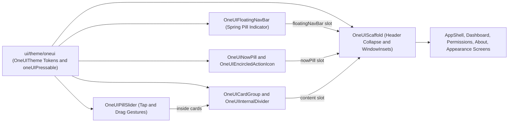

# `ui.theme.oneui.components` Package

Ready-made Samsung One UI 8 Jetpack Compose building blocks—collapsing page scaffolds, grouped cards, floating pill nav bars, status pills, and thick pill sliders.

## What This Folder Does

While `ui.theme.oneui` supplies the raw ingredients (colors, font sizes, shapes, and spring physics), `ui.theme.oneui.components` is the **prefabricated furniture kit** used to assemble actual screens. Instead of every settings screen reinventing a collapsing header, rounded card container, or floating bottom bar from scratch, screens simply snap these five components together.

Every component here automatically reads `OneUITheme` tokens, handles both Light Mode and OLED Dark Mode, respects display cutouts and gesture bars (`WindowInsets`), and adapts gracefully when displayed on a tiny flip-phone cover screen (`<= 480dp` tall).

## How It Works Step-by-Step

1. **Frame the screen (`OneUIScaffold.kt`)**: A screen starts with `OneUIScaffold`, which splits tall phone displays into a large top Viewing Area (`180.dp` expanded header collapsing to `56.dp`) and a bottom Interaction Area—while automatically switching to a compact `52.dp` header on short cover screens so controls remain immediately reachable.
2. **Group settings inside cards (`OneUICardGroup.kt`)**: Inside the scaffold's content area, related rows live inside `OneUICardGroup` containers (`24.dp` rounded corners, optional uppercase external header, and `16.dp`-indented `OneUIInternalDivider` lines) rather than floating loose on the background.
3. **Adjust controls with tactile sliders (`OneUIPillSlider.kt`)**: Numeric settings (like panel corner radius or opacity) use `OneUIPillSlider`, a thick `24.dp` stadium track that responds to both taps and horizontal finger drags.
4. **Show live status and quick actions (`OneUINowPill.kt`)**: Ongoing status ("Cover Screen Active • Flex Mode") sits in a glowing-border `OneUINowPill` anchored above the bottom nav bar, while compact icon buttons use `OneUIEncircledActionIcon`.
5. **Navigate between pages (`OneUIFloatingNavBar.kt`)**: `AppShell` slots `OneUIFloatingNavBar` into `OneUIScaffold`'s `floatingNavBar` slot, giving users a hovering pill bar with a spring-sliding highlight indicator under the active tab.

## File-by-File Guide

### `OneUIScaffold.kt`

- **In plain terms**: The outer page layout skeleton implementing One UI's signature big-title Viewing Area that smoothly shrinks into a compact top bar as you scroll, plus safe slots for a floating `nowPill` and `floatingNavBar`.
- **Key variables & state**:
  - `OneUICollapsingHeaderState`: `@Stable` controller holding `scrollOffset` (`mutableFloatStateOf`), `collapseRangePx`, `collapseFraction` (`0f..1f`), `currentHeightPx`, and `nestedScrollConnection` (consumes pre-scroll vertical drags before the child list scrolls).
  - `rememberOneUICollapsingHeaderState`: Converts `expandedHeight` (`52.dp` compact cover / `180.dp` standard) and `collapsedHeight` (`48.dp` / `56.dp`) to pixels using `LocalDensity`.
  - Inside `OneUIScaffold`: `statusBarPadding`, `cutoutPadding`, `topInset`, `cutoutStart`, `cutoutEnd` (`WindowInsets.statusBars`, `displayCutout`, `safeDrawing`), responsive flags `isWide` (`>= 600.dp`) and `isCompactHeight` (`<= 480.dp`), `showFloatingNowPill` (hidden on short cover displays), and `bottomContentPadding` (ensuring scrolled lists clear floating bottom bars).
- **How it connects**: Wraps top-level app screens, consumes `OneUITheme` dimensions/colors/typography, and hosts `OneUIFloatingNavBar` and `OneUINowPill` in its dedicated bottom slots.

### `OneUICardGroup.kt`

- **In plain terms**: A clean, rounded card wrapper with an optional label perched above its top-left edge and indented separator lines (`OneUIInternalDivider`) between rows inside.
- **Key variables & state**:
  - `OneUICardGroup` parameters: `header` (uppercased external title padded `16.dp` start / `8.dp` bottom), `shape` (`OneUITheme.shapes.card`), `containerColor` (`cardSurface`), `contentColor` (`textPrimary`), `border` (defaults to `1.dp` `hairlineBorder`), and `internalPadding` (`16.dp`).
  - `OneUIInternalDivider` parameters: `indent` (`OneUITheme.dimensions.internalDividerIndent` = `16.dp`) and `color` (`hairlineBorder`) passed to Material 3 `HorizontalDivider`.
- **How it connects**: Used inside `OneUIScaffold` content columns to enforce One UI's "strict card containment" rule across settings, dashboard, permissions, and about screens.

### `OneUIFloatingNavBar.kt`

- **In plain terms**: A hovering, capsule-shaped bottom navigation bar whose tinted highlight bubble glides smoothly on a spring from tab to tab when tapped.
- **Key variables & state**:
  - `OneUINavItem`: Data class holding `route`, `title`, and `icon` for each navigation destination.
  - Responsive sizing: `isCompactHeight` (`screenHeightDp <= 480`) switches `barHeight` (`52.dp` vs `60.dp`), `outerHorizontalPadding` (`12.dp` vs `24.dp`), `iconSize`, and `labelSize`.
  - Sliding indicator state: `selectedIndex`, `itemCount`, `itemWidth` (`maxWidth / itemCount` from `BoxWithConstraints`), `targetOffset`, and `animatedOffset` (`animateFloatAsState` with `spring(0.82f, 400f)` applied inside `Modifier.offset { IntOffset(...) }` so frames move during layout without recomposing).
  - Per-tab interaction: `isSelected` and `interactionSource` wired to `oneUIPressable` + ripple-free `clickable(indication = null)`.
- **How it connects**: Passed into `OneUIScaffold(floatingNavBar = ...)` by `AppShell` and uses `oneUIPressable` from `ui/theme/oneui/OneUIPressable.kt`.

### `OneUINowPill.kt`

- **In plain terms**: Two compact circular/pill status widgets—`OneUINowPill`, a `44.dp`-tall status badge with a subtly shimmering accent rim, and `OneUIEncircledActionIcon`, a `40.dp` round icon button.
- **Key variables & state**:
  - Inside `OneUINowPill`: `accent` (`OneUITheme.colors.accent`), `borderBrush` (a `remember(accent)` 3-stop `Brush.linearGradient` stroke), and `interactionSource` (driving `oneUIPressable` + `clickable` only when `onClick != null`).
  - Inside `OneUIEncircledActionIcon`: `interactionSource` driving press shrink feedback inside a `40.dp` `CircleShape` container (`OneUITheme.dimensions.encircledIconSize`).
- **How it connects**: Passed into `OneUIScaffold(nowPill = ...)` or placed inside card headers/toolbars; relies on `OneUITheme` and `oneUIPressable`.

### `OneUIPillSlider.kt`

- **In plain terms**: A chunky, `24.dp`-tall pill-shaped slider with an optional icon nestled on the left end and a crisp white circular handle that responds to both tapping and dragging.
- **Key variables & state**:
  - `rangeSpan` & `normalizedFraction`: Guarded math converting `value` inside `valueRange` into a safe `0f..1f` percentage.
  - `isDragging` & `animatedThumbScale`: Tracks active drag gestures (`1.15f` vs `1f` spring state).
  - `totalWidth`, `activeWidth`, `thumbOffset`: Measured inside `BoxWithConstraints` to size the accent track and position the `24.dp` handle (`(totalWidth - 20.dp) * normalizedFraction`), driven by two `pointerInput(enabled, valueRange)` blocks (`detectTapGestures` and `detectDragGestures` with `change.consume()`).
- **How it connects**: Placed inside `OneUICardGroup` rows on customization screens and styled via `OneUITheme.dimensions.sliderHeight`, `cardSurfaceVariant`, and `accent`.

## Quick-Reference Summary Table

| File | Key Composables / Classes | Primary Role |
| --- | --- | --- |
| `OneUIScaffold.kt` | `OneUIScaffold`, `OneUICollapsingHeaderState`, `rememberOneUICollapsingHeaderState` | Collapsing Viewing/Interaction page layout with safe insets and floating bottom slots |
| `OneUICardGroup.kt` | `OneUICardGroup`, `OneUIInternalDivider` | Elevated rounded card container with external label and indented dividers |
| `OneUIFloatingNavBar.kt` | `OneUIFloatingNavBar`, `OneUINavItem` | Floating pill nav bar with spring-animated active tab indicator |
| `OneUINowPill.kt` | `OneUINowPill`, `OneUIEncircledActionIcon` | Gradient-rimmed status pill and 40dp circular action button |
| `OneUIPillSlider.kt` | `OneUIPillSlider` | Thick 24dp stadium slider supporting tap and horizontal drag gestures |

## Data Flow Diagram

## Works Hand-in-Hand With

| Module | Relationship | Link |
| --- | --- | --- |
| `ui/theme/oneui` | Supplies colors, dimensions, shapes, typography, and `oneUIPressable` feedback | [oneui](../README.md) |
| `ui/theme` | Provides the root `CoverOSTheme` provider wrapping inner and cover screens | [ui/theme](../../README.md) |
| `ui/appshell` | Composes `OneUIScaffold`, `OneUIFloatingNavBar`, and `OneUINowPill` for inner navigation | [ui/appshell](../../../appshell/README.md) |
