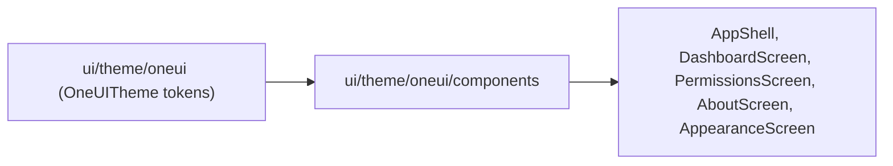

# `ui.theme.oneui.components` Package

Reusable Samsung One UI-styled Jetpack Compose UI components used across the inner-display setup and customization screens.

## What This Module Holds

| File | Key Types | Responsibility |
| --- | --- | --- |
| `OneUIScaffold.kt` | `OneUIScaffold`, `OneUICollapsingHeaderState`, `rememberOneUICollapsingHeaderState` | Collapsing-header scaffold for One UI screens |
| `OneUICardGroup.kt` | `OneUICardGroup`, `OneUIInternalDivider` | Grouped rounded card container with internal dividers |
| `OneUIFloatingNavBar.kt` | `OneUIFloatingNavBar`, `OneUINavItem` | Floating pill navigation bar used in `AppShell` |
| `OneUINowPill.kt` | `OneUINowPill`, `OneUIEncircledActionIcon` | Status pill and encircled action icon |
| `OneUIPillSlider.kt` | `OneUIPillSlider` | Pill-shaped slider control for customization settings |

## Data Flow Diagram

## Works Hand-in-Hand With

| Module | Relationship | Link |
| --- | --- | --- |
| `ui/theme/oneui` | Supplies colors, dimensions, shapes, and typography tokens | [oneui](../README.md) |
| `ui/appshell`, `ui/dashboard`, `ui/permissions`, `ui/about`, `ui/customize/appearance` | Composes these components to build all inner-display screens | [ui/appshell](../../../appshell/README.md) |
