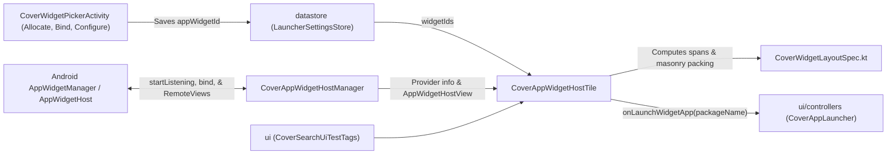

# `ui.widgets` Package

The `ui.widgets` package lets you pin **real Android home-screen widgets** (weather, calendar, clocks, controls) right onto your flip phone's outer cover screen. Think of it like a custom modular pegboard on your cover launcher: one manager handles talking to Android's widget system, a compact picker lets you choose and authorize widgets, a layout calculator folds oversized phone widgets neatly into a 2-column grid, and a Compose host tile renders them inside glass cards that open their owning app when tapped.

---

## 1. What This Folder Does

Because Cover Screen OS runs as an overlay launcher rather than replacing the stock main-screen Home app, it needs its own widget plumbing tailored to small cover displays:

1. **Battery-Safe Widget Hosting**: `CoverAppWidgetHostManager` wraps Android's `AppWidgetHost` and `AppWidgetManager`, starting updates (`startListening`) *only* while the cover overlay is actually visible and pausing them immediately when hidden.
2. **Permission, Binding & Setup Flow**: `CoverWidgetPickerActivity` provides a searchable One UI-styled picker that reserves a widget slot ID, requests Android's per-widget bind permission if needed, runs any optional provider configuration screen, and persists the bound ID.
3. **Cover-Screen Masonry Sizing**: `CoverWidgetLayoutSpec.kt` converts rigid Android `AppWidgetProviderInfo` dimensions into a balanced 2-column masonry layout scaled cleanly for small outer screens.
4. **Live Glassmorphic Rendering & Tap-to-Launch**: `CoverAppWidgetHostTile` mounts each `AppWidgetHostView` inside a rounded Haze glass card, reports exact dp bounds back to the widget provider, and intercepts taps via `onLaunchWidgetApp` so Cover Screen OS hides the overlay and opens the widget's app on the cover display.

---

## 2. How It Works Step-by-Step

1. **Picking & Binding a Widget (`CoverWidgetPickerActivity`)**:
   - Opens a searchable list of installed widgets loaded off the main thread (`produceState` on `Dispatchers.Default`).
   - When you tap a widget, `onProviderSelected()` allocates an ID (`allocateAppWidgetId()`).
   - If silent binding isn't allowed by Android, `bindWidgetLauncher` launches `ACTION_APPWIDGET_BIND` so you can grant permission.
   - If the widget declares a configuration screen (`info.configure != null`), `startConfigureActivityForResult()` launches it and awaits `onActivityResult`.
   - On completion, `finalizeAddedWidget()` saves the ID in `LauncherSettingsStore`; canceling anywhere deletes the ID via `cleanupPendingWidget()` so slots never leak.
2. **Computing the 2-Column Layout (`CoverWidgetLayoutSpec.kt`)**:
   - Each pinned widget ID looks up `AppWidgetProviderInfo` and converts pixel dimensions to dp (`toWidgetGridMetadata`).
   - `computeWidgetPlacementSpec()` decides whether the widget spans 1 or 2 columns (`resolveColumnSpan`, keeping compact `<=2`-col widgets and tall `3x4+` portrait widgets in 1 column), computes a clamped aspect-ratio slot height (`82dp` to `maxSlotHeightDp`), and fits the inner viewport (`fitWidgetViewport`) around `resizeMode` limits—snapping cleanly to the edges when a resizable widget already fills `>= 85%`.
   - `packTwoColumnGrid()` drops 1-column widgets into whichever column is shorter and starts 2-column widgets below both columns.
3. **Rendering & Interacting (`CoverAppWidgetHostTile`)**:
   - While the overlay is visible, `CoverAppWidgetHostManager.startListening()` keeps widget content alive.
   - `CoverWidgetTwoColumnGrid` (a custom Compose `Layout`) measures each tile with exact `Constraints.fixed` pixel bounds.
   - Each tile wraps its native `AppWidgetHostView` in an `AndroidView` + `FrameLayout` with `RoundedWidgetOutlineProvider` (`18.dp` rounded corners) and informs the widget provider of its exact dp size via `AppWidgetHostView.updateAppWidgetSize()`.
   - Tapping anywhere on the card fires `onLaunchWidgetApp(widgetPackageName)` so Cover Screen OS dismisses the overlay and launches that widget's owning app on the cover display, while the top-right delete button removes the widget (`onRemoveWidget`).

---

## 3. File-by-File Guide

### `CoverAppWidgetHostManager.kt`

- **In plain terms**: The battery-conscious gatekeeper between Cover Screen OS and Android's system widget service (`AppWidgetHost` / `AppWidgetManager`).
- **Key variables & state**:
  - `hostId` (`COVER_WIDGET_HOST_ID = 1042`): Stable host ID separating Cover Screen OS widgets from the phone's main launcher.
  - `appWidgetHost` (`AppWidgetHost`): Android host object that allocates IDs, creates `AppWidgetHostView`s, and receives `RemoteViews` updates.
  - `appWidgetManager` (`AppWidgetManager?`): System service queried for installed providers, metadata, and bind permissions.
  - `isListening` (`@Volatile Boolean`): Guard ensuring `startListening()` / `stopListening()` toggle cleanly strictly with overlay visibility to avoid background battery drain.
- **How it connects**: Used by `CoverAppWidgetHostTile` to inflate/inspect pinned widgets, by `CoverWidgetPickerActivity` to allocate/bind/configure new widgets, and by the overlay host lifecycle to start/stop listening.

### `CoverAppWidgetHostTile.kt`

- **In plain terms**: The cover-screen Widgets page. Shows a friendly "Add Widget" onboarding prompt when empty, or a scrollable 2-column glassmorphic grid of live widgets with delete buttons and tap-to-open-app behavior.
- **Key variables & state**:
  - `WIDGET_CORNER_RADIUS` (`18.dp`): Consistent tile corner radius shared between Compose clipping and `RoundedWidgetOutlineProvider`.
  - `availableWidthDp` & `maxSlotHeightDp`: Dynamic grid bounds computed from `LocalConfiguration` (`screenWidthDp - 24` and `68%` of screen height clamped between `160.dp` and `252.dp`).
  - `specs` (`List<WidgetPlacementSpec>`): Memoized placement geometry for every pinned widget ID.
  - `widgetPackageName` (`String?`): Owning package resolved from `AppWidgetProviderInfo.provider.packageName` and passed to `onLaunchWidgetApp` when a widget card is tapped.
  - `widgetView` (`View?`): Cached `AppWidgetHostView` inflated per widget ID, resized via `updateAppWidgetSize` only when its `SizeF` (`widgetView.tag`) changes.
  - `onLaunchWidgetApp` (`(String) -> Unit`): Callback triggered on widget card click so Cover Screen OS hides the overlay and opens the widget's app on the cover screen.
- **How it connects**: Calls `CoverWidgetLayoutSpec.kt` math (`toWidgetGridMetadata`, `computeWidgetPlacementSpec`, `packTwoColumnGrid`), queries `CoverAppWidgetHostManager`, applies Haze glass (`hazeEffect`), tags the page with `CoverSearchUiTestTags`, and routes app launches back to the cover launcher (`CoverAppLauncher`).

### `CoverWidgetLayoutSpec.kt`

- **In plain terms**: The pure-Kotlin geometry calculator and Tetris-like 2-column packer that makes widgets originally built for giant phone screens fit cleanly on a small clamshell cover display.
- **Key variables & state**:
  - `WIDGET_MIN_HEIGHT_DP` (`82`), `WIDGET_DEFAULT_MAX_HEIGHT_DP` (`252`), `WIDGET_GRID_GAP_DP` (`10`): Baseline dp limits and grid gutter spacing.
  - `SNAP_TO_FILL_THRESHOLD` (`0.85f`): Resizable widgets filling at least 85% of both slot width and height snap flush to the tile edges.
  - `WidgetGridMetadata` & `WidgetPlacementSpec`: Density-normalized provider limits (`targetCell*`, `minWidthDp`, `maxResize*`, `resizeMode`) and computed slot/widget dp sizes.
  - `colHeights` (`IntArray(2)`) & `placements`: Running left/right column Y cursors and output pixel rectangles in `packTwoColumnGrid`.
- **How it connects**: Consumed by `CoverAppWidgetHostTile` (`specs` and `CoverWidgetTwoColumnGrid`) and unit-tested directly without needing Android Views.

### `CoverWidgetPickerActivity.kt`

- **In plain terms**: A compact, searchable "Add Widget" screen styled in Cover Screen OS's One UI theme that walks Android through allocating, authorizing, configuring, and saving a new widget.
- **Key variables & state**:
  - `widgetHostManager` & `settingsStore`: Lazy `CoverAppWidgetHostManager` and `LauncherSettingsStore` handles.
  - `pendingAppWidgetId`, `pendingProviderInfo`, `isAwaitingExternalFlow`: Tracks an in-progress bind/configure flow across Android's external dialogs (kept alive across configuration changes via `!isChangingConfigurations` in `onDestroy`).
  - `bindWidgetLauncher`: `ActivityResultContracts.StartActivityForResult` launcher receiving the OS `ACTION_APPWIDGET_BIND` consent dialog result.
  - `REQUEST_CONFIGURE_WIDGET` (`4102`): Request code used with legacy `onActivityResult` for `AppWidgetHost.startAppWidgetConfigureActivityForResult`.
  - `searchQuery`, `providers`, `filteredProviders`, `iconBitmap`: Picker UI state and async `produceState` loaders decoding provider labels and 72×72 icons on `Dispatchers.Default`.
- **How it connects**: Launched when the user taps "Add Widget" from `CoverAppWidgetHostTile`, uses `CoverAppWidgetHostManager`, persists widget IDs into `datastore` (`LauncherSettingsStore`), and themes itself with `ui/theme` (`CoverOSTheme`).

---

## 4. Quick-Reference Summary

| File | Key Types | Role |
| --- | --- | --- |
| [CoverAppWidgetHostManager.kt](./CoverAppWidgetHostManager.kt) | `CoverAppWidgetHostManager` | Manages `AppWidgetHost` listening lifecycle, ID allocation/deletion, binding, and `AppWidgetHostView` creation |
| [CoverAppWidgetHostTile.kt](./CoverAppWidgetHostTile.kt) | `CoverAppWidgetHostTile`, `CoverWidgetTwoColumnGrid`, `RoundedWidgetOutlineProvider` | Renders pinned widgets in a 2-column Haze grid, sizes `AppWidgetHostView`, and handles tap-to-launch & removal |
| [CoverWidgetLayoutSpec.kt](./CoverWidgetLayoutSpec.kt) | `WidgetGridMetadata`, `WidgetPlacementSpec`, `PackedTwoColumnGrid` | Computes column spans, resize-aware viewports, and 2-column masonry pixel placements |
| [CoverWidgetPickerActivity.kt](./CoverWidgetPickerActivity.kt) | `CoverWidgetPickerActivity`, `CoverWidgetPickerScreen`, `WidgetProviderRow` | Searchable widget picker executing allocate -> bind permission -> configure -> persist flow |

---

## 5. Architecture Flow

---

## 6. Works Hand-in-Hand With

| Module | Relationship | Link |
| --- | --- | --- |
| `ui` | Supplies `CoverSearchUiTestTags` for the widget host page | [ui](../README.md) |
| `ui/launcher` | Embeds `CoverAppWidgetHostTile` inside the cover launcher pager and connects `onLaunchWidgetApp` | [ui/launcher](../launcher/README.md) |
| `ui/controllers` | Launches a tapped widget's owning app (`CoverAppLauncher`) on the cover display | [ui/controllers](../controllers/README.md) |
| `datastore` | Persists and streams user-pinned widget IDs (`LauncherSettingsStore`) | [datastore](../../datastore/README.md) |
| `ui/theme` | Provides `CoverOSTheme` and `LocalCoverPanelCornerRadius` to `CoverWidgetPickerActivity` | [ui/theme](../theme/README.md) |
