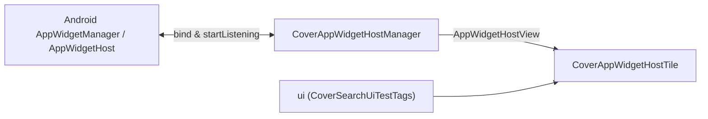

# `ui.widgets` Package

Android `AppWidgetHost` integration for hosting and rendering home-screen app widgets on the cover display.

## What This Module Holds

| File | Key Types | Responsibility |
| --- | --- | --- |
| `CoverAppWidgetHostManager.kt` | `CoverAppWidgetHostManager` | Manages `AppWidgetHost` lifecycle, widget binding, and allocated widget IDs |
| `CoverAppWidgetHostTile.kt` | `CoverAppWidgetHostTile` | Compose wrapper rendering `AppWidgetHostView` inside a cover launcher tile |

## Data Flow Diagram

## Works Hand-in-Hand With

| Module | Relationship | Link |
| --- | --- | --- |
| `ui` | Uses `CoverSearchUiTestTags` for widget page test tags | [ui](../README.md) |
| `ui/launcher` | Provides the widget host page container (`WidgetGridPageTile`) | [ui/launcher](../launcher/README.md) |
