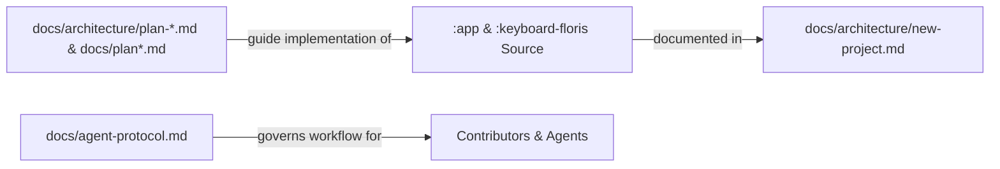

# `docs/`

Project documentation, architecture references, contributor protocols, and historical design/migration plans.

## What This Module Holds

| Path | Responsibility |
| --- | --- |
| `architecture/new-project.md` | Current system blueprint, runtime ownership, lifecycle, and source map |
| `architecture/module-organization-plan.md` | Target package/module organization proposal |
| `architecture/*.md` | Design plans for keyboard, homescreen redesign, and One UI 8 overlay restyle |
| `agent-protocol.md`, `repo-protocol-setup-*.md` | Repository automation and PR/issue conventions |
| `florisboard-migration-*.md`, `plan*.md` | Migration plans and milestones (historical and active references) |
| `app-icon.md`, `wallpaper-media.md`, `swipe-dismiss-sandbox-conflict-*.md` | Feature-specific technical notes and issue analyses |

## Data Flow Diagram

## Works Hand-in-Hand With

| Module | Relationship | Link |
| --- | --- | --- |
| Root `README.md` | Links to `docs/architecture/new-project.md`, `docs/agent-protocol.md`, and migration docs | [Root README](../README.md) |
| `:app` & `:keyboard-floris` | Architecture and feature plans map directly to runtime packages in both Gradle modules | [app](../app/README.md) |
