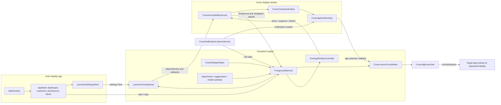
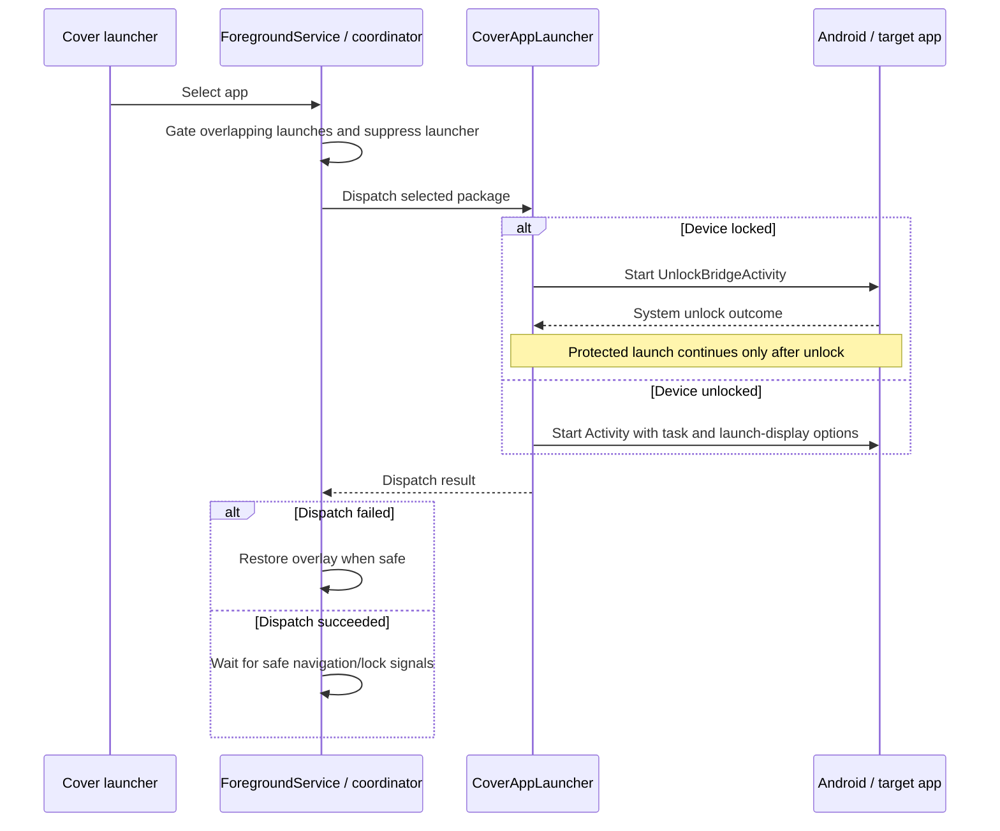

# New Project: System Architecture and Setup

This is the current technical reference for Cover Screen OS. Start with the
[README](../../README.md) for installation, feature access, and day-to-day use.
This guide records the implemented design, not the proposed end state of older
plans.

## Purpose and boundaries

Cover Screen OS exposes a launcher on a foldable phone's secondary display
without becoming its default Home app. The inner-display Activity provides
setup, runtime status, and customization. The cover UI lives in an
accessibility-owned window, outside the Activity's view tree.

The build has one Android application module, `:app`, with Android 14 (API 34)
as its minimum SDK and API 37 as its compile/target SDK. Kotlin, Compose,
coroutines/Flow, DataStore, and Haze provide the app's main building blocks.

## Runtime blueprint



The arrows describe data and command flow, not separate processes. These
components currently run in the app's process. Android binds the accessibility,
notification-listener, and IME services under their own service contracts.

## Ownership and source map

Paths below are relative to `app/src/main/java/com/tyejaedon/coverscreenos/`.

| Component | Responsibility | Source |
| --- | --- | --- |
| Inner-display app | Setup, dashboard, nested customization routes, and deep links | `MainActivity.kt`, `ui/appshell/AppShell.kt`, `ui/appshell/HomeRoutes.kt` |
| Runtime engine | Foreground notification, display/lock monitoring, suppression, recovery, and launch coordination | `services/overlay/ForegroundService.kt` |
| Display discovery | Prefer usable presentation displays, then other usable non-default displays | `helpers/CoverDisplayHelper.kt` |
| Launcher handoff | Settings/lock flows, repository, and callbacks passed to the window owner | `services/overlay/LauncherOverlayHost.kt` |
| Window command bridge | Delegate show, suppress, and remove requests; does not own a view | `services/overlay/OverlayWindowController.kt` |
| Launcher window owner | Accessibility events, navigation signals, display attachment, and detach on unbind | `services/overlay/CoverAccessibilityService.kt` |
| Shared Compose surface | Display-scoped window context, ComposeView, lifecycle, saved state, view models, and WindowManager flags | `overlay/surface/CoverComposeSurface.kt` |
| Cover UI | Pager, dock, media/notification panels, search, and Quick Settings | `ui/launcher/` |
| App discovery | Query launcher activities, deduplicate/sort apps, and cache scans | `repository/PackageManagerAppScannerRepository.kt` |
| App routing | Resolve launch activity, set task/display options, dispatch through accessibility where available | `ui/controllers/CoverAppLauncher.kt` |
| Unlock bridge | Request system keyguard dismissal before protected app launches | `ui/controllers/UnlockBridgeActivity.kt` |
| Notifications/media | Publish notification models, resolve media art/actions, and signal call state | `services/notifications/CoverNotificationListenerService.kt`, `models/CoverNotificationModel.kt` |
| Input fallback | Accessibility field tracking and cover input overlay | `overlay/input/CoverScreenInputInjectionEngine.kt` (also defines `CoverInputAccessibilityService`) |
| System IME | Keyboard bound to the target editor's InputConnection | `ime/CoverT9InputMethodService.kt` |
| Persistence | Launcher preferences and input telemetry | `datastore/LauncherSettingsStore.kt`, `datastore/InputTelemetryStore.kt` |
| Startup | Request runtime start after boot or package replacement, subject to readiness | `receivers/BootCompletedReceiver.kt`, `helpers/ForegroundServiceHelper.kt` |

Some files define classes whose Kotlin package differs from their directory
layout. Use the class declaration and manifest component name when tracing
Android entry points; do not assume a path from the class name alone.

## Display discovery and window attachment

`CoverDisplayHelper.getCoverDisplay()` queries
`DisplayManager.DISPLAY_CATEGORY_PRESENTATION` first, then all displays. A
candidate must be valid, non-default, and in `ON`, `VR`, `ON_SUSPEND`, or `DOZE`.
It returns `null` if no candidate is usable; it does not choose the default
display as an overlay fallback. A secondary display is not necessarily a
foldable cover panel, so device testing is still required.

`ForegroundService` listens to display topology changes and screen/lock
signals. Lock broadcasts are supplemented by a low-frequency keyguard check.
The current implementation does not subscribe to a hinge sensor or Jetpack
WindowManager folding features.

The runtime delegates window requests through `OverlayWindowController` to
`CoverAccessibilityService`. That service owns the launcher surface and its
accessibility window token. `CoverComposeSurface.attach()`:

1. Creates a context for the selected display and a window context for `TYPE_ACCESSIBILITY_OVERLAY`.
2. Gets that context's WindowManager and creates a ComposeView.
3. Installs LifecycleOwner, SavedStateRegistryOwner, and ViewModelStoreOwner.
4. Adds the view with the configured bounds, flags, gravity, and cutout mode.
5. Starts the view lifecycle only after attachment succeeds.

Failed context creation or window attachment is logged and reported as `false`;
it does not silently attach on another display. Detach disposes the composition,
removes the view, destroys its lifecycle, and clears the retained window state.

Suppression differs from detach: the shared surface sets `FLAG_NOT_TOUCHABLE`
and zero alpha so the running app can receive touches without rebuilding the
launcher. A repeated show on the same valid display can re-enable the existing
surface. Changing display or forcing reattachment creates a fresh surface.

## Foreground service lifecycle

The foreground service is the persistent engine. The launcher window belongs to
the accessibility service, but its runtime dependencies and policy come from
the foreground service.

| Stage | Current behavior |
| --- | --- |
| `onCreate()` | Create the notification channel, app repository, settings store, display helper, window controller, and launch coordinator. Install a LauncherOverlayHost on the accessibility service. |
| Start command | Establish a `specialUse` foreground session, verify core readiness, start lock/display monitoring, replay known call state, and schedule display attachment. |
| Display or foreground changes | Reevaluate attachment and suppression policy. Keep the overlay hidden during app use, calls, screen-off, or the unlock prompt as appropriate. |
| Stop command | Tear down listeners/window state, stop the foreground session, and stop the service. |
| `onDestroy()` | Release the launcher handoff, cancel service coroutines, tear down runtime state, and stop the foreground session. |

### Why `START_STICKY` matters

The normal `ACTION_START` path and a restarted service's `null`-intent path return
`START_STICKY` after successful setup. This tells Android that, after killing the
started service, it should try to recreate it later without retaining the
original Intent. Handling a null Intent as a start request is therefore part of
the recovery design: dependencies are rebuilt in `onCreate()`, and monitoring
is re-established in `onStartCommand()`.

Keep that return value when changing the normal start path. Replacing it with
`START_NOT_STICKY` would remove this restart request after that start command.
Do not claim that it makes the process unkillable or guarantees an immediate
restart. Force-stop, revoked access, Android background-start rules, and OEM
restrictions can still prevent recovery.

There are intentional non-sticky paths: explicit stop, failed foreground setup,
missing runtime prerequisites, and the current `ACTION_HIDE_OVERLAY` control
command return `START_NOT_STICKY`. Restart behavior depends on the last start
command result; not every command requests sticky recovery.

## App launches and focus



`CoverLaunchCoordinator` gates concurrent dispatches on the main thread.
`CoverAppLauncher` checks the resolved Activity, uses a connected accessibility
service for background launch dispatch where available, and requests a display
through `ActivityOptions.launchDisplayId`. Its resolver uses an explicit display
ID first, then the caller's display, then the default display. An accepted
dispatch does not prove the OEM actually put the app on the intended cover
panel; validate focus, bounds, and task placement on hardware.

Unlock and call screens must remain usable. Foreground package events and
notification call signals feed suppression/reclaim policy. The launcher is not
restored just because a running app has been idle for a fixed period.

## Settings, notifications, and input

`LauncherSettingsStore` persists dock selection, wallpaper, appearance, and
input choices with DataStore. The host exposes the settings Flow to the launcher;
the inner-display app edits the same store. Runtime status and notification
lists use observable state rather than a second settings copy.

The notification listener publishes `CoverNotificationModel` values. Media
models include title, artist, available action labels, and artwork. Media actions
invoke the source notification's actions; this is not a separate music playback
engine. Notification access must remain enabled.

There are three distinct input surfaces:

| Surface | Scope | Access |
| --- | --- | --- |
| Launcher search keypad / system-IME strategy | Search within the cover launcher | Launcher runtime; selected system IME where used |
| Input accessibility fallback | Focused editable fields in other apps | Separate input accessibility service |
| CoverScreenOS system keyboard | Editors connected through Android's IME contract | Enable/select the keyboard in Android settings |

The IME writes through InputConnection. The accessibility fallback uses the
focused field's supported connection/actions; it is not required to run the
launcher or use a normal system keyboard. Contact suggestions require both
explicit opt-in and `READ_CONTACTS`.

## Development setup

Use JDK 21 with Android Studio and an Android SDK platform matching API 37.
The [version catalog](../../gradle/libs.versions.toml) pins the toolchain and
libraries; [app configuration](../../app/build.gradle.kts) sets SDK levels.
The checked-in wrapper selects Gradle, so a global Gradle install is unnecessary.

Set `ANDROID_HOME` to the SDK directory or add `sdk.dir` to an untracked
`local.properties`. Do not commit machine-specific SDK paths.

```sh
bash gradlew :app:assembleDebug
bash gradlew :app:testDebugUnitTest
```

To compile instrumented tests without a device:

```sh
bash gradlew :app:compileDebugAndroidTestKotlin
```

To run them on a connected device or emulator:

```sh
bash gradlew :app:connectedDebugAndroidTest
```

Install `app/build/outputs/apk/debug/app-debug.apk`, complete the
[permission checklist](../../README.md#required-setup-and-permissions), and start
the runtime from the inner-display app. Do not add `SYSTEM_ALERT_WINDOW` as a
setup workaround: it is absent from the current architecture. The app scanner
uses launcher-intent package visibility queries, not `QUERY_ALL_PACKAGES`.

## Device validation and troubleshooting

An ordinary emulator can cover UI and many service tests, but cannot prove a
Samsung cover-display integration. Verify fold/unfold, display power changes,
locked and unlocked launches, app focus transfer, active calls, media changes,
keyboard input, and permission revocation on a supported phone.

| Symptom | Check |
| --- | --- |
| Runtime will not start | All four core readiness steps, including the launcher accessibility service rather than only the input service |
| No cover launcher | Display discovery, launcher host connection, and attachment logs; the cover panel may not be exposed as usable |
| Overlay blocks a running app | Launch suppression, foreground signals, and reclaim policy logs |
| Keyboard unavailable | Distinguish IME selection from launcher search strategy and input accessibility access |
| Runtime does not return after a kill | Last command's restart mode, Android/OEM restrictions, force-stop state, and permissions |

Useful Logcat tags include `CoverForegroundService`, `CoverOverlayTransition`,
`CoverOverlayReclaim`, `CoverA11yLauncher`, `CoverComposeSurface`,
`CoverAppLauncher`, and `CoverNotifListener`.

## Planned work versus implemented design

Third-party widget hosting remains planned in #7, #8, and #9. There is no current
AppWidgetHost subsystem. The
[module organization plan](module-organization-plan.md) describes a possible
future split, not multiple Gradle modules that already exist.

The [overlay migration plan](Overlay-architecture-shift-plan.md),
[One UI restyle plan](plan-overlayOneUI8Restyle.md), and
[keyboard plan](plan-keyboardRedesignV2.md) retain historical design context.
When their rollout stages conflict with this guide, check the current source
and manifest, then update this guide as part of the relevant change.
