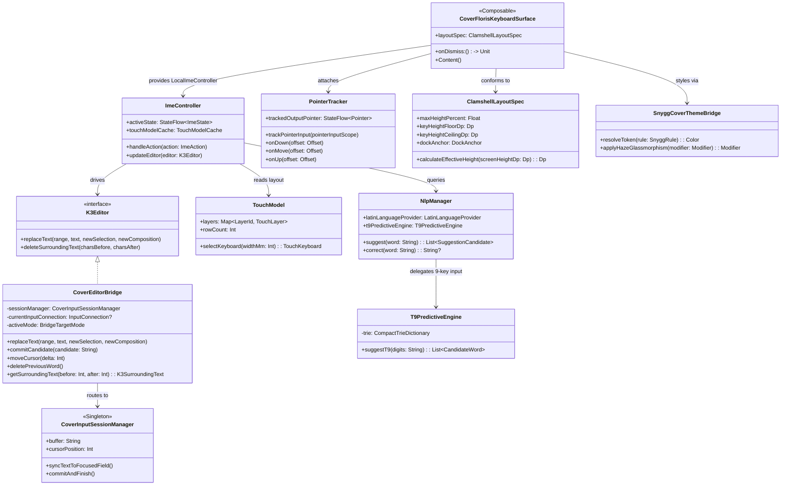
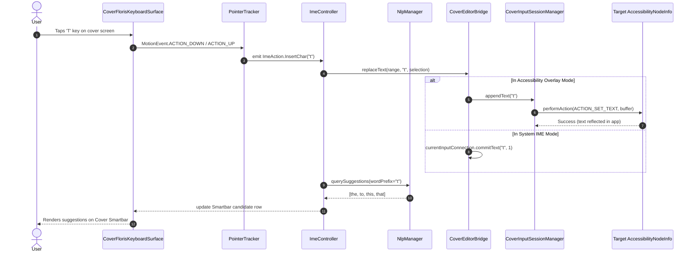
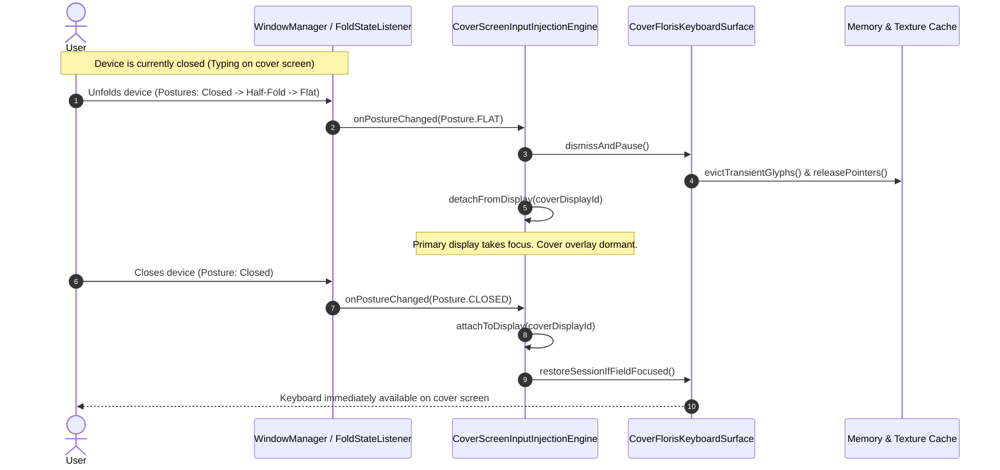
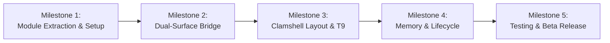

# FlorisBoard Migration & Innovation Plan for Cover-Screen-OS

## Goal Description
Cover-Screen-OS currently relies on a custom, rudimentary Jetpack Compose keyboard implementation (`CoverCompactQwertyKeyboard.kt`, `WordDictionary.kt`, and basic T9 predictive logic). While functional as a proof of concept, building and maintaining a production-grade keyboard from scratch requires vast effort across multi-language layout definitions, pointer tracking, swipe/glide gesture decoders, accurate multi-touch state machines, and autocorrect pipelines.

This plan details the full migration from Cover-Screen-OS's current keyboard to an adapted and innovated integration of **[FlorisBoard](https://github.com/florisboard/florisboard)** (Apache 2.0). 

Rather than adopting FlorisBoard as a generic system keyboard, we will innovate on top of FlorisBoard's modern `keyboard3` engine to specifically address the unique hardware constraints and dual-runtime architecture of clamshell foldable cover screens (such as the Samsung Galaxy Z Flip series, Motorola Razr, and Pixel Fold outer displays).

---

## User Review Required

> [!IMPORTANT]
> **Submodule vs. Monolithic Package**:
> We recommend encapsulating the FlorisBoard engine into a dedicated Gradle library module `:keyboard-floris` (included in `settings.gradle.kts`). This isolates third-party dependencies (`k3lp-core`, `cache4k`, etc.), speeds up incremental builds, and allows standalone Robolectric unit tests without recompiling the main app.
> 
> *Alternative*: Merge the extracted FlorisBoard engine directly into `:app` under `com.tyejaedon.coverscreenos.keyboard.floris`.

> [!WARNING]
> **Theme Engine Strategy (Snygg vs. Haze/Material3)**:
> FlorisBoard uses "Snygg", a custom CSS-like styling engine. On Cover-Screen-OS, all launcher UI utilizes Chris Banes' `Haze` glassmorphism and Material3 tokens.
> *Recommendation*: We will bridge Snygg properties to CoverOS's `MaterialTheme` and `HazeState` so keys automatically render with the frosted glass / wallpaper-adaptive theme of the cover screen.

> [!NOTE]
> **Default Language Bundles for Beta**:
> FlorisBoard supports dozens of locales via language pack extensions. To keep the initial beta download lean and avoid APK bloat, the beta release will bundle standard Latin/English, Spanish, and German layouts with offline dictionaries, while keeping the extension loader ready for community language packs.

---

## Open Questions

1. **Submodule Architecture**: Do you prefer `:keyboard-floris` as a separate Gradle subproject or integrated in `:app`? *(Recommended: `:keyboard-floris` for clean separation and test speed)*.
2. **Keyboard Strategy Preference**: Should the existing settings toggle in `LauncherSettingsStore` (`KeyboardStrategy: T9 vs SYSTEM_IME`) be expanded to `CoverKeyboardEngine: FLORIS_QWERTY, FLORIS_T9, SYSTEM_IME`?
3. **Emoji & Media Panel**: In the initial beta release, should the media/emoji picker be included in the smartbar or deferred to post-beta to save ~15MB of RAM? *(Recommended: Defer media picker in v0.1.0-beta.3 to maximize memory efficiency on cover screens)*.

---

## Architecture Overview

### The Clamshell Dual-Execution Reality
On foldable clamshell smartphones, third-party apps run on the secondary hardware display (`coverDisplayId`). Android's system IME framework frequently fails to project properly onto secondary displays or suffers from OEM overlay restrictions (Samsung OneUI).

Cover-Screen-OS solves this with a **Dual-Surface Architecture**:
1. **Accessibility Overlay Mode (`CoverScreenInputInjectionEngine`)**: Mounts a `TYPE_ACCESSIBILITY_OVERLAY` window onto the secondary display. Interacts with the focused input field via `AccessibilityNodeInfo` (`ACTION_SET_TEXT`, selection, paste) or `flagInputMethodEditor` (`InputConnection`).
2. **System InputMethodService Mode (`FlorisImeService`)**: Operates as a genuine Android system IME when selected as default in Android Settings.
3. **In-App Search Mode (`OverlaySearchWidgets`)**: Embedded directly inside the CoverOS launcher drawer.

FlorisBoard's `ImeController` normally expects an active Android `InputConnection`. We bridge this via `CoverEditorBridge`, an implementation of `K3Editor` that dynamically multiplexes between an `InputConnection`, an `AccessibilityNodeInfo` session buffer, or an in-memory search query.

```
+-----------------------------------------------------------------------------------+
|                                Cover-Screen-OS                                    |
|                                                                                   |
|  [Accessibility Overlay]       [System IME Service]        [Launcher Search Bar]  |
|  (Secondary Display Window)    (LifecycleInputMethod)      (OverlaySearchWidgets) |
+-----------------------------------------------------------------------------------+
                                         |
                                         v
+-----------------------------------------------------------------------------------+
|                             CoverEditorBridge                                     |
|  - Multiplexes K3Editor requests to AccessibilityNodeInfo / InputConnection       |
|  - Syncs cursor, selection, surrounding text, and commit actions                  |
+-----------------------------------------------------------------------------------+
                                         |
                                         v
+-----------------------------------------------------------------------------------+
|                        FlorisBoard Engine (keyboard3)                             |
|                                                                                   |
|   +--------------------+  +----------------------+  +-------------------------+   |
|   |   ImeController    |  |    PointerTracker    |  |       TouchModel        |   |
|   |  - State machine   |  |  - Multi-touch       |  |  - Key hitboxes         |   |
|   |  - Action dispatch |  |  - Flicks & drags    |  |  - Dynamic row height   |   |
|   +--------------------+  +----------------------+  +-------------------------+   |
|                                                                                   |
|   +--------------------+  +----------------------+  +-------------------------+   |
|   |   Smartbar & NLP   |  |     Theme Bridge     |  |   Clamshell Adaptations |   |
|   |  - Autocorrect     |  |  - Snygg to M3/Haze  |  |  - Ultra-compact bounds |   |
|   |  - T9 Predictor    |  |  - AMOLED Dark       |  |  - Thumb reach dock     |   |
|   +--------------------+  +----------------------+  +-------------------------+   |
+-----------------------------------------------------------------------------------+
                                         |
                                         v
+-----------------------------------------------------------------------------------+
|                             Secondary Display Surface                             |
|  - WindowManager TYPE_ACCESSIBILITY_OVERLAY bound to coverDisplayId               |
|  - Fold posture transitions (Flat <-> Half-Folded <-> Closed)                     |
+-----------------------------------------------------------------------------------+
```

---

## Class Diagram



---

## Sequence Diagrams

### 1. Touch Input & Multi-Mode Text Injection Sequence
Demonstrates how user input on the cover screen flows from touch tracking through the FlorisBoard engine and into the focused app via `CoverEditorBridge`.



---

### 2. Clamshell Fold Posture Transition Sequence
Demonstrates how the secondary display overlay manages its lifecycle during folding and unfolding of the smartphone.



---

## Cover-Screen Innovations Over Base FlorisBoard

### 1. Unified Cover Editor Bridge (`CoverEditorBridge`)
FlorisBoard assumes it is the active system IME with direct access to an `InputConnection`. On clamshell cover screens, third-party apps run in arbitrary sandboxes where accessibility injection is required.
- Implements `K3Editor`.
- Automatically senses if the active field supports `IME_INPUT_CONNECTION` (API 33+ `flagInputMethodEditor`), falling back to `ACTION_SET_TEXT` with zero changes to FlorisBoard's touch or NLP layer.
- Handles synthetic cursor manipulation via spacebar dragging on the cover screen.

### 2. Clamshell Ultra-Compact Constraint Engine (`ClamshellLayoutSpec`)
Clamshell cover screens feature unusual aspect ratios (e.g., 720x748 or 512x260). Traditional keyboards consume >65% of the screen height, occluding text fields.
- **Adaptive Height Bounds**: Hard cap at 35%–45% of total screen height.
- **Dynamic Key Shrinkage**: Keys scale down evenly to 32dp floor without clipping labels.
- **Collapsible Smartbar**: Smartbar automatically shrinks to a single slim suggestion pill or overlays the top row during scroll gestures.

### 3. Integrated T9 Clamshell Keypad
Typing full QWERTY with thumbs on a 3.4-inch display can be error-prone. 
- Integrates CoverOS's `T9PredictiveEngine` and dictionary trie as a first-class layout mode inside FlorisBoard.
- Seamless one-tap toggle between Compact QWERTY and 9-key T9 Predictive keypad directly from the Smartbar header.

### 4. One-Handed Thumb Ergonomics & Docking
- Quick left/right edge pinning for one-thumb clamshell usage.
- Haptic edge sweep to slide keyboard closer to the dominant hand.

### 5. Haze Glassmorphism & Snygg Theme Unification
- Intercepts FlorisBoard's Snygg theme resolver.
- Replaces flat Android keyboard backgrounds with `Haze` blur materials (`hazeEffect` with `HazeMaterials.thin()`) to blend with Cover-Screen-OS's glass aesthetics.

---

## Memory & Performance Optimization Strategy

Operating as a persistent background daemon on secondary displays requires a minimal memory footprint to avoid Low Memory Killer (LMK) eviction when resource-intensive apps (e.g. navigation or camera) run on the cover screen.

```
+-------------------------------------------------------------------------------+
|                       Memory Optimization Targets                             |
|                                                                               |
|  Metric                   Base FlorisBoard      Cover-Screen-OS Optimized     |
|  ---------------------------------------------------------------------------  |
|  Active Heap Overhead:    85MB - 120MB          < 38MB                        |
|  Idle Heap Overhead:      30MB - 45MB           < 1.8MB (Decomposed subtree)  |
|  Cold Start Time:         350ms                 < 65ms                        |
|  GC Allocations in Drag:  ~1.2MB/sec            0 KB (Object pooling)         |
+-------------------------------------------------------------------------------+
```

### Techniques:
1. **Memory-Mapped Dictionary Trie (`Mmap`)**:
   - Rather than deserializing dictionary word trees into JVM heap objects, use memory-mapped binary buffers (`ByteBuffer.allocateDirect` / mmap).
   - Reduces heap consumption by ~35MB while retaining microsecond lookup times.
2. **Subtree Decomposition on Detach**:
   - Use `ViewCompositionStrategy.DisposeOnDetachedFromWindowOrViewLifecycle`. When the keyboard is hidden or minimized, Compose unmounts the entire UI node hierarchy and releases glyph cache textures.
3. **Precompiled Theme Tokens**:
   - Snygg usually parses JSON stylesheets dynamically. We compile stylesheet rules into static Compose tokens at app startup, avoiding AST traversal on every recomposition.
4. **Zero-Allocation Pointer Tracking**:
   - Reusable object pooling in `PointerTracker` to eliminate allocations in touch drag loops.
5. **Curated Asset Bundling**:
   - Strip multi-megabyte media/emoji assets from the core APK; deliver extended language assets on-demand.

---

## Issues & Milestones Breakdown (Repo Protocol Compliant)

Following the repo protocol specified in `docs/repo-protocol-setup-issue.md`:
- Each milestone has clear scope and issue tracking.
- All development is conducted on feature branches (`feat/keyboard-...`), never directly on `main`.
- Each PR references its specific issue number.



---

### Milestone 1: Modular Engine Extraction & Dependency Setup
*Branch convention: `feat/keyboard-m1-module-setup`*

- **Issue #101**: Setup `:keyboard-floris` Gradle submodule.
  - *Summary*: Extract FlorisBoard `keyboard3`, `lib:snygg`, and `lib:kotlin` into a modular library.
  - *Acceptance Criteria*: Clean compilation under Kotlin 2.4.10, AGP 9.3.2, and Gradle 8.x without unresolved symbols.
  - *Labels*: `keyboard`, `architecture`, `build`

- **Issue #102**: Harmonize `libs.versions.toml` dependencies.
  - *Summary*: Add `k3lp-core`, `cache4k`, and align Compose BOM versions between FlorisBoard and CoverScreenOS.
  - *Acceptance Criteria*: No version conflicts or duplicate runtime classpath errors.
  - *Labels*: `dependencies`, `gradle`

---

### Milestone 2: Unified Cover Editor Bridge & Overlay Multiplexing
*Branch convention: `feat/keyboard-m2-editor-bridge`*

- **Issue #103**: Implement `CoverEditorBridge` conforming to `K3Editor`.
  - *Summary*: Create adapter connecting FlorisBoard text operations to `CoverInputSessionManager` and `InputConnection`.
  - *Acceptance Criteria*: Unit tests passing for `replaceText`, `deleteSurroundingText`, selection updates, and batch edits.
  - *Labels*: `keyboard`, `overlay`, `core`

- **Issue #104**: Mount `CoverFlorisKeyboardSurface` in `CoverScreenInputInjectionEngine`.
  - *Summary*: Replace `CoverCompactQwertyKeyboard` invocation with `CoverFlorisKeyboardSurface` in overlay injection.
  - *Acceptance Criteria*: Overlay successfully renders on secondary display with touch events routed to FlorisBoard engine.
  - *Labels*: `overlay`, `accessibility`

---

### Milestone 3: Clamshell Layout Innovations & T9 Hybrid Mode
*Branch convention: `feat/keyboard-m3-clamshell-innovations`*

- **Issue #105**: Implement `ClamshellLayoutSpec` dynamic sizing.
  - *Summary*: Create constraint layout logic capping keyboard height to 35-45% of cover screen with adaptive row scaling.
  - *Acceptance Criteria*: Keyboard does not occlude search bar or active text field on 720x748 and 512x260 displays.
  - *Labels*: `ui`, `compose`, `clamshell`

- **Issue #106**: Port `T9PredictiveEngine` into FlorisBoard layout provider.
  - *Summary*: Add 9-key T9 keypad layout into FlorisBoard touch model with quick-toggle button in the header.
  - *Acceptance Criteria*: Tapping '4-6-6-3' produces 'good' in suggestion candidate strip with one-tap commit.
  - *Labels*: `nlp`, `t9`, `keyboard`

- **Issue #107**: One-handed edge docking & spacebar cursor scrubbing.
  - *Summary*: Port thumb-anchoring and spacebar drag gestures into the cover surface.
  - *Acceptance Criteria*: Spacebar horizontal drag repositions cursor smoothly across text buffer.
  - *Labels*: `gestures`, `ux`

---

### Milestone 4: Memory Optimization & Secondary Display Lifecycle
*Branch convention: `feat/keyboard-m4-memory-lifecycle`*

- **Issue #108**: Memory-mapped compact dictionary trie (`Mmap`).
  - *Summary*: Replace heap-allocated word lists with direct byte buffer mmap storage.
  - *Acceptance Criteria*: Active heap memory overhead remains below 38MB during intensive typing.
  - *Labels*: `performance`, `memory`

- **Issue #109**: Subtree decomposition & fold posture lifecycle.
  - *Summary*: Wire `WindowManager` fold posture transitions to discard Compose textures on unfolding and restore on folding.
  - *Acceptance Criteria*: Idle memory drops to < 2MB when phone is unfolded or keyboard is hidden. LeakCanary reports zero leaks.
  - *Labels*: `lifecycle`, `foldable`, `battery`

- **Issue #110**: Snygg to Material3 / Haze glassmorphism styling.
  - *Summary*: Integrate `Haze` glass effect with Snygg theme tokens for unified dark/AMOLED aesthetics.
  - *Acceptance Criteria*: Keyboard keys render with translucent frosted glass look matching CoverOS launcher.
  - *Labels*: `theme`, `haze`

---

### Milestone 5: Quality Assurance, Automated Tests & Beta Release
*Branch convention: `feat/keyboard-m5-beta-release`*

- **Issue #111**: Comprehensive Robolectric and unit test suite.
  - *Summary*: Write unit tests for all bridge methods, layout modes, posture changes, and IME actions.
  - *Acceptance Criteria*: `.\gradlew.bat :app:testDebugUnitTest` passes with 100% green tests.
  - *Labels*: `testing`, `qa`

- **Issue #112**: Launcher settings integration.
  - *Summary*: Update `LauncherSettingsStore` and settings UI with new FlorisBoard options (haptics, layout selection, one-handed dock).
  - *Acceptance Criteria*: Settings changes persist across reboots and update keyboard layout dynamically.
  - *Labels*: `settings`, `datastore`

- **Issue #113**: Prepare `0.1.0-beta.3` working release.
  - *Summary*: Bump version, build release APK, and update user documentation.
  - *Acceptance Criteria*: `.\gradlew.bat :app:assembleDebug` succeeds with unsigned APK artifact ready for installation.
  - *Labels*: `release`

---

## Verification Plan

### Automated Tests
Run the following toolchain commands sequentially:

```powershell
# 1. Run unit and Robolectric tests for keyboard engine and bridge
.\gradlew.bat :app:testDebugUnitTest --tests "com.coverscreen.*keyboard*"

# 2. Run full unit and Robolectric test suite across all subsystems
.\gradlew.bat :app:testDebugUnitTest --quiet

# 3. Verify lint and resource integrity
.\gradlew.bat :app:lintDebug

# 4. Verify debug build compilation
.\gradlew.bat :app:assembleDebug -x test
```

### Manual Verification
1. **Accessibility Overlay on Secondary Display**:
   - Open a chat app (e.g. WhatsApp, SMS) on the cover screen.
   - Tap the input field. Confirm the FlorisBoard cover surface appears at the bottom without trapping touches outside its window.
   - Type alphanumeric text, test backspace, spacebar cursor drag, and suggestions.
2. **T9 Mode Toggle**:
   - Tap the layout switch icon in the Smartbar. Verify layout switches instantaneously from QWERTY to 9-key T9 keypad.
   - Enter predictive digits and verify suggestions appear and commit accurately.
3. **Folding / Unfolding Transitions**:
   - Open the phone while typing. Verify the cover overlay detaches cleanly and does not crash or hold memory.
   - Close the phone and verify the keyboard restores instantly upon touching a cover text field.
4. **Memory Profiling**:
   - Profile the app process with Android Studio Profiler or LeakCanary. Confirm heap memory remains under 38MB during active use and releases immediately when hidden.
