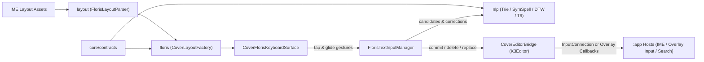

# `:keyboard-floris` Module

Android library module (`com.tyejaedon.coverscreenos.keyboard.floris`) providing a FlorisBoard-inspired keyboard surface, clamshell cover-screen layout sizing, unified editor bridge (`K3Editor`), layout asset parsing, and on-device NLP engines (binary trie, SymSpell autocorrect, DTW glide decoding, and T9 prediction).

## What This Module Holds

| Package / Path | Responsibility | Link |
| --- | --- | --- |
| `keyboard/core/contracts/` | Shared keyboard enums and data contracts (`LayoutMode`, `ShiftState`, `KeyModel`, `CandidateWord`, `InputAction`) | [contracts](src/main/java/com/tyejaedon/coverscreenos/keyboard/core/contracts/README.md) |
| `keyboard/floris/` | Compose keyboard surface, smartbar, popup UI, editor bridge, text input manager, clamshell layout spec, and theme palette | [floris](src/main/java/com/tyejaedon/coverscreenos/keyboard/floris/README.md) |
| `keyboard/floris/layout/` | Key codes, key types, and JSON keyboard layout parser | [layout](src/main/java/com/tyejaedon/coverscreenos/keyboard/floris/layout/README.md) |
| `keyboard/nlp/` | Binary/compact trie dictionaries, SymSpell autocorrect, DTW glide decoder, QWERTY geometry, and T9 predictive engine | [nlp](src/main/java/com/tyejaedon/coverscreenos/keyboard/nlp/README.md) |
| `src/main/assets/ime/keyboard/` | Bundled keyboard layout definitions | — |

## Data Flow Diagram

## Works Hand-in-Hand With

| Module | Relationship | Link |
| --- | --- | --- |
| `:app` (`ime`) | Binds `CoverEditorBridge` to Android `InputConnection` inside `CoverT9InputMethodService` | [ime](../app/src/main/java/com/tyejaedon/coverscreenos/ime/README.md) |
| `:app` (`overlay/input`) | Hosts `CoverFlorisKeyboardSurface` in the accessibility input overlay via `CoverOverlayInputCallbacks` | [overlay/input](../app/src/main/java/com/tyejaedon/coverscreenos/overlay/input/README.md) |
| `:app` (`ui/launcher`) | Embeds `SearchFlorisKeyboardHost` for cover-screen app search | [ui/launcher](../app/src/main/java/com/tyejaedon/coverscreenos/ui/launcher/README.md) |
| `:app` (`keyboard/nlp`) | Loads dictionary assets into `BinaryTrieDictionary` and `SymSpellAutocorrect` | [app keyboard/nlp](../app/src/main/java/com/tyejaedon/coverscreenos/keyboard/nlp/README.md) |
