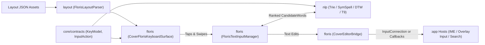

# `:keyboard-floris` Module

## What This Folder Does

`:keyboard-floris` is Cover-Screen-OS's self-contained keyboard engine module. Because the outer display of a clamshell phone (like a Galaxy Z Flip) is tiny and squarish, standard phone keyboards either clip off the edges or leave almost no room to read what you are typing.

Think of this module as a complete, miniaturized keyboard factory inspired by FlorisBoard:
- It stores the **key maps** (QWERTY, T9 3x4 keypad, numbers, and two symbol pages) as simple JSON blueprints.
- It calculates **clamshell-friendly key sizes and one-handed margins** so every key fits comfortably under a thumb on the cover screen.
- It runs **on-device smart typing** (dictionary autocomplete, autocorrect that knows which keys sit next to each other, swipe/glide path matching, and predictive T9).
- It hands finished edits to whichever host is showing the keyboard—whether that is the Android IME service, the accessibility input overlay, or the cover launcher's search bar—through one shared `CoverEditorBridge` adapter.

## How It Works Step-by-Step

1. **Load blueprints**: `FlorisLayoutParser` loads the requested JSON key arrangement (`qwerty`, `t9`, `numeric`, `western`, `compact`) from `src/main/assets/ime/keyboard/` (with compile-time JSON fallbacks so unit tests run without Android).
2. **Convert into cover-sized keys**: The `keyboard/floris` UI layer pairs those parsed `TextKeyData` blueprints with `ClamshellLayoutSpec` sizing rules and `FlorisThemePalette` styling to render `CoverFlorisKeyboardSurface`.
3. **Read taps, glides, and gestures**: Touch handlers emit `InputAction` events (`KeyTap`, `LongPressSelect`, `GlideComplete`, `SpacebarCursorDelta`, `GestureDeleteUpdate`, `ModeSwitch`) using `KeyModel` bounds and centroids.
4. **Predict and correct on device**: `FlorisTextInputManager` passes key sequences or swipe trails into the `keyboard/nlp` engines (`BinaryTrieDictionary`, `CompactTrieDictionary`, `SymSpellAutocorrect`, `DTWGlideDecoder`, `T9PredictiveEngine`) and displays ranked `CandidateWord` chips in `FlorisSmartbar`.
5. **Send edits to the host app**: `CoverEditorBridge` translates every character insertion, word replacement, deletion, or cursor move into either a real Android `InputConnection` call or `CoverOverlayInputCallbacks`.

## File-by-File Guide

### `build.gradle.kts` & `src/main/AndroidManifest.xml`
- **In plain terms**: Module build configuration and Android library manifest wiring `:keyboard-floris` dependencies (Compose, Kotlinx Serialization, SymSpellKt) for use by `:app`.
- **Key variables & state**: Defines the `com.tyejaedon.coverscreenos.keyboard.floris` library namespace, assets bundling (`src/main/assets/`), and JVM/Robolectric unit test configuration (`src/test/`).
- **How it connects**: Compiled into `:app` so both the IME (`ime`), accessibility overlay (`overlay/input`), and launcher search (`ui/launcher`) share one keyboard engine.

### `keyboard/core/contracts/` (`KeyboardContracts.kt`)
- **In plain terms**: The shared dictionary of nouns and verbs (`LayoutMode`, `ShiftState`, `KeyModel`, `CandidateWord`, `InputAction`) that lets the keyboard UI and NLP prediction engines talk without depending on Android Views or Services.
- **Key variables & state**: Holds each key's hit box (`bounds`), center point (`centroid`), T9 letters (`t9Chars`), ranked suggestion scores (`CandidateWord.score`), and user gesture payloads (`InputAction`).
- **How it connects**: Imported by both `keyboard/floris` (UI & input manager) and `keyboard/nlp` (dictionaries & decoders). See [contracts README](src/main/java/com/tyejaedon/coverscreenos/keyboard/core/contracts/README.md).

### `keyboard/floris/layout/` (`FlorisKeyData.kt`, `FlorisLayoutParser.kt`)
- **In plain terms**: Reads FlorisBoard-style JSON files describing which keys go in each row and turns them into strongly typed Kotlin data models (`TextKeyData`, `PopupSet`, `FlorisLayoutArrangement`).
- **Key variables & state**: `FlorisLayoutParser.layoutCache` (`ConcurrentHashMap`) caches parsed layouts by `"<type>/<name>"`; `KeyCode` defines negative action constants (`DELETE`, `SHIFT`, `VIEW_SYMBOLS`, etc.).
- **How it connects**: Supplies parsed key rows to `CoverFlorisKeyboardModel` / `CoverFlorisKeyboardSurface`. See [layout README](src/main/java/com/tyejaedon/coverscreenos/keyboard/floris/layout/README.md).

### `keyboard/floris/` (Compose Keyboard Surface, Bridge, & Sizing)
- **In plain terms**: Draws the interactive Compose keyboard (`CoverFlorisKeyboardSurface`, `FlorisSmartbar`, `FlorisPopupUi`, `FlorisThemePalette`), manages clamshell sizing (`ClamshellLayoutSpec`), and routes typing through `FlorisTextInputManager` and `CoverEditorBridge`.
- **Key variables & state**: Uses `FlorisKeyboardCustomization` (height override, one-handed `ClamshellDockAnchor`, suggestion/autocorrect toggles, `FlorisThemePalette.AmoledCover`) and `CoverOverlayInputCallbacks` / `InputConnection` bindings inside `CoverEditorBridge`.
- **How it connects**: Directly embedded by `CoverKeyboardOverlayRoot` in `:app`'s `overlay/input`, `CoverT9InputMethodService` in `ime`, and search UI in `ui/launcher`. See [floris README](src/main/java/com/tyejaedon/coverscreenos/keyboard/floris/README.md).

### `keyboard/nlp/` (Tries, Autocorrect, Glide, Geometry, & T9)
- **In plain terms**: Six pure-Kotlin language and math engines that guess what word you meant from partial prefixes, fat-finger typos, continuous finger swipes, or 3x4 T9 digit sequences.
- **Key variables & state**: Pre-allocated DTW scratch matrices (`dtwMatrix`), QWERTY `(x, y)` key maps (`KEY_COORDINATES`), SymSpell hash dictionaries (`dictionaryHolder`), and zero-allocation memory-mapped binary trie buffers (`BinaryTrieDictionary.buffer`).
- **How it connects**: Loaded by `:app`'s `CoverKeyboardNlpManager` and queried on every keystroke or swipe by `FlorisTextInputManager` and `CoverKeyboardOverlayRoot`. See [nlp README](src/main/java/com/tyejaedon/coverscreenos/keyboard/nlp/README.md).

### `src/main/assets/ime/keyboard/org.florisboard.layouts/`
- **In plain terms**: JSON keyboard layout blueprints (`characters/qwerty.json`, `numeric/default.json`, `symbols/western.json`, `symbols2/western.json`, `t9/default.json`) defining labels, key codes, width multipliers, T9 letters, and long-press popups.
- **Key variables & state**: Each JSON file declares `type`, `name`, `direction`, and a 2D `arrangement` array of key objects.
- **How it connects**: Loaded on demand by `FlorisLayoutParser.loadArrangement()`.

## Quick-Reference Summary

| Package / Path | Core Purpose | README Link |
| --- | --- | --- |
| `keyboard/core/contracts/` | Framework-light enums, key models, candidates, and input actions | [contracts](src/main/java/com/tyejaedon/coverscreenos/keyboard/core/contracts/README.md) |
| `keyboard/floris/layout/` | Key codes, key descriptors, popup models, and cached JSON layout loader | [layout](src/main/java/com/tyejaedon/coverscreenos/keyboard/floris/layout/README.md) |
| `keyboard/floris/` | Compose keyboard rendering, smartbar, popups, clamshell sizing, and editor bridge | [floris](src/main/java/com/tyejaedon/coverscreenos/keyboard/floris/README.md) |
| `keyboard/nlp/` | Binary/compact tries, SymSpell autocorrect, DTW swipe decoder, QWERTY geometry, T9 engine | [nlp](src/main/java/com/tyejaedon/coverscreenos/keyboard/nlp/README.md) |

## Data Flow Diagram

## Works Hand-in-Hand With

| Module | Relationship | Link |
| --- | --- | --- |
| `:app` (`ime`) | Binds `CoverEditorBridge` to Android `InputConnection` inside `CoverT9InputMethodService` | [ime](../app/src/main/java/com/tyejaedon/coverscreenos/ime/README.md) |
| `:app` (`overlay/input`) | Hosts `CoverFlorisKeyboardSurface` in the accessibility input overlay via `CoverOverlayInputCallbacks` | [overlay/input](../app/src/main/java/com/tyejaedon/coverscreenos/overlay/input/README.md) |
| `:app` (`ui/launcher`) | Embeds `SearchFlorisKeyboardHost` for cover-screen app search | [ui/launcher](../app/src/main/java/com/tyejaedon/coverscreenos/ui/launcher/README.md) |
| `:app` (`keyboard/nlp`) | Loads dictionary assets into `BinaryTrieDictionary` and `SymSpellAutocorrect` | [app keyboard/nlp](../app/src/main/java/com/tyejaedon/coverscreenos/keyboard/nlp/README.md) |
