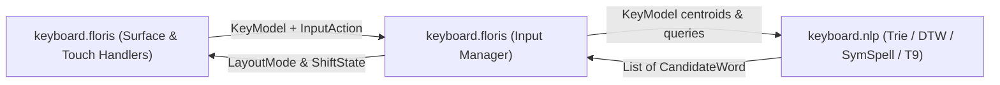

# `keyboard.core.contracts` Package

## What This Folder Does

This package is the **shared rulebook (contract layer)** for `:keyboard-floris`. Instead of letting the Compose keyboard UI and the NLP prediction math depend directly on each other—or on heavy Android `InputMethodService` classes—both sides communicate through lightweight, immutable data models defined here.

Think of it like a restaurant order ticket: the waiter (touch/gesture UI) writes down what happened (`InputAction` + `KeyModel`), and the kitchen (`keyboard.nlp` and input manager) sends back finished plates (`CandidateWord`) without either side needing to know how the other is built internally.

## How It Works Step-by-Step

1. **Describe the current keyboard screen**: `LayoutMode` specifies which key grid is visible (`QWERTY_COMPACT`, `T9_PREDICTIVE`, `SYMBOLS_PRIMARY`, `SYMBOLS_SECONDARY`, or `NUMBER_PAD`), while `ShiftState` tracks capitalization (`LOWERCASE`, `SINGLE_SHIFT`, `CAPS_LOCK`).
2. **Map every key's shape and position**: Each rendered key produces a `KeyModel` carrying its code (`id`), labels, optional `t9Chars`, hit-test rectangle (`bounds`), and center point (`centroid`).
3. **Turn finger events into structured actions**: When the user taps a key, long-presses an accent, swipes across keys, drags the spacebar to move the cursor, swipes left from backspace to erase words, or toggles modes, the UI emits an `InputAction` sealed-interface variant.
4. **Return scored word suggestions**: Prediction engines (`BinaryTrieDictionary`, `CompactTrieDictionary`, `SymSpellAutocorrect`, `DTWGlideDecoder`, `T9PredictiveEngine`) return sorted lists of `CandidateWord` items, flagging the top confident match with `isAutocorrectDefault`.

## File-by-File Guide

### `KeyboardContracts.kt`
- **In plain terms**: Defines all five core contract types shared across the keyboard surface and NLP layer (`LayoutMode`, `ShiftState`, `KeyModel`, `CandidateWord`, and `InputAction`).
- **Key variables & state**:
  - `LayoutMode`: Five-mode enum choosing between compact QWERTY, 3x4 T9, primary symbols, secondary symbols, and numeric pad.
  - `ShiftState`: Three-state enum tracking lowercase, single-character auto-lowering shift, or locked caps.
  - `KeyModel.id`, `primaryLabel`, `secondaryLabel`, `t9Chars`, `bounds`, `centroid`, `isFunctional`: Everything needed to draw a key, style function keys, hit-test touches, and compute glide paths.
  - `CandidateWord.word`, `score`, `isAutocorrectDefault`: Prediction text, composite frequency/proximity rank, and whether spacebar/punctuation should auto-commit it.
  - `InputAction` variants (`KeyTap`, `LongPressSelect`, `GlideComplete`, `SpacebarCursorDelta`, `GestureDeleteUpdate`, `ModeSwitch`): Immutable event payloads carrying touch coordinates, swipe point trails (`sampledPoints`), cursor deltas (`charDelta`), or word-deletion counts (`wordsToDelete`).
- **How it connects**: Imported by `keyboard.floris` for rendering/gesture handling and by every engine in `keyboard.nlp` for spatial centroids and candidate output.

## Quick-Reference Summary

| Symbol | Kind | Role |
| --- | --- | --- |
| `LayoutMode` | Enum | Identifies the active keyboard page (QWERTY, T9, Symbols 1/2, Number Pad) |
| `ShiftState` | Enum | Tracks lowercase, single-tap shift, and caps lock |
| `KeyModel` | Data class | Key labels, code ID, T9 letters, hit `Rect`, and `Offset` centroid |
| `CandidateWord` | Data class | Suggested word, numeric ranking score, and autocorrect flag |
| `InputAction` | Sealed interface | Unified gesture/tap event variants dispatched from the keyboard UI |

## Data Flow Diagram

## Works Hand-in-Hand With

| Module | Relationship | Link |
| --- | --- | --- |
| `keyboard.floris` | Consumes `LayoutMode`, `ShiftState`, `KeyModel`, `CandidateWord`, and `InputAction` for rendering and input dispatch | [floris](../../floris/README.md) |
| `keyboard.nlp` | Produces `CandidateWord` predictions and consumes `KeyModel` bounds/centroids for glide decoding | [nlp](../../nlp/README.md) |
