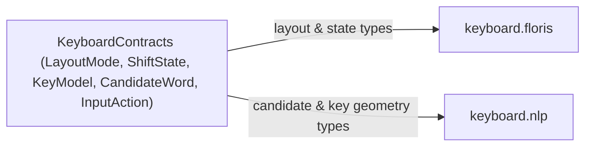

# `keyboard.core.contracts` Package

Shared, framework-light keyboard contracts used across both the Floris UI layer and the NLP prediction layer inside `:keyboard-floris`.

## What This Module Holds

| File | Key Types | Responsibility |
| --- | --- | --- |
| `KeyboardContracts.kt` | `LayoutMode`, `ShiftState`, `KeyModel`, `CandidateWord`, `InputAction` | Defines layout modes (`QWERTY_COMPACT`, `T9_PREDICTIVE`, `SYMBOLS_PRIMARY`, `SYMBOLS_SECONDARY`, `NUMBER_PAD`), shift states, key geometry models, candidate words, and input action intents |

## Data Flow Diagram

## Works Hand-in-Hand With

| Module | Relationship | Link |
| --- | --- | --- |
| `keyboard.floris` | Consumes `LayoutMode`, `ShiftState`, `KeyModel`, `CandidateWord`, and `InputAction` for rendering and input dispatch | [floris](../../floris/README.md) |
| `keyboard.nlp` | Produces `CandidateWord` predictions and consumes `KeyModel` bounds/centroids for glide decoding | [nlp](../../nlp/README.md) |
