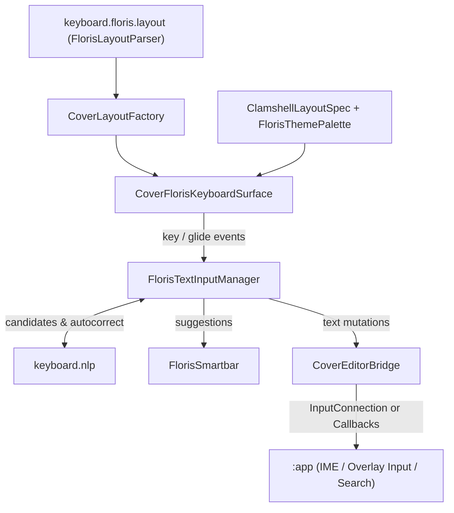

# `keyboard.floris` Package

The core Compose keyboard UI, clamshell sizing specification, text input state manager, and unified editor bridge for Cover Screen OS.

## What This Module Holds

| File | Key Types | Responsibility |
| --- | --- | --- |
| `ClamshellLayoutSpec.kt` | `ClamshellDockAnchor`, `ClamshellLayoutSpec` | Enforces clamshell cover-screen height ratios, key height bounds, and left/center/right one-handed anchoring |
| `CoverEditorBridge.kt` | `CoverOverlayInputCallbacks`, `CoverEditorBridge` | Unified `K3Editor` bridge routing edits either to an Android `InputConnection` or overlay local-buffer callbacks |
| `CoverFlorisKeyboardModel.kt` | `CoverLayoutMode`, `CoverShiftState`, `CoverKeyAction`, `CoverKeyItem`, `CoverLayoutFactory` | Keyboard state enums, key action definitions, and factory building key grids from parsed layouts |
| `CoverFlorisKeyboardSurface.kt` | `CoverFlorisKeyboardSurface`, `normalizeGlidePathToQwerty` | Main Jetpack Compose keyboard surface handling key taps, long-press popups, and glide gestures |
| `FlorisPopupUi.kt` | `FlorisKeyPreviewBubble`, `FlorisExtendedPopupMenu` | Key press preview bubble and extended character popup overlay |
| `FlorisSmartbar.kt` | `FlorisKeyboardCustomization`, `FlorisSmartbar`, `FlorisCandidateChip`, `FlorisResizeAndControlBar` | Top suggestion/candidate bar and resize/one-handed control strip |
| `FlorisTextInputManager.kt` | `FlorisTextInputManager` | Coordinates composing text, shift transitions, NLP candidate generation, and commits to `CoverEditorBridge` |
| `FlorisThemePalette.kt` | `FlorisThemeMode`, `FlorisThemePalette` | Theme color tokens for the Floris keyboard surface |

## Data Flow Diagram

## Works Hand-in-Hand With

| Module | Relationship | Link |
| --- | --- | --- |
| `keyboard.core.contracts` | Supplies shared `LayoutMode`, `ShiftState`, `KeyModel`, and `CandidateWord` types | [contracts](../core/contracts/README.md) |
| `keyboard.floris.layout` | Supplies parsed key rows, `KeyCode`, and `TextKeyData` | [layout](layout/README.md) |
| `keyboard.nlp` | Supplies `DTWGlideDecoder`, `SymSpellAutocorrect`, `T9PredictiveEngine`, and `QwertyGeometry` | [nlp](../nlp/README.md) |
| `:app` (`ime`, `overlay/input`, `ui/launcher`, `ui/keyboard`) | Hosts `CoverFlorisKeyboardSurface` and binds `CoverEditorBridge` | [:app](../../../../../../../../../app/README.md) |
