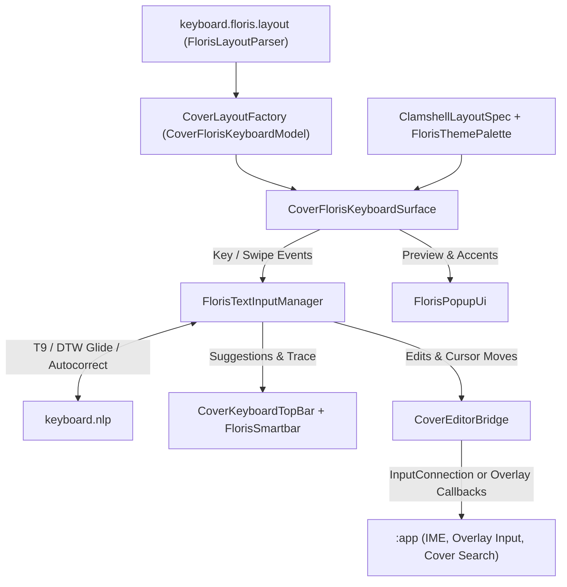

# `keyboard.floris` Package

## What This Folder Does

Think of `keyboard.floris/` as the **complete keyboard engine** for Cover-Screen-OS. Adapted from FlorisBoard's architecture specifically for tiny clamshell cover screens (like the Galaxy Z Flip outer display), it gives the entire app one unified keyboard that can handle:
- **QWERTY typing** with swipe/glide typing (`DTWGlideDecoder`), autocorrect-on-space, and accent pop-up menus
- **T9 3×4 keypad typing** with both smart predictive word guessing and classic 650ms multi-tap (`ABC`) cycling
- **Symbols, Secondary Symbols, and Numeric PIN pads**
- **Clamshell-safe sizing and one-handed docking** so the keyboard stays under ~44% of screen height and never hides the text box above it

Best of all, `CoverEditorBridge` acts like a **universal travel plug**: the exact same keyboard works whether it is plugged into Android's real system IME (`InputConnection`) or into a cover-screen overlay's local text callbacks.

---

## How It Works Step-by-Step

1. **Measure the cover screen**: `ClamshellLayoutSpec` checks `screenHeightDp`, caps keyboard height (44% default, 38% compact), adds any user drag-resize offset (`extraHeightDp`), and clamps each row between `34dp` and `52dp`.
2. **Build the key grid**: `CoverLayoutFactory` reads parsed JSON layouts from `layout/` (`FlorisLayoutParser`) and creates `CoverKeyItem` rows styled with `FlorisThemePalette` (AMOLED dark or Material dynamic colors) and current `CoverShiftState`.
3. **Render the top bar + grid**: `CoverFlorisKeyboardSurface` renders `CoverKeyboardTopBar` (switching seamlessly between `FlorisSmartbar` word chips while typing and quick tools when idle) above the key rows.
4. **Handle taps, holds, drags, and glides**:
   - **Tap a key**: `CoverKeyView` triggers haptics/sound, pops up `FlorisKeyPreviewBubble`, and dispatches a `CoverKeyAction` (either directly or via `FlorisTextInputManager`).
   - **Hold Backspace or Swipe Left**: Repeats backspace every `60ms` after a `350ms` delay, or swiping left deletes the whole previous word.
   - **Hold a letter**: Opens `FlorisExtendedPopupMenu` for accented/secondary symbols (or long-press Clear to wipe text while saving it in `lastClearedText` for tap-to-undo).
   - **Drag on Spacebar**: Moves the text cursor left/right 1 character for every `24dp` slid.
   - **Swipe across QWERTY letters**: The grid-level glide detector draws `activeGlideTrail` on a glowing `Canvas`, normalizes coordinates via `normalizeGlidePathToQwerty`, and commits the top word from `DTWGlideDecoder`.
5. **Commit into the app**: `FlorisTextInputManager` routes every edit into `CoverEditorBridge`, which either edits the Android `InputConnection` or calls `CoverOverlayInputCallbacks` and bumps `mutationRevision` so hosts immediately refresh suggestions.

---

## File-by-File Guide

### `ClamshellLayoutSpec.kt`
- **In plain terms**: The safety ruler preventing the keyboard from growing too tall on a small cover screen, plus left/center/right one-handed docking rules.
- **Key variables & state**:
  - `maxHeightRatio` (`0.44f` default, `0.38f` compact): Max percentage of cover-screen height allowed for the key grid.
  - `keyHeightFloorDp` / `keyHeightCeilingDp` (`34dp`..`52dp`): Minimum and maximum height per row so keys stay comfortable.
  - `dockAnchor` (`ClamshellDockAnchor`: `LEFT`, `CENTER`, `RIGHT`) & `isOneHandedEnabled`: Controls one-handed thumb edge alignment.
  - `extraHeightDp`: User vertical-drag resize offset added before clamping.
- **How it connects**: Used by `CoverFlorisKeyboardSurface` to compute `effectiveRowHeight` and `maxRowsHeight`.

### `CoverEditorBridge.kt`
- **In plain terms**: The two-way adapter (`K3Editor`) that lets one keyboard drive both Android's official IME `InputConnection` and cover-overlay text boxes (`CoverOverlayInputCallbacks`).
- **Key variables & state**:
  - `inputConnectionProvider` & `inputConnectionRef` (`WeakReference<InputConnection>`): Supplies the live Android editor connection without leaking old windows.
  - `overlayCallbacks`: Fallback callbacks (`onAppend`, `onDeleteBackward`, `onCommitCandidate`, etc.) when editing an overlay buffer.
  - `_mutationRevision` / `mutationRevision` (`StateFlow<Long>`): Bumped after every edit so IME and overlay hosts re-query NLP predictions and auto-capitalization.
- **How it connects**: Passed into `CoverFlorisKeyboardSurface` and `FlorisTextInputManager`; implemented/bound by `:app` hosts.

### `CoverFlorisKeyboardModel.kt`
- **In plain terms**: The data dictionary for keyboard modes (`CoverLayoutMode`), Shift states (`CoverShiftState`), key actions (`CoverKeyAction`), individual key descriptors (`CoverKeyItem`), and the JSON-to-UI builder (`CoverLayoutFactory`).
- **Key variables & state**:
  - `CoverLayoutMode`: `QWERTY`, `T9_PREDICTIVE`, `SYMBOLS`, `SYMBOLS_SECONDARY`, `NUMERIC`.
  - `CoverShiftState`: `LOWERCASE`, `SINGLE_SHIFT`, `CAPS_LOCK` (double-tapping Shift within `350ms` locks Caps Lock).
  - `CoverKeyItem`: Holds `id`, `primaryLabel`, `secondaryLabel`, `t9Chars`, `weight`, `isFunctional`, `action`, `popupOptions`, `popupSet`, and `tag`.
- **How it connects**: Consumes `FlorisLayoutParser` from `layout/`; feeds `CoverKeyItem` grids to `CoverFlorisKeyboardSurface`.

### `CoverFlorisKeyboardSurface.kt`
- **In plain terms**: The main Jetpack Compose keyboard view combining the smart top bar, optional clipboard row, multi-row key grid, glowing swipe-typing trail canvas, repeat-backspace, spacebar cursor scrubbing, and floating previews.
- **Key variables & state**:
  - `activeMode`, `shiftState`, `lastShiftTapMs`: Tracks which layout page and letter casing are active (with `autoCapActive` checking sentence boundaries).
  - `localDockAnchor`, `localOneHanded`, `localExtraHeightDp`, `localT9Predictive`: Local fallback states when the host doesn't supply persistence callbacks.
  - `internalBuffer` & `lastClearedText`: Fallback text mirror and saved Clear-undo snapshot.
  - `activeGlideTrail`, `sampledPoints`, `glideThresholdPx`, `isGliding`: Finger coordinates and `1.15`-key-width drag threshold driving DTW swipe typing.
  - `CoverKeyView` states: `isPressed`, `popupMenuExpanded`, `cursorDragPixels` (`24dp` per cursor step), and `holdJob` (`350ms` -> `60ms` repeat delete or `400ms` long-press popup).
- **How it connects**: Coordinates `CoverKeyboardTopBar`, `FlorisPopupUi`, `FlorisTextInputManager`, `ClamshellLayoutSpec`, and `CoverEditorBridge`.

### `FlorisPopupUi.kt`
- **In plain terms**: Two floating Compose `Popup` widgets: the quick key-tap preview bubble (`FlorisKeyPreviewBubble`) and the horizontal accent/symbol picker opened on long-press (`FlorisExtendedPopupMenu`).
- **Key variables & state**:
  - `yOffsetPx` (`-48dp` for bubble, `-46dp` for menu): Lifts popups clear of the user's thumb.
  - `PopupProperties`: `FlorisKeyPreviewBubble` uses `focusable = false` so key presses aren't interrupted; `FlorisExtendedPopupMenu` uses `focusable = true` + `dismissOnClickOutside = true` so tapping outside closes the menu.
- **How it connects**: Mounted directly inside `CoverKeyView` in `CoverFlorisKeyboardSurface`.

### `FlorisSmartbar.kt`
- **In plain terms**: Holds the customization bundle (`FlorisKeyboardCustomization`), the 34dp dual-mode top bar (`CoverKeyboardTopBar` with drag-to-resize and quick tools), and the scrolling candidate chip bar (`FlorisSmartbar`).
- **Key variables & state**:
  - `FlorisKeyboardCustomization`: Holds height offset, one-handed flags, suggestion/autocorrect/preview toggles, `imeOptions`, `isT9Predictive`, and `themePalette`.
  - `forceToolsVisible` & `showCandidates`: Lets users tap `<` (`floris_tools_back`) to peek at toolbar icons while suggestions are showing.
  - `lastSnapped`: Tracks `6dp` vertical drag steps on `CoverKeyboardTopBar` (`0..24dp`) for resize haptic clicks.
  - `FlorisCandidateChip.menuExpanded`: Opens the long-press Learn/Suppress dictionary menu.
- **How it connects**: Placed at the top of `CoverFlorisKeyboardSurface` and reused standalone by `CoverT9SuggestionStrip` in `:app`.

### `FlorisTextInputManager.kt`
- **In plain terms**: The typing state machine that turns key presses, T9 digit runs, spacebar taps, Clear/Undo, and glide paths into clean editor mutations via `CoverEditorBridge`.
- **Key variables & state**:
  - `MULTI_TAP_TIMEOUT_MS` (`650L`) & `T9_DIGIT_TO_LETTERS`: Timing window and `'1'..'9'` letter map for classic multi-tap mode.
  - `t9PredictiveDigits` & `t9MultiTapTrace`: Current buffered T9 digit sequence (e.g. `"4663"`) and multi-tap trace notified via `onT9TraceUpdated`.
  - `lastTapDigit`, `lastTapTimeMs`, `multiTapCycleIndex`: Tracks active ABC multi-tap letter cycling.
  - `lastClearedText`: Preserved when Clear is long-pressed so tapping Clear while empty restores the wiped text.
- **How it connects**: Uses `T9PredictiveEngine`, `DTWGlideDecoder`, autocorrect callbacks, and `CoverEditorBridge`.

### `FlorisThemePalette.kt`
- **In plain terms**: Color sheet defining dark OLED cover colors (`AmoledCover`) and dynamic Material 3 colors (`fromMaterialColorScheme`) for keys, smartbar, popups, and glide trails.
- **Key variables & state**:
  - `FlorisThemeMode` (`AMOLED_COVER`, `MATERIAL_DYNAMIC`).
  - Semantic tokens: `keyboardSurface` (`#111215`), `keyBackground` (`#272A30`), `functionalKeyBackground` (`#1B1D22`), `actionKeyBackground` / `glideTrailPrimary` (`#3E7BFA`), plus shift-lock, candidate, and popup colors.
- **How it connects**: Passed through `FlorisKeyboardCustomization` into `CoverFlorisKeyboardSurface`, `FlorisSmartbar`, and `FlorisPopupUi`.

### `layout/`
- **In plain terms**: Loads and parses upstream FlorisBoard JSON keyboard definitions (QWERTY, T9, Symbols, Numeric) into `FlorisLayoutArrangement`, `TextKeyData`, `KeyCode`, and `PopupSet`.
- **Key variables & state**: JSON arrangement caches and parsed `TextKeyData` trees documented in [layout/README.md](layout/README.md).
- **How it connects**: Supplies parsed key arrangements directly to `CoverLayoutFactory`.

---

## Quick-Reference Summary Table

| File / Sub-Package | Role | Key Types / Entry Points | Link |
| --- | --- | --- | --- |
| `ClamshellLayoutSpec.kt` | Cover-display height ratio, row clamping, & 1-handed anchor rules | `ClamshellDockAnchor`, `ClamshellLayoutSpec` | — |
| `CoverEditorBridge.kt` | Unified `K3Editor` bridge for `InputConnection` & overlay buffers | `CoverOverlayInputCallbacks`, `CoverEditorBridge` | — |
| `CoverFlorisKeyboardModel.kt` | Layout modes, shift states, key actions, & JSON-to-UI factory | `CoverLayoutMode`, `CoverShiftState`, `CoverKeyAction`, `CoverLayoutFactory` | — |
| `CoverFlorisKeyboardSurface.kt` | Main Compose keyboard grid, glide canvas, & key gesture engine | `CoverFlorisKeyboardSurface`, `normalizeGlidePathToQwerty` | — |
| `FlorisPopupUi.kt` | Key-tap preview bubble & long-press accent menu popups | `FlorisKeyPreviewBubble`, `FlorisExtendedPopupMenu` | — |
| `FlorisSmartbar.kt` | Customization config, resize/tool top bar, & candidate chip strip | `FlorisKeyboardCustomization`, `CoverKeyboardTopBar`, `FlorisSmartbar` | — |
| `FlorisTextInputManager.kt` | T9 predictive/multi-tap, auto-cap, autocorrect, undo, & glide manager | `FlorisTextInputManager` | — |
| `FlorisThemePalette.kt` | AMOLED cover & Material3 dynamic color token palettes | `FlorisThemeMode`, `FlorisThemePalette` | — |
| `layout/` | Upstream FlorisBoard JSON layout parser & key data models | `FlorisLayoutParser`, `TextKeyData`, `KeyCode` | [layout](layout/README.md) |

---

## Architecture Flow

---

## Works Hand-in-Hand With

| Module | Relationship | Link |
| --- | --- | --- |
| `keyboard.core.contracts` | Supplies shared `LayoutMode`, `ShiftState`, `KeyModel`, `InputAction`, and `CandidateWord` types | [contracts](../core/contracts/README.md) |
| `keyboard.floris.layout` | Supplies parsed JSON key rows, `KeyCode`, `PopupSet`, and `TextKeyData` | [layout](layout/README.md) |
| `keyboard.nlp` | Supplies `DTWGlideDecoder`, `T9PredictiveEngine`, autocorrect, and QWERTY geometry | [nlp](../nlp/README.md) |
| `:app` (`ime`, `overlay/input`, `ui/launcher`, `ui/keyboard`) | Hosts `CoverFlorisKeyboardSurface`, `FlorisSmartbar`, and binds `CoverEditorBridge` | [:app](../../../../../../../../../app/README.md) |
