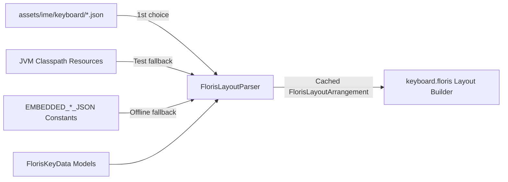

# `keyboard.floris.layout` Package

## What This Folder Does

This package is the **blueprint reader** for `:keyboard-floris`. Instead of hardcoding dozens of keys, rows, width ratios, and accent popups directly inside Jetpack Compose UI code, keyboards are described as clean JSON files (matching upstream FlorisBoard conventions).

Think of `FlorisKeyData.kt` as the vocabulary used to describe a single key ("what character code does it send, how wide is it compared to a normal letter, and what accented letters pop up if you hold it down?"), and `FlorisLayoutParser.kt` as the fast, cached reader that loads those JSON blueprints into memory once and reuses them everywhere.

## How It Works Step-by-Step

1. **Request a layout**: A caller asks `FlorisLayoutParser.loadArrangement(type, name, context)` for a category (`CHARACTERS`, `SYMBOLS`, `SYMBOLS2`, `T9`, `NUMERIC`) and optional variant (`"qwerty"`, `"western"`, `"compact"`, `"default"`).
2. **Check the in-memory cache**: `layoutCache` (`ConcurrentHashMap`) returns the already-parsed `FlorisLayoutArrangement` immediately if it was loaded earlier.
3. **Locate the JSON source with 3-tier fallback**:
   - First tries Android `context.assets` under `ime/keyboard/org.florisboard.layouts/<type>/<name>.json`.
   - Next checks the JVM classpath (`assets/...` or relative path) so Robolectric and pure-JVM unit tests can load files without an `AssetManager`.
   - Finally falls back to compile-time embedded JSON strings (`EMBEDDED_QWERTY_JSON`, `EMBEDDED_T9_JSON`, `EMBEDDED_NUMERIC_JSON`, etc.) so the keyboard never crashes even if assets are stripped.
4. **Deserialize into typed rows**: Kotlinx Serialization (`Json { ignoreUnknownKeys = true; isLenient = true }`) decodes each row into `List<TextKeyData>`, stores it in `layoutCache`, and hands the `FlorisLayoutArrangement` to the keyboard builder.

## File-by-File Guide

### `FlorisKeyData.kt`
- **In plain terms**: Defines all key codes, key categories, long-press popup containers, individual key blueprints (`TextKeyData`), and full grid arrangements (`FlorisLayoutArrangement`).
- **Key variables & state**:
  - `KeyCode`: Integer constants matching FlorisBoard—positive Unicode values for space (`32`), enter (`10`), tab (`9`), and negative codes for control/view actions like `DELETE` (`-5`), `SHIFT` (`-11`), `VIEW_CHARACTERS` (`-201`), `VIEW_SYMBOLS` (`-202`), `VIEW_T9` (`-210`), and `T9_PREDICTION_TOGGLE` (`-211`).
  - `KeyType` & `FlorisLayoutType`: Serializable enums classifying each key's role (`CHARACTER`, `MODIFIER`, `ENTER_EDITING`, `SYSTEM_GUI`, etc.) and asset folder (`dirName`).
  - `PopupSet<T>` (`main`, `relevant`): Holds the primary long-press key (like `'1'` on `'q'`) plus extended accent options (`relevant`), with `merge()` to combine overlays cleanly.
  - `TextKeyData`: Holds `type`, `code`, `label`, `groupId` (`GROUP_DEFAULT`/`LEFT`/`RIGHT`/`ENTER`), `popup`, `widthFactor` (e.g. `4.2f` for spacebar), `t9Chars` (e.g. `"abc"`), and optional `testTag`.
  - `FlorisLayoutArrangement`: Top-level JSON model storing `type`, `name`, `direction` (`"ltr"`), and the 2D `arrangement` grid of rows.
- **How it connects**: Serialized/deserialized by `FlorisLayoutParser` and mapped into UI `KeyModel` / `CoverKeyItem` grids by `keyboard.floris`.

### `FlorisLayoutParser.kt`
- **In plain terms**: Loads, parses, caches, and provides offline fallbacks for all FlorisBoard JSON keyboard layouts.
- **Key variables & state**:
  - `ASSET_BASE_PATH`: Root directory (`"ime/keyboard/org.florisboard.layouts"`) where JSON files live in Android assets.
  - `json`: Lenient `kotlinx.serialization.json.Json` parser configured with `ignoreUnknownKeys = true` and `encodeDefaults = true`.
  - `layoutCache`: Thread-safe `ConcurrentHashMap<String, FlorisLayoutArrangement>` keyed by `"<dirName>/<name>"` so layouts are decoded at most once per process.
  - `EMBEDDED_*_JSON`: Five built-in raw JSON fallback layouts (QWERTY, Western Symbols, Compact Symbols, Secondary Symbols, T9, and Numeric).
- **How it connects**: Invoked by `keyboard.floris` layout factories whenever switching between QWERTY, T9, Symbols, or Numeric keypads.

## Quick-Reference Summary

| File | Primary Types | Main Job |
| --- | --- | --- |
| `FlorisKeyData.kt` | `KeyCode`, `KeyType`, `FlorisLayoutType`, `PopupSet`, `TextKeyData`, `FlorisLayoutArrangement` | Strongly typed key codes, popup sets, and serializable key-row blueprints |
| `FlorisLayoutParser.kt` | `FlorisLayoutParser` | Loads and caches JSON layouts from assets, classpath resources, or embedded fallbacks |

## Data Flow Diagram

## Works Hand-in-Hand With

| Module | Relationship | Link |
| --- | --- | --- |
| `keyboard.floris` | Consumes parsed `FlorisLayoutArrangement`, `TextKeyData`, `KeyCode`, and `KeyType` to build cover-sized key grids | [floris](../README.md) |
| `keyboard.core.contracts` | Maps parsed `TextKeyData` into UI-agnostic `KeyModel` and `LayoutMode` contracts | [contracts](../../core/contracts/README.md) |
