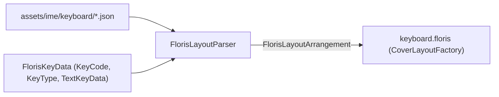

# `keyboard.floris.layout` Package

Defines keyboard key codes, key types, popup metadata, and JSON layout parsing for `:keyboard-floris`.

## What This Module Holds

| File | Key Types | Responsibility |
| --- | --- | --- |
| `FlorisKeyData.kt` | `KeyCode`, `KeyType`, `FlorisLayoutType`, `PopupSet`, `TextKeyData` | Core key code constants, key classification, layout type enums, and key/popup data models |
| `FlorisLayoutParser.kt` | `FlorisLayoutParser`, `FlorisLayoutArrangement` | Parses JSON keyboard layout definitions from assets into structured key rows |

## Data Flow Diagram

## Works Hand-in-Hand With

| Module | Relationship | Link |
| --- | --- | --- |
| `keyboard.floris` | Consumes parsed `FlorisLayoutArrangement`, `TextKeyData`, `KeyCode`, and `KeyType` to build `CoverKeyItem` grids | [floris](../README.md) |
