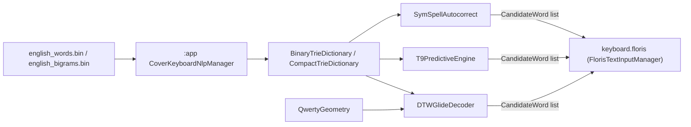

# `keyboard.nlp` Package

On-device natural language processing engines for dictionary lookup, SymSpell autocorrection, DTW glide-typing decoding, and T9 predictive text.

## What This Module Holds

| File | Key Types | Responsibility |
| --- | --- | --- |
| `BinaryTrieDictionary.kt` | `BinaryTrieDictionary` | Reads compact binary trie dictionary assets for fast prefix/word frequency lookup |
| `CompactTrieDictionary.kt` | `CompactTrieDictionary` | In-memory compact trie structure for dictionary word and frequency queries |
| `DTWGlideDecoder.kt` | `DTWGlideDecoder` | Dynamic Time Warping (DTW) decoder matching normalized swipe paths against QWERTY key centroids |
| `QwertyGeometry.kt` | `QwertyGeometry` | Spatial QWERTY key coordinate model used by glide decoding and proximity scoring |
| `SymSpellAutocorrect.kt` | `SymSpellAutocorrect` | Symmetric delete spelling correction for typo recovery and candidate ranking |
| `T9PredictiveEngine.kt` | `T9PredictiveEngine` | Maps numeric T9 digit sequences (`2`–`9`) to ranked word candidates |

## Data Flow Diagram

## Works Hand-in-Hand With

| Module | Relationship | Link |
| --- | --- | --- |
| `keyboard.core.contracts` | Uses `CandidateWord` and `KeyModel` | [contracts](../core/contracts/README.md) |
| `keyboard.floris` | Consumes predictions in `FlorisTextInputManager` and `CoverFlorisKeyboardSurface` | [floris](../floris/README.md) |
| `:app` (`keyboard/nlp`) | `CoverKeyboardNlpManager` loads binary assets into these engines | [app keyboard/nlp](../../../../../../../../../app/src/main/java/com/tyejaedon/coverscreenos/keyboard/nlp/README.md) |
| `:app` (`ime`, `overlay/input`, `ui/keyboard`, `ui/launcher`) | Triggers T9/QWERTY/glide prediction and renders candidate chips | [:app](../../../../../../../../../app/README.md) |
