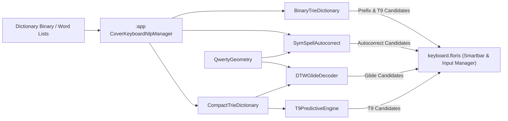

# `keyboard.nlp` Package

## What This Folder Does

This package is the **smart typing brain** inside `:keyboard-floris`. Typing accurately on a tiny clamshell cover display is hard—keys are narrow, fingers overlap neighbors, and 3x4 T9 keys pack three or four letters onto one button. These six pure-Kotlin engines solve those problems completely offline with sub-millisecond speed:

1. **Prefix autocomplete (`CompactTrieDictionary` & `BinaryTrieDictionary`)**: Instantly finds the most common English words starting with whatever letters you typed so far—either in regular JVM memory or straight from a zero-copy memory-mapped binary file.
2. **Fat-finger autocorrect (`SymSpellAutocorrect` + `QwertyGeometry`)**: Notices when you accidentally hit `'r'` instead of `'t'` or swapped `'eh'` in `"teh"`, using physical QWERTY key distances so nearby slips get forgiven more than far-away mistakes.
3. **Swipe / glide typing (`DTWGlideDecoder` + `QwertyGeometry`)**: Traces the shape of a continuous finger swipe across the keyboard and matches it against ideal letter-to-letter paths using Dynamic Time Warping (DTW).
4. **3x4 T9 decoding (`T9PredictiveEngine`)**: Turns phone-keypad digit sequences like `"43556"` into `"hello"` (and supports multi-tap dash groups like `"44-33-55-55-666"`), boosting words you taught the keyboard and hiding suppressed ones.

## How It Works Step-by-Step

1. **Load dictionaries at startup**: `:app`'s `CoverKeyboardNlpManager` loads word-frequency assets into `BinaryTrieDictionary` (from a memory-mapped `"CTRI"` binary buffer) and/or `CompactTrieDictionary`, plus `SymSpellAutocorrect`.
2. **Predict as you tap (QWERTY)**:
   - `CompactTrieDictionary.predictForPrefix()` or `BinaryTrieDictionary.predictForPrefix()` uses a max-frequency priority queue (`maxSubtreeFrequency`) to explore only the highest-ranked branches first and return top completions early.
   - `CompactTrieDictionary.getNextCharPriors()` computes a smoothed 26-letter probability map so touch hitboxes can slightly favor likely next letters.
3. **Fix typos (`SymSpellAutocorrect`)**:
   - `SymSpell.lookup()` finds nearby dictionary words within `maxEditDistance` (up to 2 edits) using pre-computed symmetric deletes.
   - `QwertyGeometry.weightedEditDistance()` re-scores every candidate using physical key coordinates (`KEY_COORDINATES`) and combines that with logarithmic word frequency (`calculateScore()`).
4. **Decode a finger swipe (`DTWGlideDecoder`)**:
   - Resamples the user's raw swipe trail to `32` evenly spaced points (`RESAMPLED_POINT_COUNT`).
   - Looks up nearby start/end keys (`findCandidateKeys`), pulls matching dictionary words from `CompactTrieDictionary`, turns each word into a 32-point key-centroid trail, and aligns them inside a pre-allocated 33x33 matrix (`dtwMatrix`) to pick the best-matching word.
5. **Decode T9 keypads (`T9PredictiveEngine`)**:
   - For multi-tap input (`'-'` present), `decodeMultiTapGrouped()` converts press groups into letters and suggests completions.
   - For predictive digits (`'2'..'9'`), `searchT9()` walks the trie along valid `DIGIT_TO_LETTERS` branches, placing exact-length matches first and prefix completions after, with a score boost for `learnedWords` and filtering for `suppressedWords`.

## File-by-File Guide

### `BinaryTrieDictionary.kt`
- **In plain terms**: A zero-allocation, memory-mapped binary prefix tree (`"CTRI"` format) that reads word predictions and T9 matches straight out of raw bytes on disk without creating thousands of Kotlin objects on startup.
- **Key variables & state**:
  - `buffer`: Little-endian `ByteBuffer` (direct or `FileChannel.map` read-only mapping) holding the 24-byte header + packed node records.
  - `wordCount`, `nodeCount`, `rootOffset`: Header metadata read directly from fixed byte offsets (`12`, `8`, `16`).
  - `BinaryNode` (`offset`, `isTerminal`, `childMask`, `maxSubtreeFrequency`, `frequency`, `terminalWord`): On-demand decoded view of a single node; `childMask` packs 26 bits (`'a'..'z'`) so child offsets are found in O(1) via `Integer.bitCount`.
  - `MAGIC` (`0x43545249`), `VERSION` (`1`), `HEADER_SIZE` (`24`), `T9_DIGIT_MAP`: Binary format constants and digit-to-letter map.
- **How it connects**: Compiled from `CompactTrieDictionary` via `BinaryTrieDictionary.compile()` / `writeToFile()`, loaded via `mapFromFile()`, and queried by `:app`'s NLP manager for instant cold starts.

### `CompactTrieDictionary.kt`
- **In plain terms**: An in-memory prefix tree storing dictionary words and their usage frequencies, optimized for fast branch-and-bound autocomplete and next-letter probability priors.
- **Key variables & state**:
  - `root` & `size`: Root `TrieNode` (`'\u0000'`) and total inserted word count.
  - `TrieNode.children`: Fixed 26-element array (`Array<TrieNode?>(26)`) giving instant O(1) lookup for `'a'..'z'` without hash-map overhead.
  - `TrieNode.frequency` & `maxSubtreeFrequency`: Word count at this node plus the highest frequency anywhere below it—allowing `predictForPrefix()`'s `PriorityQueue` to stop searching once remaining branches cannot beat the current top results.
  - `TrieNode.isTerminal` & `terminalWord`: Marks complete words and preserves their original string.
- **How it connects**: Serves as the shared in-memory dictionary backing `DTWGlideDecoder`, `T9PredictiveEngine`, word normalization (`normalizeWord`), and `BinaryTrieDictionary.compile()`.

### `DTWGlideDecoder.kt`
- **In plain terms**: Turns continuous swipe trails across QWERTY keys into ranked words by comparing the geometric shape of your finger's path against the ideal path connecting a word's keys.
- **Key variables & state**:
  - `dictionary`, `keyCentroids`, `candidateSearchRadius`: Word source, letter center coordinates (defaulting to `QwertyGeometry.getDefaultCentroidMap()`), and start/end key capture radius (`1.5f`).
  - `RESAMPLED_POINT_COUNT` (`32`): Fixed sample count ensuring fast swipes and slow swipes have the exact same point count before comparison.
  - `dtwMatrix`: Pre-allocated `33 x 33` `FloatArray` scratch table reused on every candidate word so swipe decoding causes zero per-word matrix heap allocations.
- **How it connects**: Uses `CompactTrieDictionary` to find candidate words matching the start/end keys and `QwertyGeometry` centroids to build each word's ideal trail; returns `CandidateWord` lists to the keyboard surface.

### `QwertyGeometry.kt`
- **In plain terms**: Knows the physical `(x, y)` center coordinates of all 26 letters on a staggered QWERTY keyboard and measures how easy it is to accidentally type one letter instead of another.
- **Key variables & state**:
  - `KEY_COORDINATES`: Normalized grid (`1.0` unit per key, row 2 offset `+0.5`, row 3 offset `+1.5`) storing each letter's `Offset`.
  - `weightedEditDistance` `dp` matrix: Dynamic-programming table scoring edits where adjacent key slips cost ~`0.55–0.75`, repeated-letter mistakes cost `0.6`, adjacent swaps cost `0.65`, and distant substitutions cost up to `2.0`.
- **How it connects**: Supplies default key centroids to `DTWGlideDecoder` and physical substitution weights to `SymSpellAutocorrect`.

### `SymSpellAutocorrect.kt`
- **In plain terms**: Spelling corrector that finds candidate words within a few typos and ranks them so natural adjacent-key slips beat unlikely edits.
- **Key variables & state**:
  - `settings` (`maxEditDistance = 2.0`, `topK = 15`), `dictionaryHolder`, `checker`: SymSpell library components generating fast O(1) delete-hash lookup candidates.
  - `frequencyMap`: Direct `HashMap<String, Long>` storing word frequencies for re-ranking.
  - `ScoredCandidate` (`word`, `distance`, `frequency`, `score`): Intermediate ranking entries merging `QwertyGeometry.weightedEditDistance()` with `ln(frequency)` in `calculateScore()`, then deciding `isAutocorrectDefault` (including common transpositions like `"teh"` -> `"the"`).
- **How it connects**: Receives normalized words from `CompactTrieDictionary.normalizeWord`, calls `QwertyGeometry.weightedEditDistance()`, and outputs ranked `CandidateWord` objects to the keyboard input manager.

### `T9PredictiveEngine.kt`
- **In plain terms**: Decodes classic 9-key phone keypad typing—supporting both single-tap predictive T9 (`"43556"` -> `"hello"`) and dash-grouped multi-tap sequences (`"44-33-55-55-666"`).
- **Key variables & state**:
  - `dictionary`, `learnedWords`, `suppressedWords`: Word trie plus user-personalized boosts and blocklist filters.
  - `DIGIT_TO_LETTERS` & `CHAR_TO_DIGIT`: Bidirectional maps between `'2'..'9'` keypad buttons and `'a'..'z'`.
  - `exactMatches` & `prefixCompletions`: Separate result lists gathered during DFS `searchT9()` so exact-length matches outrank longer prefix extensions (and `learnedWords` receive 5x–10x frequency multipliers).
- **How it connects**: Queries `CompactTrieDictionary` and feeds ranked `CandidateWord` suggestions to `CoverFlorisKeyboardSurface` in T9 mode.

## Quick-Reference Summary

| File | Primary Types | Main Job |
| --- | --- | --- |
| `BinaryTrieDictionary.kt` | `BinaryTrieDictionary`, `BinaryNode` | Memory-mapped `"CTRI"` binary trie for zero-allocation prefix & T9 lookup |
| `CompactTrieDictionary.kt` | `CompactTrieDictionary`, `TrieNode` | In-memory 26-way prefix trie with branch-and-bound prediction & next-char priors |
| `DTWGlideDecoder.kt` | `DTWGlideDecoder` | 32-point path resampling & Dynamic Time Warping swipe decoder |
| `QwertyGeometry.kt` | `QwertyGeometry` | Staggered QWERTY coordinates and key-distance-weighted edit distance |
| `SymSpellAutocorrect.kt` | `SymSpellAutocorrect` | Symmetric-delete spellchecker re-ranked by physical key adjacency |
| `T9PredictiveEngine.kt` | `T9PredictiveEngine` | T9 predictive digit-sequence & grouped multi-tap decoder |

## Data Flow Diagram

## Works Hand-in-Hand With

| Module | Relationship | Link |
| --- | --- | --- |
| `keyboard.core.contracts` | Uses `CandidateWord` and `KeyModel` | [contracts](../core/contracts/README.md) |
| `keyboard.floris` | Consumes predictions in `FlorisTextInputManager` and `CoverFlorisKeyboardSurface` | [floris](../floris/README.md) |
| `:app` (`keyboard/nlp`) | `CoverKeyboardNlpManager` loads binary assets into these engines | [app keyboard/nlp](../../../../../../../../../app/src/main/java/com/tyejaedon/coverscreenos/keyboard/nlp/README.md) |
| `:app` (`overlay/input`) | Queries T9/QWERTY/glide suggestions in `CoverKeyboardOverlayRoot` | [overlay/input](../../../../../../../../../app/src/main/java/com/tyejaedon/coverscreenos/overlay/input/README.md) |
| `:app` (`ime`, `ui/keyboard`, `ui/launcher`) | Triggers predictions and renders candidate chips across cover surfaces | [:app](../../../../../../../../../app/README.md) |
