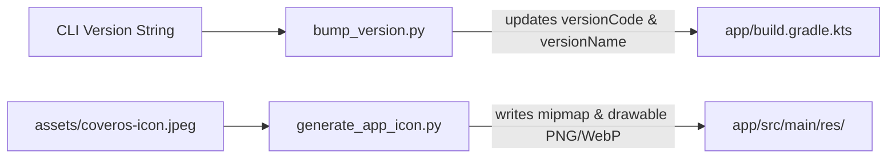

# `tools/`

Python maintenance utilities and unit tests for versioning and launcher icon generation.

## What This Module Holds

| File | Responsibility |
| --- | --- |
| `bump_version.py` | Validates semantic/beta version strings and increments `versionCode` + updates `versionName` in `app/build.gradle.kts` |
| `generate_app_icon.py` | Crops, masks, and exports adaptive and legacy density launcher icons from `assets/coveros-icon.jpeg` into `app/src/main/res/` |
| `test_bump_version.py` | Unit tests for `bump_version.py` (`python3 -m unittest discover -s tools`) |
| `test_generate_app_icon.py` | Unit tests verifying source dimensions, alpha masking, and output icon sizes |

## Data Flow Diagram

## Works Hand-in-Hand With

| Module | Relationship | Link |
| --- | --- | --- |
| `:app` | Receives updated version metadata in `app/build.gradle.kts` and generated icon assets in `app/src/main/res/` | [app](../app/README.md) |
